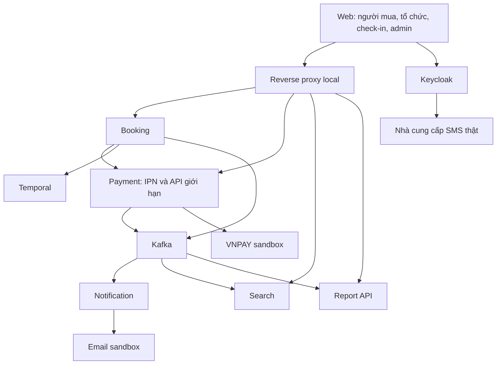
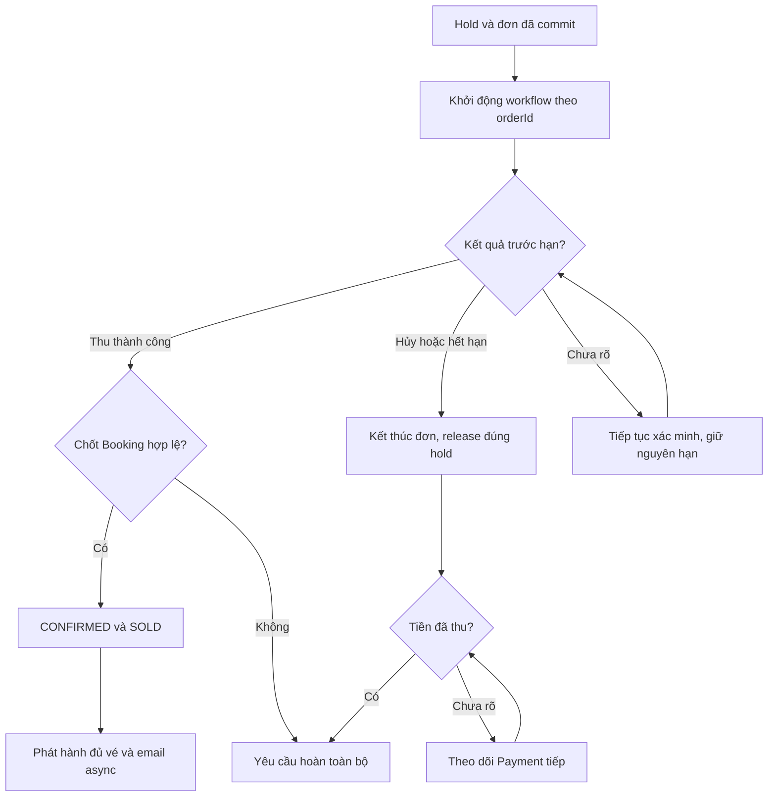
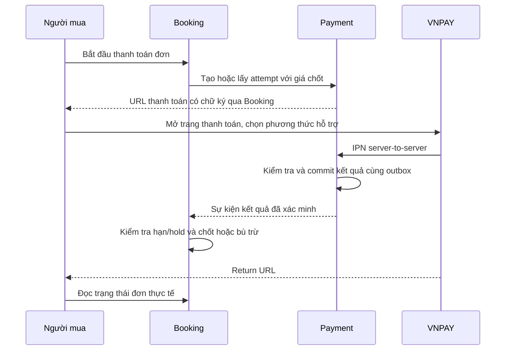
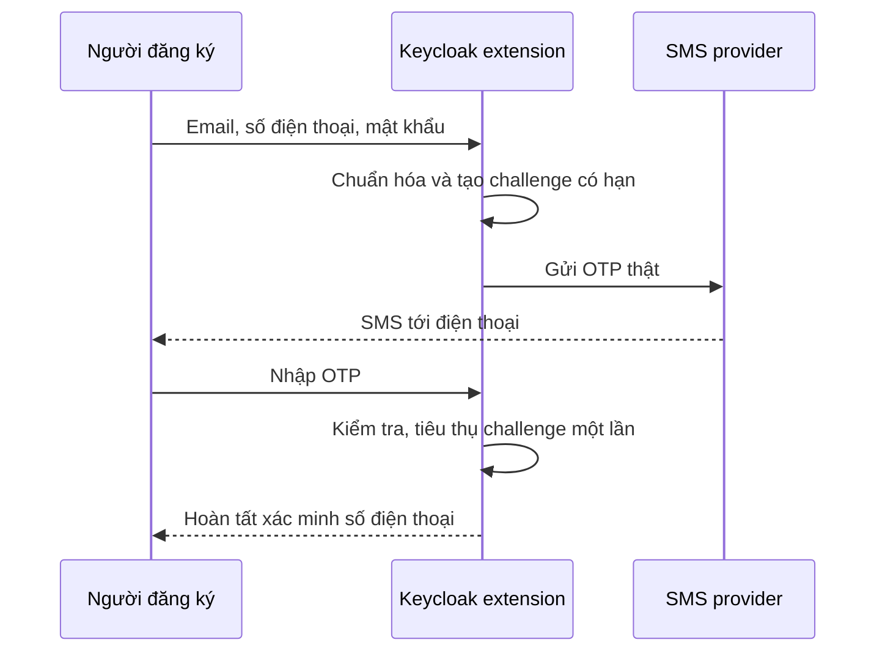
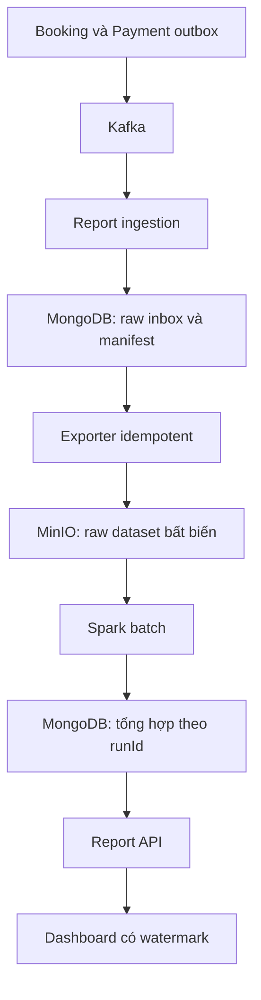

# HLD — Concert Ticketing

**High Level Design · Phiên bản 1.0 · Ngày 03/11/2026**  
**Phạm vi:** 5 microservices, triển khai local, Java 25 + Spring Boot.  
**Đối tượng:** Backend/frontend developer và người vận hành pet project.  
**Trạng thái:** Thiết kế cơ sở theo các quyết định đã thống nhất; thông tin tài khoản nhà cung cấp và ngưỡng vận hành còn cần cấu hình khi triển khai.

## 1. Mục tiêu và căn cứ

Thiết kế nền tảng bán vé concert có chọn ghế, giữ chỗ, thanh toán VNPAY sandbox, phát hành QR và check-in online. Hệ thống phục vụ học hệ thống phân tán và portfolio; đánh giá bằng luồng nghiệp vụ hoàn chỉnh, tải giả lập và mô phỏng lỗi.

Nguồn nghiệp vụ:

| Tài liệu | Vai trò |
|---|---|
| BRD-Concert-Ticketing.md v1.0 | Phạm vi, vai trò, BR-01–BR-16, BL-01–BL-20 |
| Process-Flows-Concert-Ticketing.md v1.0 | PF-01–PF-11 và các nhánh ngoại lệ |
| SRS-Concert-Ticketing.md v1.0 | FR-01–FR-20, mô hình trạng thái, dữ liệu và bất biến |
| Quyết định trao đổi ngày 03/11/2026 | Làm rõ OPEN và điều chỉnh tìm kiếm, vé, danh tính, thanh toán, môi trường |

HLD xác định ranh giới service, nguồn dữ liệu, giao tiếp, transaction, phục hồi, bảo mật mục tiêu và cách chạy local. Chưa quy định DDL, toàn bộ endpoint/topic, DTO, cấu trúc folder hoặc code triển khai.

### 1.1. Thay đổi so với SRS v1.0

| Nội dung | Quyết định dùng trong HLD | Tác động |
|---|---|---|
| Thanh toán giả lập | Tích hợp VNPAY sandbox; ưu tiên phương thức VNPAY-QR khi tài khoản sandbox hỗ trợ | Thay adapter cổng giả lập; vẫn giữ xác minh, refund và mô phỏng lỗi |
| Tài khoản | Keycloak cho các vai trò; đăng nhập email hoặc số điện thoại + mật khẩu; đăng ký thu thập email và số điện thoại | Bổ sung xác minh SMS OTP thật, giữ xác minh email/khôi phục qua email |
| SMS | Chỉ OTP xác minh tài khoản | Ngoại lệ được duyệt đối với phạm vi không SMS của BRD; không thêm SMS thông báo giao dịch |
| Tìm kiếm | Tên concert/nghệ sĩ, địa điểm, ngày diễn | Bỏ lọc khoảng giá trong MVP |
| Vé/file | QR trong tài khoản và email; không có PDF | Bỏ pipeline PDF, trạng thái file PDF và API tải PDF |
| Quyền hỗ trợ | Admin/ban tổ chức không được xem hoặc tải QR vé | Giới hạn cả API, log, sự kiện và lịch sử email hỗ trợ |
| Môi trường | Local + Docker Compose | Không thiết kế Kubernetes/GCP ở phiên bản này; MinIO thay vai trò lưu object local |

Đây là bản ghi thay đổi để triển khai HLD; ba tài liệu nguồn không được sửa trong lần bàn giao này. Các FR/AC liên quan PDF, lọc giá và simulator cần được đồng bộ ở lần cập nhật SRS tiếp theo. Mọi yêu cầu không được thay đổi tại đây vẫn giữ hiệu lực.

## 2. Những quyết định kiến trúc chính

| ID | Quyết định | Lý do |
|---|---|---|
| ADR-01 | Giữ đúng Booking, Payment, Notification, Search, Report | Tránh chia nhỏ nghiệp vụ và tăng giao dịch phân tán không cần thiết |
| ADR-02 | Catalog, Inventory, Ordering, Ticketing cùng Booking và cùng database nghiệp vụ | Giữ ghế/tạo đơn và xác nhận/bán ghế có thể chốt bằng local transaction |
| ADR-03 | PostgreSQL quyết định quyền ghế; Redis không là nguồn quyền sở hữu | Cache/TTL không thay thế transaction và kiểm tra hạn giữ |
| ADR-04 | Temporal ở Booking điều phối Saga; Payment sở hữu trạng thái thu/hoàn | Tách quyết định đơn hàng khỏi xác minh tiền |
| ADR-05 | Kafka + transactional outbox, consumer xử lý idempotent | Bảo đảm công việc đã ghi được phát tiếp sau restart; chấp nhận delivery lặp |
| ADR-06 | Mỗi service sở hữu dữ liệu riêng; không join/ghi DB service khác | Giữ ranh giới triển khai và trách nhiệm |
| ADR-07 | Search/Report là read model có thể xây lại | Không quyết định bán ghế, số tiền phải thu hoặc quyền vào cổng |
| ADR-08 | Keycloak triển khai sau luồng nghiệp vụ cơ bản | Giảm bước khởi đầu nhưng vẫn giữ sẵn user ID và kiểm tra phạm vi trong use case |
| ADR-09 | Spark batch chạy riêng thuộc phạm vi Report | Học pipeline dữ liệu mà không thêm service nghiệp vụ thứ sáu |
| ADR-10 | Chưa cần API gateway viết bằng Spring riêng | Reverse proxy local đủ routing; bổ sung gateway khi xuất hiện nhu cầu rõ |

### 2.1. Runtime và phiên bản

Chọn **Java 25 + Spring Boot 3.5.x** làm baseline ứng dụng. Tài liệu chính thức của nhánh 3.5 xác nhận tương thích Java 25 [T1]. Patch ổn định cụ thể được khóa khi khởi tạo build và kiểm tra dependency Temporal SDK, Kafka client, JDBC driver; không dùng tag `latest`. Đây là lựa chọn baseline, không phải tuyên bố đã chạy kiểm thử tương thích toàn bộ stack.

Keycloak, Kafka, Elasticsearch, MongoDB, Spark và các container dùng runtime riêng trong image tương ứng; không ép tất cả chạy JDK 25. Spark pipeline ban đầu dùng PySpark batch. Liquibase chỉ quản lý schema PostgreSQL do ứng dụng sở hữu; database nội bộ Keycloak/Temporal theo cơ chế migration của chính sản phẩm.

## 3. Kiến trúc tổng thể

Sơ đồ mô tả quan hệ chính, không mô tả trình tự. Temporal worker là thành phần chạy code Booking; Kafka consumer và batch worker là runtime của service tương ứng, không phải service nghiệp vụ mới. Luồng ghi object và Spark được tách tại mục Report.

### 3.1. Ranh giới service

| Service | Trách nhiệm | Kiến trúc nội bộ | Dữ liệu/tích hợp |
|---|---|---|---|
| Booking | Concert, suất diễn, sơ đồ/giá, giữ ghế, đơn, phát hành vé, check-in, phân công và điều phối hỗ trợ | Hexagonal; 4 module nghiệp vụ | PostgreSQL, Liquibase, Redis, Temporal, Kafka |
| Payment | Payment attempt, VNPAY redirect/IPN/query, refund, đối chiếu | Hexagonal | PostgreSQL, Liquibase, Kafka, ShedLock, VNPAY |
| Notification | Email xác nhận vé/kết quả refund, retry và lịch sử gửi | Hexagonal gọn | PostgreSQL, Liquibase, Kafka, email sandbox |
| Search | Tìm nội dung công bố theo tên/nghệ sĩ/địa điểm/ngày | Layered | Elasticsearch, Kafka; Booking để xác minh công bố |
| Report | Ingest dữ liệu, lưu raw, tổng hợp batch, API chỉ số và đối chiếu | Layered cho API; pipeline Spark riêng | MongoDB, Kafka, Spark, MinIO |

Booking chưa cần MinIO cho PDF vì PDF đã bỏ. QR có thể dựng lại từ định danh vé; không cần lưu ảnh QR vào bucket công khai. Có thể sử dụng MinIO sau này cho media concert nếu bổ sung yêu cầu quản lý media; không đưa chức năng upload media mới vào MVP chỉ vì đã có MinIO.

### 3.2. Ranh giới trong Booking

| Module/năng lực | Sở hữu | Phối hợp |
|---|---|---|
| Catalog | Concert, suất, địa điểm, lịch bán và nội dung công bố | Inventory kiểm tra cấu hình ghế bị ảnh hưởng |
| Inventory | Ghế theo suất, giá hiện hành, chủ giữ, expiresAt, ghế bán | Ordering tham gia cùng transaction giữ/xác nhận/hủy |
| Ordering | Đơn, snapshot giá, trạng thái, mã thao tác, Saga | Payment qua hợp đồng; Ticketing sau xác nhận |
| Ticketing | Vé, QR, quyền xem và lần check-in | Ordering bảo đảm nguồn đơn xác nhận |
| Phân công và hỗ trợ | Quan hệ user–organizer–performance, audit tra cứu, yêu cầu can thiệp | Dùng use case của module/service sở hữu tác vụ |

Phân công/hỗ trợ là năng lực trong Booking, không thêm microservice hay generic framework. Domain không phụ thuộc Kafka, Temporal, controller hay entity persistence. Application use case giữ ranh giới transaction; adapter thực hiện DB, REST, Kafka và workflow activity.

## 4. Sở hữu dữ liệu và mô hình nhất quán

| Nguồn | Dữ liệu có thẩm quyền | Bản sao/người đọc |
|---|---|---|
| Keycloak | User ID, credential, email, số điện thoại đã xác minh, vai trò nền | Service nhận subject/claim; Booking lưu tham chiếu và thông tin tối thiểu cần dùng |
| Booking PostgreSQL | Phân công, concert/suất/ghế, hold, đơn/dòng đơn, vé/check-in, audit, outbox/inbox | Search, Report và Payment nhận snapshot/tham chiếu cần thiết |
| Payment PostgreSQL | Attempt thu, provider reference, xác minh, nghĩa vụ refund, audit, outbox/inbox | Booking có projection trạng thái; Report nhận sự kiện |
| Notification PostgreSQL | Yêu cầu email, recipient, kết quả từng lần gửi, retry và audit gửi lại | Booking/admin chỉ đọc metadata đã che thông tin |
| Elasticsearch | Chỉ mục công bố theo phiên bản | Client tìm kiếm; không dùng cho thao tác ghi |
| Report MongoDB | Event ingest đã dedup, manifest, tổng hợp theo run và watermark | Report API |
| MinIO | Raw dataset bất biến phục vụ batch/replay | Spark và Report ingestion |
| Redis | Cache đọc ngắn hạn, rate limit | Mất Redis không làm mất quyền ghế hoặc idempotency bền vững |
| Temporal persistence | History/timer/workflow execution | Booking worker; không thay DB nghiệp vụ |

Local có thể dùng một PostgreSQL instance nhưng database/user riêng cho Booking, Payment, Notification, Keycloak và Temporal. Không foreign key xuyên service, không tài khoản DB dùng chung để ghi chéo. Schema và quyền sở hữu vẫn tách ngay cả khi chạy chung instance.

Mức nhất quán:

- **Strong consistency trong Booking:** tập ghế giữ + đơn, bán tập ghế + xác nhận, hủy/hết hạn và quyền release, check-in một lần.
- **Strong consistency trong Payment:** một attempt đang hoạt động/chưa rõ cho đơn; ghi kết quả thu và nghĩa vụ hoàn idempotent.
- **Eventual consistency giữa service:** trạng thái tiền sang Booking, email, chỉ mục và báo cáo. UI phân biệt dữ liệu đang xử lý/chưa đọc được.
- Không có distributed transaction giữa PostgreSQL của Booking và Payment; bù trừ bằng hoàn tiền khi đã thu mà không thể xác nhận.

## 5. Hợp đồng giao tiếp ở mức HLD

| Quan hệ | Cơ chế | Nội dung/giới hạn |
|---|---|---|
| Client → Booking | REST | Catalog, seat map, checkout, đơn/vé, check-in, quản trị |
| Client → Search/Report | REST | Truy vấn read model có quyền phù hợp |
| Booking → Payment | REST từ use case/activity | Tạo/lấy attempt, tra trạng thái, yêu cầu refund, hỗ trợ xác minh |
| Payment → Booking | Kafka qua outbox | Kết quả thu/hoàn đã xác minh; có thể lặp/đến muộn |
| Booking → Temporal | Start/signal qua dispatcher bền vững | Workflow ID theo order; không coi start/signal là transaction với DB |
| Booking/Payment → Notification | Kafka qua outbox | Ticket set đã đủ/refund thành công; reference và recipient tối thiểu |
| Booking → Search | Kafka qua outbox | Catalog snapshot, trạng thái công bố, source version |
| Booking/Payment → Report | Kafka qua outbox | Facts nghiệp vụ và snapshot cấu hình cần đối chiếu |
| Notification → Booking | REST nội bộ có service identity | Lấy QR để gửi đúng loại email/đúng owner; không mở API này cho admin |
| Service → Booking | REST authorization nội bộ | Xác minh phạm vi organizer/performance khi cần |
| Payment ↔ VNPAY | HTTPS redirect, IPN, query/refund | Adapter riêng; không đưa provider model vào domain |
| Keycloak → SMS provider | HTTPS | Gửi SMS OTP thật qua extension/adapter |

REST xác định timeout hữu hạn. Tác vụ async trả mã theo dõi; trả “đã tiếp nhận” không có nghĩa đã hoàn thành. Client đọc trạng thái qua polling có backoff ở MVP; chưa cần WebSocket. Email, Search và Report không nằm trong critical path checkout.

### 5.1. Quy ước sự kiện và idempotency

Envelope tối thiểu: eventId, eventType, schemaVersion, aggregateId, aggregateVersion, occurredAt, correlationId, causationId và phạm vi organizer/performance khi cần. Payment thêm orderId/attemptId; refund thêm paymentId/refundId. Không đưa password, OTP, access token, QR thô vào event chung.

Outbox được ghi trong cùng transaction với thay đổi nghiệp vụ. Relay chỉ đánh dấu đã phát sau broker acknowledgement; crash có thể phát lại. Consumer dùng eventId/inbox và ràng buộc nghiệp vụ, không chỉ dựa Kafka offset. Partition key chọn theo aggregate để giảm đảo thứ tự; vẫn kiểm tra version/trạng thái vì không có thứ tự toàn cục xuyên topic.

Các khóa logic phải phân biệt:

- Checkout: subject + operation + idempotency key + request hash; lưu kết quả cùng transaction tạo đơn.
- Payment: order + attempt; khóa mới từ client không cho tạo thu mới khi attempt trước chưa rõ/đã thành công.
- Refund: nghĩa vụ hoàn toàn bộ của giao dịch thu; retry dùng lại nghĩa vụ, không tạo refund mới.
- Ticket: duy nhất theo order line/ghế bán; check-in duy nhất theo ticket.
- Email: loại thông báo + nguồn nghiệp vụ; resend chủ đích có ID riêng và audit.

Cùng idempotency key khác payload trả conflict. TTL cache không xóa các ràng buộc chống thu/hoàn/vé/check-in trùng. Không tuyên bố exactly-once end-to-end; thiết kế hướng tới một tác động nghiệp vụ với delivery ít nhất một lần.

## 6. Giữ ghế, xác nhận, hủy và hết hạn

### 6.1. Giữ 1–4 ghế

1. Kiểm tra danh tính, phạm vi, input, rate limit và mã thao tác.
2. Mở transaction Booking; khóa dữ liệu điều kiện bán/cấu hình liên quan và các ghế theo thứ tự ổn định.
3. Sau khi chờ khóa, kiểm tra lại giờ hiện tại của DB, lịch bán và quyền giữ. Ghế HELD đã hết hạn có thể cấp cho hold mới dù cleanup chưa chạy.
4. Nếu bất kỳ ghế nào không hợp lệ: rollback toàn bộ. Không tạo đơn thiếu ghế.
5. Tạo đơn và snapshot giá VND; gắn cùng holdId/orderId và expiresAt vào toàn bộ ghế. Thời hạn là 5 phút tính từ mốc cấp giữ trong transaction ngắn, trước commit; không tính từ phản hồi tới client.
6. Ghi idempotency result, outbox khởi động workflow; commit rồi trả orderId, expiresAt và server time.

Không gọi VNPAY, Kafka hay Temporal trong khi giữ row lock. Thứ tự khóa được thống nhất cho hold, sửa giá/cấu hình, xác nhận, release để hạn chế deadlock. Retry deadlock phải giới hạn và dùng lại mã thao tác.

### 6.2. Xác nhận khi tiền thành công

Activity của Saga khóa đơn và tập ghế; kiểm tra payment đã xác minh đúng đơn/số tiền, trạng thái đơn, từng holdId và **giờ DB sau khi đã lấy khóa**. Không dùng thời gian callback hoặc timestamp transaction cũ để vượt biên hết hạn.

Nếu hợp lệ, một transaction đổi đơn thành CONFIRMED, toàn bộ ghế thành SOLD và ghi outbox công việc phát hành vé. Đây là điểm chốt quyền mua. Nếu đã CONFIRMED bởi cùng giao dịch thì no-op; không phát sinh refund nhầm.

Nếu hết hạn/hủy thì giữ trạng thái kết thúc và yêu cầu hoàn. Nếu mất một phần quyền giữ trước hạn, chuyển CANCELLED với reason INVENTORY_INCONSISTENCY, release phần còn thuộc hold, ghi cờ hỗ trợ/audit và yêu cầu hoàn toàn bộ.

### 6.3. Hết hạn và hủy

Temporal timer thức dậy tại expiresAt; Booking vẫn kiểm tra hạn tại mọi thao tác cấp/xác nhận nên timer chậm không gia hạn. Workflow chưa start hoặc đang downtime không cho xác nhận sau hạn.

Hủy và expire dùng cùng quy tắc khóa/chuyển trạng thái với xác nhận. Chỉ release ghế còn thuộc đúng holdId và chưa SOLD. Hold mới không bị tác vụ cũ giải phóng. Đơn CANCELLED/EXPIRED không phục hồi. Payment chưa rõ vẫn tiếp tục đối chiếu, kể cả workflow giữ chỗ đã hết hạn.

Một tác vụ reconciliation trong Booking rà các đơn PENDING đã quá hạn và intent workflow chưa được xử lý. Nó chạy idempotent/chia lô bằng DB claim, không tạo một hệ thống job điều phối cạnh tranh với Temporal.

## 7. Saga và trách nhiệm Temporal/ShedLock

| Thành phần | Sở hữu công việc | Không làm |
|---|---|---|
| Temporal workflow của Booking | Timer giữ ghế, điều phối xác nhận, yêu cầu bù trừ, theo dõi hoàn/vé và cờ hỗ trợ | Không truy cập DB/HTTP trực tiếp trong workflow code; I/O qua activity |
| Booking activity | Thực thi use case transaction/idempotent | Không tin history Temporal thay dữ liệu nguồn |
| Payment + ShedLock | Job truy vấn các attempt/refund chưa rõ; khóa job giữa nhiều replica | Không xác nhận đơn, không kéo dài hold; ShedLock không thay idempotency provider |
| Notification worker | Gửi email, retry và theo dõi kết quả | Không hủy đơn hoặc yêu cầu refund khi email lỗi |

Để tránh khoảng trống DB–Temporal: commit intent/outbox trước; dispatcher start workflow với ID xác định, lỗi thì retry. Event tiền được consumer ghi inbox/pending signal bền vững trước khi commit offset; dispatcher signal workflow rồi đánh dấu đã gửi. Signal gửi thành công nhưng crash trước đánh dấu có thể lặp; workflow/activity phải dedup. Không bỏ sự kiện nếu workflow chưa tồn tại hoặc tạm ngừng.

Payment scheduler claim từng bản ghi trước khi gọi provider. ShedLock giúp không chạy trùng một lượt quét, nhưng khi lease hết hạn hoặc nhiều đường xử lý cùng chạy vẫn phải an toàn bằng row claim, transaction và provider reference. Cấu hình thời hạn lock theo batch và gia hạn khi cần. Temporal không chạy một vòng polling provider thứ hai cạnh tranh với Payment; chỉ gửi yêu cầu tra trạng thái nội bộ/nhận kết quả.

Retry có exponential backoff, jitter và giới hạn vận hành. Hết ngưỡng tự động thì lưu needsAttention và công việc chưa giải quyết; không đổi payment chưa rõ thành FAILED chỉ để kết thúc workflow. History dài dùng cơ chế tiếp nối workflow khi cần, giữ nguyên business reference.

## 8. Tích hợp VNPAY sandbox

### 8.1. Hai loại QR độc lập

| QR | Nguồn | Mục đích |
|---|---|---|
| QR thanh toán VNPAY | Trang/cổng thanh toán VNPAY | Thực hiện giao dịch sandbox |
| QR vé | Booking Ticketing sau xác nhận | Check-in đúng suất, sử dụng một lần |

Không gửi QR thanh toán thay QR vé. Không tự phát hành vé chỉ vì trình duyệt quay về trang thành công.

### 8.2. Luồng tích hợp

Payment sở hữu vnp_TxnRef gắn với từng attempt; lưu reference trước khi trả URL. Adapter chuyển tiền nguyên đồng sang đơn vị API VNPAY và kiểm tra tràn số/khớp ngược khi nhận. IPN kiểm chữ ký, merchant, reference, tiền tệ/số tiền và mã trạng thái theo hợp đồng provider; lưu durable trước khi phản hồi acknowledgement. Return URL chỉ hướng UI đọc trạng thái; không tự xác nhận đơn. Các yêu cầu URL/IPN và quy tắc nhân 100 của amount được mô tả trong tài liệu VNPAY [T2].

Nếu callback không đến: Payment query giao dịch cũ. Nếu callback mâu thuẫn/không hợp lệ: không ghi đè tùy tiện, ghi audit và đối chiếu. Chỉ cho lần thanh toán mới khi attempt trước đã xác định FAILED và hold còn hạn. Provider deadline cấu hình phù hợp với hold khi API cho phép; hạn Booking vẫn là nguồn quyết định xác nhận. Thu đến muộn dẫn tới refund.

### 8.3. Hoàn tiền và giới hạn sandbox

Refund là yêu cầu hoàn toàn bộ gắn giao dịch thu. Payment ghi PENDING, reference ổn định và intent trước khi gọi provider. Timeout phải query/đối chiếu trạng thái cũ; không giả định provider hỗ trợ idempotency tùy ý và không tạo reference mới để thử lại mù. Chỉ ghi SUCCEEDED khi có kết quả xác minh hoàn tất; phản hồi tiếp nhận không được coi là hoàn thành.

VNPAY có tài liệu query/refund riêng [T3]. Cần kiểm chứng quyền refund/query, cách đối chiếu một refund chưa rõ và phương thức QR bằng chính merchant sandbox được cấp. Nếu tài khoản chưa hỗ trợ, ghi rõ phần nghiệm thu tích hợp chưa hoàn thành; không thay bằng việc đánh dấu hoàn tiền thành công nội bộ.

Local cần URL HTTPS công khai cho IPN; `localhost` không thể là đích của máy chủ VNPAY. Dùng tunnel tới reverse proxy chỉ mở route cần thiết, đăng ký callback theo merchant sandbox. Không công khai DB, Kafka, Keycloak admin hoặc console vận hành. Tunnel là điều kiện kết nối local, không phải triển khai GCP.

### 8.4. Kiểm chứng lỗi

VNPAY sandbox là adapter thanh toán chính. Dùng fault switch/proxy ở biên ứng dụng để trì hoãn xử lý IPN, làm mất response, tắt worker và replay event. Kịch bản không kích hoạt được bằng sandbox sử dụng stub adapter trong profile kiểm chứng riêng. Kết quả báo cáo phải phân biệt VNPAY thực chạy và stub; stub không được tính là nghiệm thu tích hợp provider.

## 9. Vé QR, email và check-in

### 9.1. Phát hành và bảo vệ QR

Sau CONFIRMED, Ticketing tạo/lấy một vé cho mỗi order line. Unique constraint bảo vệ vé hợp lệ duy nhất; nếu lỗi giữa chừng, tiếp tục vé còn thiếu. Chỉ phát sự kiện TicketSetIssued khi đủ vé. Đơn vẫn CONFIRMED trong lúc chờ phát hành.

QR chứa token ngẫu nhiên đủ mạnh, không chứa thông tin cá nhân hoặc ID tuần tự có thể đoán. Booking lưu token ở dạng bảo vệ phù hợp để dựng lại cùng QR cho owner/email, lưu digest tra cứu check-in và quản lý khóa ngoài database. Không ghi token thô vào log, audit hay Kafka. Retry không tạo QR mới cho vé cũ.

Owner xem QR qua endpoint có xác thực và kiểm tra subject. Admin/organizer chỉ thấy ticket ID, ghế, trạng thái, thời điểm dùng; không thấy QR. Nhân viên quét QR khách cung cấp, không có API liệt kê QR vé. Đây là kiểm soát quyền ở ứng dụng; tài khoản hạ tầng truy cập DB/mail sandbox là quyền vận hành riêng và phải hạn chế tương ứng.

### 9.2. Email

Notification nhận TicketSetIssued, lấy nội dung QR bằng service identity giới hạn cho đúng notification và gửi ảnh QR inline/đính kèm PNG trong email. Không có PDF. Recipient lấy từ thông tin đã xác minh của chủ đơn, không lấy địa chỉ tùy ý từ request resend của admin. Dữ liệu email có QR không xuất hiện trong màn hình lịch sử hỗ trợ; chỉ lưu/trả metadata, trạng thái, mã lỗi đã che thông tin.

Email sandbox local đề xuất Mailpit. Xác nhận vé và refund gửi sandbox; **SMS OTP là SMS thật**, không nhầm hai môi trường. Email lỗi không ảnh hưởng vé/ghế; retry có kiểm soát. Nếu SMTP nhận email nhưng response mất, có thể có email lặp; không cam kết đúng một lần ở hộp thư. Resend chủ đích có ID/audit riêng và vẫn dùng QR cũ.

### 9.3. Check-in

Nhân viên chọn suất và cổng đã cấu hình. Booking kiểm tra phân công, cửa sổ check-in của suất, cổng hợp lệ, token và vé đúng suất. Transaction chuyển ISSUED → USED có điều kiện và ghi gate/staff/time/audit/outbox. Hai cổng đồng thời chỉ một lần chuyển thành công.

Quét lại trả ALREADY_USED cùng thông tin lần trước. Nếu client mất phản hồi sau ghi thành công, lượt sau xác nhận lần dùng cũ; không ghi lần vào mới. Không hỗ trợ offline, vào lại hoặc admin reset USED. Lỗi mạng là “chưa thể xác minh”, không phải “vé giả”.

## 10. Keycloak, tài khoản và SMS OTP thật

### 10.1. Mô hình tài khoản mục tiêu

Keycloak quản lý credential cho buyer, organizer, check-in staff và admin. Đăng ký thu thập email, số điện thoại và mật khẩu; xác minh số điện thoại bằng SMS OTP thật và email bằng luồng email đã chốt. Account chưa hoàn tất xác minh không được checkout.

Đề xuất lưu **username là số điện thoại chuẩn hóa E.164**, bật đăng nhập bằng email, email duy nhất; UI hiển thị ô “Email hoặc số điện thoại”. Username/phone không tự sửa sau xác minh trong MVP. Tên hiển thị tách khỏi username. Keycloak có thể xác thực email/username nhưng quy trình đăng ký số điện thoại, chuẩn hóa, xác minh SMS và chống trùng cần extension được triển khai/kiểm chứng; không coi SMS là tính năng chỉ bật checkbox. Authentication SPI/required action là điểm mở rộng chính thức [T4].

Keycloak subject là ID ổn định trong các service, không dùng email/phone làm khóa đơn/vé. Booking lưu quan hệ organizer membership và performance assignment. Khi thay quyền đối tượng, service kiểm tra lại phân công từ Booking; không dựa hoàn toàn token cũ. HLD ưu tiên kiểm tra trực tiếp cho thao tác đặc quyền, cache ngắn cho đọc khi có cơ chế invalidation. Nếu không xác minh được quyền, từ chối thay vì cho qua.

### 10.2. Trách nhiệm SMS

Keycloak extension sở hữu challenge/verification. SMS adapter gọi provider trực tiếp; Notification hiện chỉ sở hữu email giao dịch, không chịu trách nhiệm xác thực OTP. Không truyền OTP qua Kafka, không tự tạo Auth service.

Challenge phải gắn số điện thoại, phiên đăng ký, purpose và expiry; mã được bảo vệ, giới hạn lần đoán, resend cooldown, rate limit theo phone/IP/session và ngân sách gửi. Mã mới vô hiệu mã cũ; mã đã dùng không dùng lại. Không log OTP, password hoặc khóa provider. Các ngưỡng là cấu hình triển khai cần chốt, không phải SLA đã đo.

Nhà cung cấp SMS chưa được chọn. HLD định nghĩa adapter để dùng dịch vụ hỗ trợ gửi tới số Việt Nam; trước tích hợp cần account, credential, sender/template được cấp và ngân sách. Đây là dependency triển khai, không chặn thiết kế và cũng không có nghĩa SMS thật đã được gửi trong lần tạo HLD.

### 10.3. Triển khai bảo mật theo giai đoạn

Giai đoạn đầu dùng dev identity cố định qua adapter, chỉ chạy local, dùng subject và organizer/performance giống mô hình đích; không tự xây kho password tạm. Profile này không bật SMS thật, không expose route nghiệp vụ qua tunnel và không được coi là hoàn tất MVP.

Giai đoạn tích hợp Keycloak dùng OIDC Authorization Code + PKCE cho web; service xác minh issuer/audience/expiry và quyền đối tượng. API nội bộ dùng service identity giới hạn. HTTP header tự khai buyerId/role không thay token. IPN public chỉ dựa cơ chế xác thực provider, không yêu cầu token người dùng. Khi mở tunnel VNPAY, route được giới hạn và profile xác thực cần được cấu hình đúng.

Khôi phục mật khẩu qua email đã xác minh; chưa bổ sung passwordless hoặc OTP mỗi lần đăng nhập. Đổi số điện thoại/khôi phục khi mất cả email và số thuộc thiết kế mở rộng, không được cho admin sửa phone_verified tùy ý.

## 11. Search và duyệt concert

Elasticsearch nhận snapshot catalog qua Kafka. Search hỗ trợ tên concert/nghệ sĩ không dấu, địa điểm và khoảng ngày; concert khớp khi có ít nhất một suất thỏa toàn bộ bộ lọc. Mặc định sắp theo suất khớp gần nhất sắp diễn, ID làm tie-break ổn định. Giá chỉ là thông tin tham khảo; không có lọc giá MVP.

Consumer cập nhật theo source version, bỏ update cũ, giữ thông tin tombstone/version khi ẩn để replay không đưa concert trở lại. Chỉ mục là projection có thể reindex từ snapshot xuất bởi Booking rồi áp dụng delta; không đọc trực tiếp DB Booking.

Để đáp ứng FR-05.05, Search lấy candidate ID từ Elasticsearch rồi batch-check trạng thái công bố tại Booking trước khi trả nội dung. Không trả bản sao cũ nếu không xác minh được quyền công khai. Khi loại candidate đã ẩn có thể cần lấy thêm trang với giới hạn hữu hạn. Đường chi tiết/seat map cũng đọc Booking. Mức bảo đảm là tại thời điểm kiểm tra nguồn, không hứa thu hồi nội dung đã gửi trước thao tác ẩn.

Nếu Search/Elasticsearch lỗi, UI hoặc proxy chuyển sang endpoint duyệt cơ bản của Booking với phân trang; không cần hỗ trợ tìm nâng cao tương đương. Cache catalog không được bỏ bước kiểm tra công bố hoặc điều kiện bán khi giữ ghế.

## 12. Report, MongoDB, Spark và MinIO

Ingestion ghi eventId duy nhất vào MongoDB rồi mới commit Kafka offset. Exporter claim batch, ghi object với key xác định và checksum vào MinIO, sau đó cập nhật manifest. Crash giữa hai bước được retry bằng cùng key; không xóa raw chưa export. Spark chỉ đọc manifest hoàn tất, không đọc object đang ghi dở.

Pipeline batch đọc dữ liệu raw theo business time, loại trùng bằng event/business key, xây bảng tổng hợp mới theo runId. Kết quả staging đầy đủ mới chuyển con trỏ activeRun; API không đọc tập kết quả nửa cũ nửa mới. Chạy lại cùng đầu vào không cộng dồn vào kết quả cũ. Giữ watermark/offset theo từng nguồn, không dùng giờ chạy job thay mốc dữ liệu đã bao phủ.

| Chỉ số | Cách tính |
|---|---|
| Vé bán | Vé hợp lệ phát hành cho đơn CONFIRMED; ngày phát hành |
| Tiền thu | Giao dịch SUCCEEDED đã xác minh; ngày thu thực tế |
| Tiền hoàn | Refund SUCCEEDED; ngày hoàn thực tế |
| Thu ròng | Thu trừ hoàn trong kỳ; có thể âm, không phải lợi nhuận |
| Check-in | Một lần sử dụng thành công mỗi vé; ngày sử dụng |
| Lấp đầy | Ghế SOLD / ghế cấu hình bán tại cùng snapshot; tổng tử/tổng mẫu khi gộp suất |

Ngày kinh doanh là Asia/Ho_Chi_Minh. Lấp đầy hiện tại dùng snapshot đã hoàn tất mới nhất; lịch sử theo ngày dùng snapshot cuối ngày nghiệp vụ với dữ liệu đến trễ có thể hiệu chỉnh qua run mới. Source version và lịch sử thay đổi cấu hình giúp tái dựng mẫu số tại mốc tương ứng; mẫu số 0 hiển thị “Chưa áp dụng”.

Tiền thu đang chờ hoàn vẫn là tiền thu; refund pending chưa tính vào tiền hoàn. Báo cáo cần drill-down tham chiếu đơn/payment để giải thích chênh lệch, không chứa QR. Phân quyền report theo organizer scope được xác minh từ Booking, không tin query parameter organizerId. Report không được sửa nguồn khi đối chiếu thấy chênh lệch.

Batch chạy theo lịch cấu hình; chưa cam kết trễ tối đa. Nếu pipeline lỗi, API có thể trả run hoàn tất trước đó kèm watermark và cảnh báo dữ liệu cũ. MinIO/MongoDB/Spark lỗi không chặn checkout.

## 13. Tra cứu hỗ trợ và audit

Booking cung cấp điểm tra cứu tổng hợp theo mã đơn/vé, payment/refund reference hoặc buyer ID/email khớp chính xác. Query service sở hữu bằng API; paymentId chưa có orderId được Payment resolve dưới quyền service rồi kiểm phạm vi trước khi trả. Không trả dữ liệu để dò ID trái phép.

Admin yêu cầu xác minh payment, retry refund, phát hành phần vé còn thiếu hoặc gửi lại email qua use case hợp lệ. Không có thao tác PDF, ép xác nhận, đánh dấu đã hoàn bằng tay, xem QR hoặc khôi phục đơn hết hạn. Mỗi yêu cầu tiếp nhận có operation ID và lý do can thiệp.

Mỗi service lưu audit nguồn cùng transaction nghiệp vụ thành công. Audit từ chối lưu qua transaction riêng sau rollback, tránh rollback mất dấu vết. Audit gồm actor, action, entity/reference, thời gian, kết quả, before/after cần thiết; bỏ secret/OTP/QR. Booking tổng hợp tra cứu audit qua API service, không thêm Audit service. Keycloak quản lý audit danh tính; cần bật sự kiện quản trị/người dùng và nối tham chiếu với thay đổi phân công của Booking.

Local chưa tự động xóa đơn/tiền/audit; reset dataset là thao tác vận hành riêng, không đi qua API nghiệp vụ. Không xóa bản ghi chưa xử lý để che giao dịch treo.

## 14. Triển khai local bằng Docker Compose

| Nhóm/profile đề xuất | Thành phần | Cách dùng |
|---|---|---|
| core | PostgreSQL, Redis, Kafka | Giữ ghế, đơn, event |
| workflow | Temporal server + persistence + UI | Saga và recovery; dùng cấu hình persistent, không chỉ in-memory |
| messaging | Mailpit | Email xác nhận vé/refund và email tài khoản |
| search | Elasticsearch | Bật khi triển khai Search |
| analytics | MongoDB, MinIO, Spark runtime | Ingestion/batch/Report API |
| identity | Keycloak + custom provider | Tích hợp danh tính/SMS ở giai đoạn sau |
| observability | Prometheus, Grafana | Metrics và dashboard |
| application | 5 ứng dụng + worker cần thiết, reverse proxy | Tùy chọn thay chạy từ IDE |

Không bắt buộc bật cả stack ngay. Developer chạy Spring Boot từ IDE và hạ tầng trong Docker trước; khi cần demo tái lập dùng application profile. Spark có thể chạy local mode trong container cho batch; không cần cluster Spark nhiều node ở baseline.

Dữ liệu dùng named volume; các credential qua biến môi trường/file secret ngoài git. Tách database/user và bucket theo chủ sở hữu. Service trong container dùng DNS Compose; service từ IDE dùng port localhost được cấu hình riêng. Healthcheck/startup ordering không thay retry kết nối trong ứng dụng.

Reverse proxy định tuyến Booking, Search, Report và endpoint Payment cần public. Notification API hỗ trợ là nội bộ; Keycloak endpoint đăng nhập có đường riêng. Không có Eureka, service mesh hay config server ở local. Chưa triển khai K8s/GCP, cloud storage hay HA nhiều máy.

VNPAY sandbox và SMS provider vẫn cần Internet. Trước demo SMS thật, cấu hình recipient thử nghiệm/rate limit và theo dõi chi phí; load test không gửi SMS thật hàng loạt. Quy mô tài nguyên máy chưa có, vì vậy HLD không tự đặt RAM/TPS hay số replica cam kết.

## 15. Quan sát và phản hồi khi lỗi

Ứng dụng dùng Spring Boot Actuator/Micrometer, Prometheus scrape và Grafana hiển thị. Structured log có correlationId/orderId/paymentId/refundId/workflowId khi thích hợp; không dùng các ID có cardinality cao làm metric label. Có trace context xuyên HTTP/event; backend lưu trace tập trung là phần có thể thêm sau, chưa bắt buộc ở local baseline.

| Nhóm dashboard | Chỉ số |
|---|---|
| API | TPS, p50/p95/p99, timeout, 5xx; phân biệt lỗi kỹ thuật và tranh ghế/rate limit |
| Booking | Hold thành công/thất bại, hết hạn xử lý chậm, lock wait, đơn chờ lâu, vé phát hành thiếu |
| Payment | Attempt VERIFYING, tuổi giao dịch, IPN invalid/duplicate, query lỗi, refund pending/needsAttention |
| Async | Outbox oldest age, consumer lag, inbox pending signal, retry/quarantine, Temporal activity/timer backlog |
| Notification/Identity | Email retry, SMS delivery request lỗi, OTP bị giới hạn; không có nội dung mã |
| Search/Report | Source version lag, reindex lỗi, batch run status, watermark theo nguồn |
| Runtime | CPU/heap/GC, connection pool, DB slow query, dung lượng volume và disk |

| Lỗi | Hành vi |
|---|---|
| PostgreSQL Booking không ghi được | Từ chối giữ/xác nhận/check-in có lỗi hữu hạn; không dùng cache để xác nhận |
| Redis lỗi | Cache đọc có thể bypass; endpoint giữ mới fail-closed khi không còn rate limit tin cậy, đơn hiện có/check-in tiếp tục nếu các nguồn cần thiết hoạt động |
| Kafka lỗi | Transaction nguồn vẫn ghi outbox; side effect chậm. Với checkout cần theo dõi backlog vì kết quả đến trễ có thể dẫn refund |
| Temporal lỗi | Hold không gia hạn; intent còn bền vững, worker hồi phục tiếp tục; reconciliation xử lý đơn quá hạn |
| VNPAY timeout | VERIFYING, query attempt cũ; không tự FAILED/thu lại |
| Search lỗi | Duyệt cơ bản từ Booking |
| Report lỗi | Hiển thị run cũ có watermark hoặc unavailable |
| Email lỗi | Vé vẫn xem được trong tài khoản |
| SMS lỗi | Không đánh dấu phone verified; cho retry có kiểm soát |
| Keycloak lỗi | Không cấp phiên mới; token còn hợp lệ được xử lý theo chính sách, vẫn kiểm tra quyền đối tượng |

## 16. Trình tự triển khai

| Giai đoạn | Nội dung | Điều kiện hoàn thành |
|---|---|---|
| M1 — Nền tảng | Java 25/Boot, Compose core, Liquibase, 4 module Booking, dev identity, cấu hình và log | Chạy local, migration và dữ liệu mẫu tái lập |
| M2 — Catalog/hold | Concert/suất/ghế/giá, đơn, transaction, idempotency, rate limit, hủy/hết hạn | Tranh ghế và giữ toàn bộ đúng; reload không gia hạn |
| M3 — Giao dịch phân tán | Payment, VNPAY adapter, outbox/Kafka, Temporal, query/refund/ShedLock | Thành công/đến muộn/timeout/restart có kết quả hoặc hồ sơ theo dõi |
| M4 — Vé/email/check-in | Vé QR, Notification/Mailpit, check-in, audit/hỗ trợ | Đủ vé, email async, quét đồng thời chỉ một lần; admin không thấy QR |
| M5 — Danh tính thật | Keycloak, đăng ký email/phone, SMS OTP thật, object authorization | Xác minh tài khoản và truy cập chéo bị từ chối; bỏ dev identity khỏi demo hoàn chỉnh |
| M6 — Search/Report | Elasticsearch; MongoDB/MinIO/Spark batch, reindex/replay | Tìm đúng phạm vi và báo cáo không cộng trùng, có watermark |
| M7 — Thực nghiệm | Prometheus/Grafana hoàn thiện, load/fault scenario và đối chiếu | Có kết quả đo, recovery và danh sách giới hạn thực tế |

Observability và audit được thêm dần, không chờ M7 mới bắt đầu. M3 có thể kiểm adapter bằng dữ liệu local; việc expose callback và demo public chỉ dùng cấu hình giới hạn phù hợp. MVP chỉ hoàn tất khi bao phủ mọi giai đoạn và yêu cầu quyền/SMS, không dừng ở luồng mua vé dev identity.

## 17. Nghiệm thu kiến trúc và truy vết

Không thêm yêu cầu unit test vào HLD. Dùng E2E/load/fault scenarios từ SRS làm bằng chứng cho thiết kế.

| Yêu cầu | Thiết kế chính | Bằng chứng |
|---|---|---|
| FR-01/02 | Keycloak, phone OTP thật, Booking assignment | Email/phone login, OTP sai/hết hạn, truy cập chéo bị từ chối |
| FR-03/04/05/06 | Catalog, khóa cấu hình, Search revalidation | Sửa giá không đổi snapshot; ẩn không lộ qua bản sao cũ |
| FR-07/08/10/19 | Booking transaction, holdId, DB time, rate limit | 4 ghế có 1 bận rollback toàn bộ; timer chậm không gia hạn |
| FR-09/11 | Payment attempt, Saga, IPN/query/refund | Callback lặp/muộn, mất response, thu thành công sau hủy dẫn hoàn |
| FR-12/13/14 | Ticketing, unique ticket, conditional check-in | Phát hành lại không trùng; 100 lần quét chỉ một lần dùng |
| FR-15 | Notification dedup/retry, email QR | Email lỗi không mất vé; hỗ trợ chỉ thấy metadata |
| FR-16/18 | API aggregate và audit nguồn | Retry hợp lệ có reference; không ép trạng thái hoặc lộ QR |
| FR-17 | Report raw/manifest/runId | Replay không cộng trùng; thu/hoàn khác ngày đúng kỳ |
| FR-20 và NFR | Persistent intent/outbox, recovery, metrics | Dừng trước/sau commit, restart service, đối chiếu nguồn |

Các điểm crash cần kiểm tra: sau giữ trước start workflow; sau ghi payment trước publish; sau signal trước đánh dấu đã gửi; sau xác nhận trước vé; giữa các vé; sau SMTP accept trước lưu SENT; sau check-in trước response; sau ghi MinIO trước cập nhật manifest; giữa publish batch và đổi activeRun.

Mỗi lần thực nghiệm ghi dataset, cấu hình máy/container, phiên bản, workload, điểm gây lỗi, p50/p95/p99, throughput, lỗi kỹ thuật riêng với từ chối nghiệp vụ và đối chiếu ghế/đơn/thu/hoàn/vé/check-in. Chưa đặt SLA, TPS, RPO/RTO hoặc độ trễ báo cáo trước baseline. Named volume hỗ trợ restart, không tự bảo đảm khôi phục khi hỏng/mất máy.

## 18. Trạng thái các quyết định mở và phụ thuộc triển khai

| Mã | Kết quả |
|---|---|
| OPEN-01 | Keycloak các vai trò, email/phone + password; SMS OTP thật và xác minh email; TTL/policy chi tiết cấu hình ở giai đoạn identity |
| OPEN-02 | Đóng bán/ẩn chỉ chặn giữ mới; hold cũ chạy đến hạn gốc |
| OPEN-03 | Attempt mới chỉ sau thất bại đã xác định, còn hold |
| OPEN-04 | CANCELLED do hệ thống, reason rõ, release đúng chủ, refund và needsAttention |
| OPEN-05 | Biên bán [mở, đóng), đóng không sau giờ diễn; tiền nguyên VND dương; trần validation cấu hình theo giới hạn tích hợp |
| OPEN-06 | Tên/nghệ sĩ/địa điểm/ngày; không lọc giá; suất thỏa cùng bộ lọc |
| OPEN-07 | Không PDF; email kèm QR sau khi đủ vé; admin không xem QR |
| OPEN-08 | Cổng thuộc địa điểm, chọn theo suất; cửa sổ check-in cấu hình riêng |
| OPEN-09 | Cơ chế retry/limit đã định hướng; các con số và retention idempotency chốt sau baseline/thiết kế chi tiết |
| OPEN-10 | Buyer ID/email chính xác, theo phạm vi |
| OPEN-11 | Ngày phát hành/ngày check-in; occupancy snapshot cùng mốc và lịch sử phiên bản |
| OPEN-12 | Chưa tự động xóa dữ liệu local; admin audit, che dữ liệu nhạy cảm, reset riêng |

Các đầu vào còn cần trước khi chạy tích hợp, không phải câu hỏi chặn HLD:

1. Merchant VNPAY sandbox, secret, IPN/Return URL, phương thức QR khả dụng, quyền query/refund và quy tắc đối chiếu refund.
2. SMS provider hỗ trợ số Việt Nam, account/credential, sender/template và ngân sách; nghiệm thu bằng điện thoại thật.
3. Pin patch Spring Boot, version container/SDK và compatibility smoke run. Không coi việc tương thích Java của Boot là bằng chứng toàn bộ SDK đã chạy.
4. Cấu hình local thực tế, timeout/backoff, TTL phiên/OTP, rate limit và cảnh báo; các giá trị ban đầu là cấu hình thử nghiệm, sau đó đo và chốt.
5. Cập nhật SRS theo các thay đổi ở mục 1.1 trước khi dùng bộ AC cũ để nghiệm thu cuối.

## 19. Tài liệu kỹ thuật tham chiếu

Tra cứu ngày 03/11/2026. Đây là nguồn về khả năng sản phẩm; phân bổ trách nhiệm, transaction và workflow trong HLD là quyết định thiết kế dự án.

- **[T1] Spring Boot 3.5 — System Requirements:** https://docs.spring.io/spring-boot/3.5/system-requirements.html — xác nhận Java 25 thuộc dải hỗ trợ của nhánh baseline.
- **[T2] VNPAY — Kết nối cổng thanh toán:** https://sandbox.vnpayment.vn/apis/docs/thanh-toan-pay/pay.html — redirect, IPN/Return URL, dữ liệu xác minh và amount. Tham chiếu khi khóa adapter contract.
- **[T3] VNPAY — Query và refund:** https://sandbox.vnpayment.vn/apis/docs/truy-van-hoan-tien/querydr%26refund.html — tài liệu được tìm thấy trên nguồn chính thức nhưng truy cập toàn văn bị timeout trong lần tra cứu; chi tiết đối chiếu/refund phải xác minh lại khi có tài khoản sandbox.
- **[T4] Keycloak — Server Developer Guide, Authentication SPI:** https://www.keycloak.org/docs/26.0.8/server_development/index.html — điểm mở rộng authentication/registration/required action. Phiên bản Keycloak triển khai cần được pin và kiểm lại SPI tương ứng, không mặc định dùng phiên bản của đường dẫn tham khảo.
