# Booking Service — Low-Level Design

## Document control

| Field | Value |
|---|---|
| Version | 1.0 — 04/11/2026 |
| Status | Thiết kế đề xuất để review trước triển khai |
| Scope | Catalog, Inventory, Ordering, Ticketing; phân công, hỗ trợ và các cơ chế tích hợp thuộc Booking |
| Sources | BRD-Concert-Ticketing.md, Process-Flows-Concert-Ticketing.md, SRS-Concert-Ticketing.md, HLD-Concert-Ticketing.md — bản nguồn ngày 03/11/2026 |
| Template | EIGP-EIG Low level design.pdf: Objective → Architecture baseline → Domain/state → Core flows → Idempotency → Concurrency → Security → API reference → Observability |
| Audience | Backend/frontend engineer, QA, SA |
| Out of scope | Thiết kế nội bộ Payment, Notification, Search, Report, Keycloak; triển khai Kubernetes/GCP; giao diện chi tiết |

**Căn cứ thiết kế:** tài liệu này được xây dựng từ bốn tài liệu nguồn và tham khảo cấu trúc file mẫu. `LLD-Concert-Ticketing.pdf` chưa được review, không được dùng làm nguồn hoặc chuẩn thiết kế. Tên bảng, lớp, API, topic và lựa chọn khóa được xác định trong bản LLD Booking này; chưa phải hợp đồng đã triển khai.

**Điều chỉnh nguồn:** áp dụng các thay đổi đã ghi tại HLD mục 1.1/18: VNPAY sandbox; Keycloak cho các vai trò; xác minh email và SMS OTP thật; vé QR trong tài khoản/email, không PDF vé; admin/organizer không xem QR; không lọc khoảng giá; triển khai local. Những yêu cầu còn lại của BRD/SRS giữ hiệu lực. Tài liệu không sửa các file nguồn.

## 1. Objective

Thiết kế đủ chi tiết để triển khai các luồng của Booking:

1. Phân công quyền theo organizer/performance.
2. Tạo concert, cấu hình suất/ghế/giá/lịch bán, công bố và ẩn.
3. Đọc catalog, sơ đồ ghế và hỗ trợ Search xác minh nội dung công khai.
4. Giữ toàn bộ 1–4 ghế trong 5 phút và tạo đơn.
5. Yêu cầu Payment tạo/lấy attempt; nhận kết quả và xác nhận đơn.
6. Hủy, hết hạn, yêu cầu hoàn toàn bộ khi không thể xác nhận.
7. Phát hành QR, xem vé và cung cấp nội dung email đúng chủ sở hữu.
8. Check-in một lần, tra cứu và retry hỗ trợ hợp lệ.
9. Phát sự kiện, điều phối Temporal, phục hồi công việc sau lỗi.

Mỗi flow quy định trigger/API, điều kiện, sơ đồ, transaction, bất biến, retry và lỗi. ERD và từ điển dữ liệu chỉ bao gồm dữ liệu do Booking sở hữu.

## 2. Architecture baseline

### 2.1. Design principles

| Rule | Enforcement |
|---|---|
| Bốn module trong một service và một DB | Use case có thể commit đơn + ghế + audit/outbox trong một local transaction |
| PostgreSQL quyết định quyền ghế | Row lock và kiểm tra owner/hold/expiry; Redis chỉ cache/rate limit |
| Domain độc lập framework | Domain không import Spring, JPA, Kafka, Temporal |
| Giá giao dịch bất biến | Snapshot giá/nhãn ghế trong order item; sửa giá chỉ áp dụng đơn mới |
| Đơn terminal không phục hồi | State transition có điều kiện; tiền tới muộn được bù trừ |
| Một tác động nghiệp vụ khi delivery lặp | Unique constraints, idempotency record, inbox, trạng thái nguồn |
| Không I/O ngoài DB trong transaction giữ khóa | Payment/Kafka/Temporal gọi sau commit hoặc qua durable intent |
| Audit đi cùng thay đổi | Audit thành công trong cùng transaction; từ chối được ghi sau rollback |
| Scope kiểm tại use case | Role Keycloak + membership/assignment hoặc owner trong DB |

Runtime theo baseline HLD: Java 25 và Spring Boot 3.5.x; patch/SDK/image cụ thể được pin và kiểm chứng khi init. PostgreSQL + Liquibase; Redis; Kafka; Temporal worker chạy code Booking. LLD không coi baseline phiên bản là bằng chứng tích hợp đã chạy.

### 2.2. Code layout

Dùng package gốc minh họa `com.concert.booking`; có thể đổi namespace khi init mà không đổi ranh giới module. Các đường dẫn dưới đây là cấu trúc dự kiến, chưa phải file tồn tại.

| Path dưới `src/main/java/com/concert/booking/` | Trách nhiệm |
|---|---|
| `catalog/domain/model/` | Concert, Performance, Venue, quy tắc công bố/lịch bán |
| `catalog/application/` | CatalogCommandService, CatalogQueryService, các input/output port |
| `catalog/infrastructure/` | REST, JPA adapter, mapper, catalog snapshot publisher |
| `inventory/domain/model/` | PerformanceSeat, SeatStatus, HoldOwnership |
| `inventory/application/` | HoldSeats, SellHeldSeats, ReleaseHeldSeats, ConfigureSeats |
| `inventory/infrastructure/persistence/` | SQL/JPA adapter khóa và ghi tập ghế theo thứ tự |
| `ordering/domain/model/` | BookingOrder, OrderItem, OrderStatus, Money |
| `ordering/application/` | CreateOrder, ConfirmOrder, CloseOrder, StartPayment, RequestCompensation |
| `ordering/infrastructure/temporal/` | OrderWorkflow, OrderActivitiesImpl, workflow dispatcher |
| `ordering/infrastructure/payment/` | Payment REST adapter; không chứa VNPAY SDK/IPN |
| `ordering/infrastructure/messaging/` | Payment/refund consumer, inbox adapter |
| `ticketing/domain/model/` | Ticket, CheckIn, TicketStatus |
| `ticketing/application/` | IssueTickets, GetOwnerQr, CheckInTicket, PrepareTicketEmail |
| `ticketing/infrastructure/` | REST, persistence, QR codec/crypto adapter |
| `access/` | ScopeAuthorizationService, membership/assignment persistence, Identity lookup adapter |
| `support/` | Tra cứu tổng hợp, SupportOperationService, audit query |
| `shared/` | ID/time/value types tối thiểu; transaction configuration; outbox/inbox/idempotency/audit adapters |
| `bootstrap/` | Spring configuration, security, worker/consumer registration |

`src/main/resources/db/changelog/` chứa Liquibase changelog theo nhóm catalog, inventory, ordering, ticketing, integration. Application gọi qua port/use case; không truy cập repository adapter của module khác từ controller. Không cần base service/repository generic.

| Use case | Transaction owner | Port phối hợp chính |
|---|---|---|
| CreateOrder | Ordering | CatalogSalePolicyPort, SeatAllocationPort, OrderRepository, IdempotencyPort, DispatchPort |
| ConfirmOrder | Ordering | PaymentEvidencePort, SeatAllocationPort, OrderRepository, DispatchPort |
| Cancel/ExpireOrder | Ordering | SeatAllocationPort, OrderRepository, DispatchPort |
| IssueTickets | Ticketing | ConfirmedOrderReadPort, TicketRepository, QrTokenPort, OutboxPort |
| CheckInTicket | Ticketing | ScopeAuthorizationPort, TicketRepository, CheckInRepository, AuditPort |

Các port tham gia một local transaction dùng cùng datasource/transaction manager; không `REQUIRES_NEW` cho việc giữ/bán ghế. Adapter JPA chỉ map entity, không để domain phụ thuộc entity persistence.

### 2.3. Persistence conventions

- Database `booking_db`, schema `booking`. Tên bảng/cột `snake_case`; DTO JSON `camelCase`.
- ID nghiệp vụ: `uuid`, do ứng dụng sinh. Keycloak subject: `varchar(128)`, không giả định luôn là UUID.
- `NN` = NOT NULL; `?` = nullable. PK/UK/FK tương ứng primary/unique/foreign key. Mỗi trường chỉ có default khi được ghi rõ.
- Nhóm cột **M** cho bảng mutable: `created_at timestamptz NN DEFAULT clock_timestamp()`, `updated_at timestamptz NN DEFAULT clock_timestamp()`, `version bigint NN DEFAULT 0 CHECK(version>=0)`. Mỗi mutation tăng version và cập nhật updated_at; SQL trực tiếp phải thực hiện như JPA versioned update.
- Nhóm **A** cho append-only: chỉ thêm `created_at timestamptz NN DEFAULT clock_timestamp()`.
- Mọi FK vật lý chỉ trong Booking, `ON DELETE RESTRICT`. Không FK tới Keycloak/Payment hoặc DB service khác. Index các FK chưa được phủ bởi prefix của index/UK khác.
- Tiền `bigint` VND nguyên đồng, không float; giá > 0, phí = 0. Trần tiền cấu hình theo contract Payment, kiểm overflow khi cộng.
- Timestamp UTC; API ISO-8601 có offset. Báo cáo dùng ngày Asia/Ho_Chi_Minh. Kiểm hạn bằng giờ DB sau khi lấy đủ khóa.
- Enum dùng `varchar` + CHECK. Không tự xóa giao dịch/audit/idempotency trong local MVP. Ghế bị ngừng dùng bằng `enabled=false`, không xóa lịch sử.

### 2.4. Persistence model — ERD

ERD được chia theo module để đọc được. Bảng lặp lại giữa sơ đồ là cùng một bảng. Các cặp/triple FK bảo đảm cùng suất được liệt kê ở từ điển; sơ đồ thể hiện quan hệ nghiệp vụ tương ứng.

#### 2.4.1. Catalog và quyền

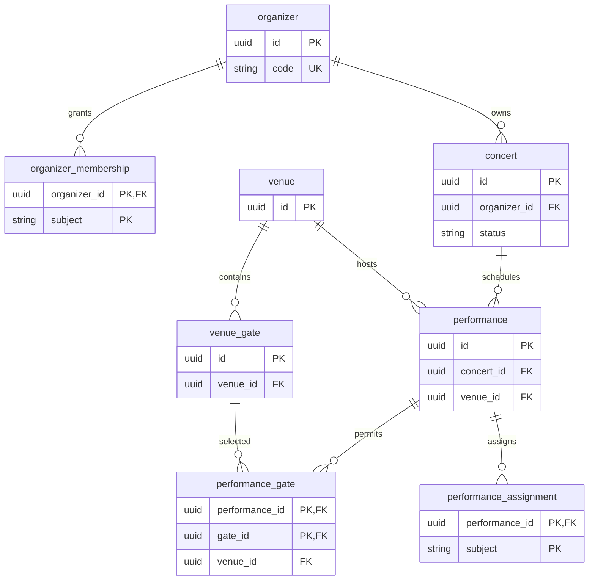

#### 2.4.2. Ghế, đơn và kết quả tiền

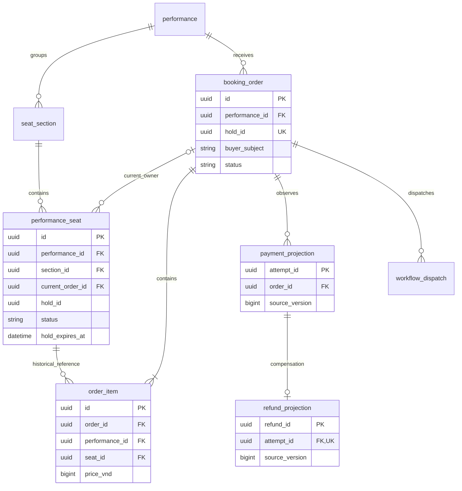

Một đơn có 1–4 dòng; Mermaid không thể hiện giới hạn tối đa 4 nên ràng buộc này được kiểm ở use case. Ghế có thể được tham chiếu bởi nhiều dòng đơn đã hết hạn, nhưng chỉ một `current_order_id` tại một thời điểm. **LLD lựa chọn một row `performance_seat` chứa cả cấu hình và quyền hiện tại** để sửa giá/giữ/bán khóa cùng row, không tạo thêm bảng runtime chỉ để tách cột.

#### 2.4.3. Vé, check-in và hỗ trợ

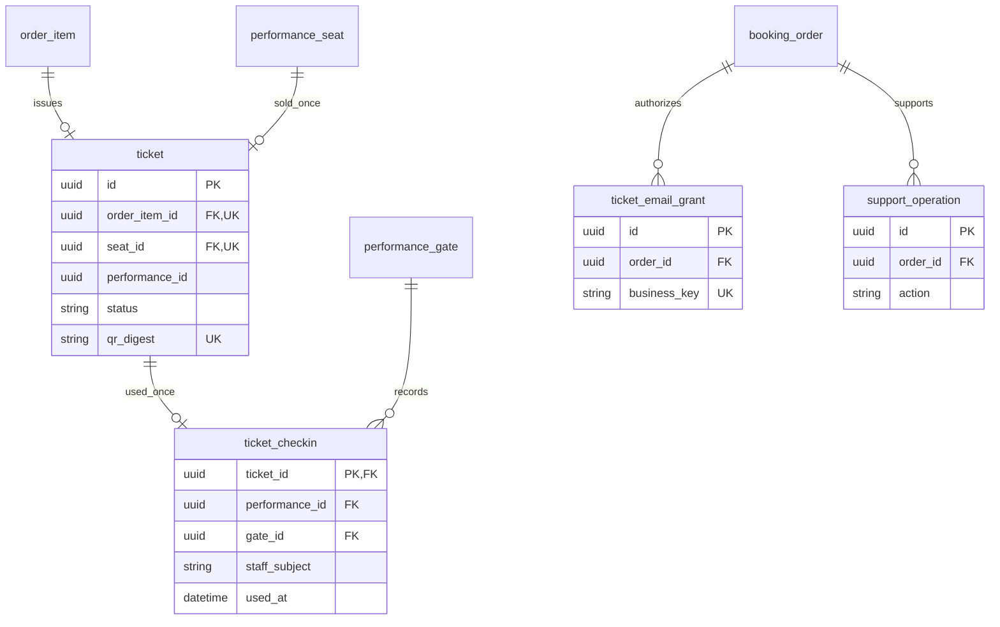

`staff_subject` không FK đến assignment: thu hồi quyền không xóa dấu vết người đã quét. Kiểm assignment active là điều kiện transaction tại thời điểm check-in.

#### 2.4.4. Standalone tables

`idempotency_record`, `outbox_event`, `inbox_event`, `audit_log` có khóa riêng, không FK polymorphic tới aggregate. `aggregate_id`/`entity_id` là logical reference. `workflow_dispatch` có FK tới order vì toàn bộ dispatch của bảng này thuộc một đơn.

### 2.5. Data dictionary

Các bảng dưới đây nằm trong schema `booking`; cột chung M/A được cộng vào danh sách cột, không thay các cột được liệt kê.

#### organizer

Cột chung: **M**.

| Column | Type | Null/default | Meaning |
|---|---|---|---|
| id | uuid | NN | PK |
| code | varchar(40) | NN | UK |
| name | varchar(200) | NN | Tên tổ chức |
| active | boolean | NN, true | Trạng thái đơn vị |

**Constraints/indexes:** UK(code). Không xóa organizer đã có concert. Ngừng hoạt động không tự hủy vé.

#### organizer_membership

Cột chung: **M**.

| Column | Type | Null/default | Meaning |
|---|---|---|---|
| organizer_id | uuid | NN | PK thành phần, FK organizer |
| subject | varchar(128) | NN | PK thành phần, Identity ref |
| permission | varchar(24) | NN | MANAGE hoặc SUPPORT_READ |
| active | boolean | NN, true | Hiệu lực scope |
| granted_by | varchar(128) | NN | Admin cấp quyền |

**Constraints/indexes:** PK(organizer_id,subject); index(subject,active). ORGANIZER cần MANAGE; ADMIN tra cứu/hỗ trợ cần scope được cấp. Không có quyền xem QR từ membership.

#### venue

Cột chung: **M**.

| Column | Type | Null/default | Meaning |
|---|---|---|---|
| id | uuid | NN | PK |
| code | varchar(40) | NN | UK |
| name | varchar(200) | NN | Tên địa điểm |
| address | varchar(500) | NN | Địa chỉ |
| city | varchar(100) | NN | Thành phố |
| timezone | varchar(64) | NN, Asia/Ho_Chi_Minh | IANA zone |
| active | boolean | NN, true | Cho chọn mới |

**Constraints/indexes:** UK(code). Seed danh mục local; thay đổi không được đổi snapshot của suất đã công bố.

#### venue_gate

Cột chung: **M**.

| Column | Type | Null/default | Meaning |
|---|---|---|---|
| id | uuid | NN | PK |
| venue_id | uuid | NN | FK venue |
| code | varchar(40) | NN | Mã cổng |
| name | varchar(120) | NN | Tên cổng |
| active | boolean | NN, true | Cho cấu hình mới |

**Constraints/indexes:** UK(venue_id,code); UK(id,venue_id) cho composite FK.

#### concert

Cột chung: **M**.

| Column | Type | Null/default | Meaning |
|---|---|---|---|
| id | uuid | NN | PK |
| organizer_id | uuid | NN | FK organizer |
| slug | varchar(180) | NN | UK, URL code |
| title | varchar(250) | NN | Tên concert |
| artists | jsonb | NN | Array tên nghệ sĩ |
| description | text | NN | Nội dung đã sanitize |
| purchase_terms | text | NN | Điều kiện mua |
| status | varchar(16) | NN, DRAFT | DRAFT, PUBLISHED, HIDDEN |
| first_published_at | timestamptz | ? | Mốc công bố đầu tiên |
| catalog_revision | bigint | NN, 0 | Version toàn snapshot concert và các suất |

**Constraints/indexes:** UK(slug); UK(id,organizer_id); index(organizer_id,status,id). CHECK catalog_revision>=0; artists là JSON array. Publish yêu cầu nội dung đủ. Mọi sửa nội dung/suất liên quan snapshot tăng catalog_revision dưới khóa concert.

#### performance

Cột chung: **M**.

| Column | Type | Null/default | Meaning |
|---|---|---|---|
| id | uuid | NN | PK |
| concert_id | uuid | NN | FK concert |
| venue_id | uuid | NN | FK venue |
| code | varchar(40) | NN | Mã suất trong concert |
| starts_at | timestamptz | NN | Giờ diễn |
| sales_open_at | timestamptz | NN | Biên gồm |
| sales_close_at | timestamptz | NN | Biên loại trừ |
| sales_enabled | boolean | NN, false | Đóng/mở thủ công |
| checkin_open_at | timestamptz | NN | Bắt đầu cho vào |
| checkin_close_at | timestamptz | NN | Kết thúc cho vào |
| venue_snapshot | jsonb | NN | name/address/city/timezone lúc cấu hình |

**Constraints/indexes:** UK(concert_id,code); UK(id,concert_id); UK(id,venue_id). CHECK sales_open_at<sales_close_at AND sales_close_at<=starts_at; CHECK checkin_open_at<checkin_close_at. Index(concert_id,starts_at,id). Không đổi lịch/venue sau công bố trong MVP.

#### performance_gate

Cột chung: **M**.

| Column | Type | Null/default | Meaning |
|---|---|---|---|
| performance_id | uuid | NN | PK thành phần |
| venue_id | uuid | NN | Cùng venue của suất/cổng |
| gate_id | uuid | NN | PK thành phần |
| enabled | boolean | NN, true | Cho phép quét |

**Constraints/indexes:** PK(performance_id,gate_id). FK(performance_id,venue_id) -> performance(id,venue_id); FK(gate_id,venue_id) -> venue_gate(id,venue_id). Disable thay vì xóa cổng đã có check-in.

#### performance_assignment

Cột chung: **M**.

| Column | Type | Null/default | Meaning |
|---|---|---|---|
| performance_id | uuid | NN | PK thành phần, FK performance |
| subject | varchar(128) | NN | PK thành phần, nhân viên |
| active | boolean | NN, true | Hiệu lực |
| granted_by | varchar(128) | NN | Admin |

**Constraints/indexes:** PK(performance_id,subject); index(subject,active). Role CHECKIN_STAFF và assignment cùng bắt buộc.

#### seat_section

Cột chung: **M**.

| Column | Type | Null/default | Meaning |
|---|---|---|---|
| id | uuid | NN | PK |
| performance_id | uuid | NN | FK performance |
| code | varchar(40) | NN | Mã khu |
| name | varchar(120) | NN | Tên khu |
| sort_order | integer | NN, 0 | Thứ tự hiển thị |

**Constraints/indexes:** UK(performance_id,code); UK(id,performance_id); CHECK sort_order>=0. Khu thuộc từng suất, chưa thêm reusable seat-map template.

#### performance_seat

Cột chung: **M**.

| Column | Type | Null/default | Meaning |
|---|---|---|---|
| id | uuid | NN | PK |
| performance_id | uuid | NN | FK performance |
| section_id | uuid | NN | Khu cùng suất |
| row_label | varchar(20) | NN | Nhãn hàng |
| seat_number | varchar(20) | NN | Số/nhãn ghế |
| x | numeric(10,2) | NN | Tọa độ trên sơ đồ |
| y | numeric(10,2) | NN | Tọa độ trên sơ đồ |
| price_vnd | bigint | NN | Giá hiện tại >0 |
| enabled | boolean | NN, true | Có thuộc cấu hình bán |
| status | varchar(16) | NN, AVAILABLE | AVAILABLE, HELD, SOLD |
| current_order_id | uuid | ? | Đơn giữ/mua hiện tại |
| hold_id | uuid | ? | Lần giữ hiện tại |
| hold_expires_at | timestamptz | ? | Có khi HELD |
| sold_at | timestamptz | ? | Có khi SOLD |

**Constraints/indexes:** UK(section_id,row_label,seat_number); UK(id,performance_id). FK(section_id,performance_id) -> seat_section(id,performance_id). FK(current_order_id,performance_id,hold_id) -> booking_order(id,performance_id,hold_id). Index(performance_id,enabled,id), index(current_order_id), partial index(hold_expires_at) WHERE status=HELD. CHECK price_vnd>0. AVAILABLE: owner/hold/expiry/sold_at đều null. HELD: owner/hold/expiry khác null, sold_at null. SOLD: owner/hold/sold_at khác null, expiry null; enabled=true. Ghế quá hạn được cấp hold mới mà không cần dọn row trước.

#### booking_order

Cột chung: **M**.

| Column | Type | Null/default | Meaning |
|---|---|---|---|
| id | uuid | NN | PK |
| order_code | varchar(40) | NN | UK, mã tra cứu không là quyền truy cập |
| buyer_subject | varchar(128) | NN | Owner ổn định |
| buyer_email | varchar(320) | NN | Email đã xác minh khi đặt |
| buyer_email_normalized | varchar(320) | NN | Exact lookup theo chuẩn Identity |
| organizer_id | uuid | NN | Scope |
| concert_id | uuid | NN | Concert nguồn |
| performance_id | uuid | NN | Suất duy nhất |
| hold_id | uuid | NN | UK, giữ nguyên khi retry |
| status | varchar(24) | NN | PENDING_PAYMENT, CONFIRMED, CANCELLED, EXPIRED |
| seat_count | smallint | NN | 1 đến 4 |
| subtotal_vnd | bigint | NN | Tổng dòng đơn >0 |
| fee_vnd | bigint | NN, 0 | CHECK =0 |
| total_vnd | bigint | NN | subtotal + fee |
| currency | char(3) | NN, VND | CHECK =VND |
| held_at | timestamptz | NN | Mốc DB cấp giữ |
| expires_at | timestamptz | NN | held_at + 5 phút |
| confirmed_at | timestamptz | ? | Có khi CONFIRMED |
| closed_at | timestamptz | ? | Có khi CANCELLED/EXPIRED |
| close_reason | varchar(64) | ? | USER_CANCELLED, HOLD_EXPIRED, INVENTORY_INCONSISTENCY |
| confirmed_attempt_id | uuid | ? | Payment ref, UK khi khác null |
| tickets_completed_at | timestamptz | ? | Marker đủ vé một lần |
| needs_attention | boolean | NN, false | Cờ theo dõi |
| attention_reason | varchar(100) | ? | Lý do |
| concert_snapshot | jsonb | NN | title/artists/venue/startsAt/terms |

**Constraints/indexes:** FK(concert_id,organizer_id) -> concert(id,organizer_id); FK(performance_id,concert_id) -> performance(id,concert_id). UK(order_code), UK(hold_id), UK(id,performance_id), UK(id,performance_id,hold_id). CHECK seat_count BETWEEN 1 AND 4, total_vnd=subtotal_vnd+fee_vnd, expires_at=held_at+interval 5 minutes. PENDING không có confirmed/closed/attempt; CONFIRMED có confirmed_at/attempt, closed_at null; terminal hủy/hết hạn có closed_at/reason, confirmed_at/attempt null. Index(buyer_subject,created_at DESC,id); (organizer_id,buyer_email_normalized,created_at DESC); partial(expires_at) WHERE status=PENDING_PAYMENT. Kiểm count(items), tổng tiền và cùng hold ở use case trong transaction, không dùng CHECK liên bảng giả định.

#### order_item

Cột chung: **A**.

| Column | Type | Null/default | Meaning |
|---|---|---|---|
| id | uuid | NN | PK |
| order_id | uuid | NN | Đơn |
| performance_id | uuid | NN | Cùng suất đơn/ghế |
| seat_id | uuid | NN | Ghế nguồn |
| section_name | varchar(120) | NN | Snapshot |
| row_label | varchar(20) | NN | Snapshot |
| seat_number | varchar(20) | NN | Snapshot |
| price_vnd | bigint | NN | Snapshot >0; quantity=1 |

**Constraints/indexes:** FK(order_id,performance_id) -> booking_order(id,performance_id); FK(seat_id,performance_id) -> performance_seat(id,performance_id). UK(order_id,seat_id); UK(id,order_id,performance_id,seat_id) cho ticket. Không UK(seat_id) ở bảng lịch sử này. Không cập nhật giá/nhãn sau checkout.

#### payment_projection

Cột chung: **M**.

| Column | Type | Null/default | Meaning |
|---|---|---|---|
| attempt_id | uuid | NN | PK, Payment ref |
| order_id | uuid | NN | FK booking_order |
| amount_vnd | bigint | NN | Khoản thu >0 |
| currency | char(3) | NN | VND |
| status | varchar(16) | NN | PROCESSING, VERIFYING, SUCCEEDED, FAILED |
| paid_at | timestamptz | ? | Mốc nguồn khi SUCCEEDED |
| verified_at | timestamptz | ? | Mốc xác minh nguồn |
| source_version | bigint | NN | Version attempt, không dùng version order |
| received_at | timestamptz | NN | Mốc nhận |
| last_event_id | uuid | NN | Event áp dụng gần nhất |

**Constraints/indexes:** Index(order_id). Projection không là nguồn tiền; chỉ nhận từ Payment có danh tính hợp lệ. SUCCEEDED yêu cầu paid_at/verified_at; amount/currency phải khớp order khi confirm. Không sửa projection theo Return URL.

#### refund_projection

Cột chung: **M**.

| Column | Type | Null/default | Meaning |
|---|---|---|---|
| refund_id | uuid | NN | PK, Payment ref |
| attempt_id | uuid | NN | UK, FK payment_projection |
| status | varchar(24) | NN | PENDING, SUCCEEDED, NEEDS_SUPPORT |
| amount_vnd | bigint | NN | Toàn bộ khoản thu |
| refunded_at | timestamptz | ? | Mốc hoàn thực tế |
| source_version | bigint | NN | Version refund độc lập |
| received_at | timestamptz | NN | Mốc nhận |
| last_event_id | uuid | NN | Event áp dụng |

**Constraints/indexes:** UK(attempt_id). Event refund đến trước projection payment được giữ inbox PENDING; worker đọc snapshot Payment ngoài transaction rồi áp dụng lại. Không bỏ event vì chưa có FK parent. SUCCEEDED có refunded_at.

#### ticket

Cột chung: **M**.

| Column | Type | Null/default | Meaning |
|---|---|---|---|
| id | uuid | NN | PK |
| ticket_code | varchar(40) | NN | UK, mã hỗ trợ không phải token |
| order_item_id | uuid | NN | UK |
| order_id | uuid | NN | Đơn nguồn |
| performance_id | uuid | NN | Suất |
| seat_id | uuid | NN | UK, ghế bán một lần |
| status | varchar(16) | NN, ISSUED | ISSUED hoặc USED |
| issued_at | timestamptz | NN | Mốc phát hành đầu tiên |
| used_at | timestamptz | ? | Có khi USED |
| qr_digest | bytea | NN | UK, SHA-256 token |
| qr_ciphertext | bytea | NN | Token mã hóa AEAD, gồm tag |
| qr_nonce | bytea | NN | Nonce ngẫu nhiên |
| qr_key_id | varchar(64) | NN | Khóa ngoài DB |

**Constraints/indexes:** FK(order_item_id,order_id,performance_id,seat_id) -> order_item(id,order_id,performance_id,seat_id); FK(seat_id,performance_id) -> performance_seat(id,performance_id); UK(id,performance_id). CHECK status/used_at nhất quán; digest 32 byte; nonce 12 byte. Sinh token CSPRNG 32 byte, encode base64url khi dựng QR; AAD gắn ticket_id. Dùng thư viện crypto, không tự viết thuật toán. Owner suy từ order; không nhân bản quyền.

#### ticket_checkin

Cột chung: **A**.

| Column | Type | Null/default | Meaning |
|---|---|---|---|
| ticket_id | uuid | NN | PK |
| performance_id | uuid | NN | Cùng suất vé/cổng |
| gate_id | uuid | NN | Cổng quét |
| staff_subject | varchar(128) | NN | Nhân viên |
| used_at | timestamptz | NN | Giờ DB |
| request_id | uuid | NN | Correlation của lần thắng |

**Constraints/indexes:** FK(ticket_id,performance_id) -> ticket(id,performance_id); FK(performance_id,gate_id) -> performance_gate(performance_id,gate_id). Index(performance_id,used_at), (staff_subject,used_at). Chỉ lưu lần thành công; quét lỗi vào audit đã bỏ token.

#### ticket_email_grant

Cột chung: **M**.

| Column | Type | Null/default | Meaning |
|---|---|---|---|
| id | uuid | NN | PK |
| order_id | uuid | NN | FK booking_order |
| business_key | varchar(160) | NN | UK: TICKET_SET:orderId hoặc RESEND:operationId |
| owner_subject | varchar(128) | NN | Owner snapshot |
| recipient_email | varchar(320) | NN | Email verified của đơn |
| purpose | varchar(24) | NN | TICKET_SET hoặc TICKET_RESEND |
| active | boolean | NN, true | Cho fetch/retry |
| requested_by | varchar(128) | ? | Admin khi resend |

**Constraints/indexes:** Index(order_id). Grant chỉ là reference, không bearer credential; Notification vẫn phải có service identity. Retry cùng grant dùng QR cũ. Không cho client/admin tự đặt recipient.

#### support_operation

Cột chung: **M**.

| Column | Type | Null/default | Meaning |
|---|---|---|---|
| id | uuid | NN | PK |
| order_id | uuid | NN | FK booking_order |
| action | varchar(32) | NN | VERIFY_PAYMENT, RETRY_REFUND, ISSUE_MISSING_TICKETS, RESEND_EMAIL |
| target_reference | varchar(160) | NN | ID tại service nguồn |
| actor_subject | varchar(128) | NN | Admin |
| reason | varchar(500) | NN | Lý do bắt buộc |
| status | varchar(24) | NN | ACCEPTED, RUNNING, COMPLETED, REJECTED, NEEDS_SUPPORT |
| result_reference | varchar(160) | ? | ID kết quả |
| error_code | varchar(80) | ? | Lỗi đã sanitize |

**Constraints/indexes:** Index(order_id,created_at). Định danh operation dùng làm key khi gọi nguồn; không đổi key vì timeout. COMPLETED diễn giải theo action, không được thay trạng thái refund nguồn bằng thành công giả.

#### idempotency_record

Cột chung: **A**.

| Column | Type | Null/default | Meaning |
|---|---|---|---|
| actor | varchar(160) | NN | PK thành phần |
| operation | varchar(64) | NN | PK thành phần |
| request_key | varchar(128) | NN | PK thành phần |
| request_hash | char(64) | NN | Hash canonical payload và scope |
| resource_id | uuid | NN | Order/operation tạo hoặc lấy |
| http_status | smallint | NN | Kết quả đã commit |
| response | jsonb | NN | DTO tối thiểu không QR/token |
| completed_at | timestamptz | NN | Mốc hoàn tất |

**Constraints/indexes:** PK(actor,operation,request_key). Không TTL/xóa trong MVP. Cùng key khác payload trả 409; INSERT kết quả trong transaction nghiệp vụ. Với checkout dùng advisory transaction lock theo hash64 của key để serialize trước row locks, rồi kiểm key đầy đủ; collision hash chỉ gây chờ dư.

#### workflow_dispatch

Cột chung: **M**.

| Column | Type | Null/default | Meaning |
|---|---|---|---|
| id | uuid | NN | PK |
| order_id | uuid | NN | FK booking_order |
| business_key | varchar(180) | NN | UK, START:orderId hoặc EVENT:eventId/OP:operationId |
| kind | varchar(32) | NN | START, PAYMENT_CHANGED, REFUND_CHANGED, ORDER_CLOSED, SUPPORT |
| workflow_id | varchar(160) | NN | order:orderId |
| payload | jsonb | NN | References/version, không QR |
| state | varchar(16) | NN | PENDING, CLAIMED, DELIVERED, ATTENTION |
| attempts | integer | NN, 0 | Số lần thử |
| next_attempt_at | timestamptz | NN | Lịch xử lý |
| lease_token | uuid | ? | Fencing token |
| lease_until | timestamptz | ? | Hạn claim |
| last_error | varchar(100) | ? | Mã lỗi |
| delivered_at | timestamptz | ? | Temporal đã nhận |

**Constraints/indexes:** UK(business_key); index(state,next_attempt_at). Claim bằng DB, commit rồi start/signal. Signal xong crash vẫn có thể gửi lặp; activity idempotent. Đây là durable transport intent, không là workflow engine thứ hai.

#### outbox_event

Cột chung: **A**.

| Column | Type | Null/default | Meaning |
|---|---|---|---|
| event_id | uuid | NN | PK |
| aggregate_type | varchar(40) | NN | Loại aggregate |
| aggregate_id | uuid | NN | Logical ref |
| aggregate_version | bigint | NN | Version nguồn |
| sequence_in_version | smallint | NN | Thứ tự nếu một version có nhiều event |
| event_type | varchar(64) | NN | Contract name |
| schema_version | integer | NN, 1 | Version schema |
| topic | varchar(120) | NN | Topic đích |
| partition_key | varchar(128) | NN | Order/concert/seat ID |
| envelope | jsonb | NN | Payload đã whitelist |
| occurred_at | timestamptz | NN | Giờ nghiệp vụ |
| state | varchar(16) | NN | PENDING, CLAIMED, PUBLISHED, ATTENTION |
| attempts | integer | NN, 0 | Số lần relay |
| next_attempt_at | timestamptz | NN | Lịch relay |
| lease_token | uuid | ? | Fencing token |
| lease_until | timestamptz | ? | Hạn claim |
| published_at | timestamptz | ? | Sau broker ack |
| last_error | varchar(100) | ? | Mã lỗi |

**Constraints/indexes:** UK(aggregate_type,aggregate_id,aggregate_version,sequence_in_version); index(state,next_attempt_at). Payload/event ID bất biến sau commit; chỉ metadata delivery thay đổi. Relay không được đánh PUBLISHED trước acknowledgement.

#### inbox_event

Cột chung: **Không thêm cột chung**.

| Column | Type | Null/default | Meaning |
|---|---|---|---|
| consumer_name | varchar(80) | NN | PK thành phần |
| event_id | uuid | NN | PK thành phần |
| payload_hash | char(64) | NN | Phát hiện ID trùng nội dung khác |
| envelope | jsonb | NN | Event không QR/secret |
| state | varchar(16) | NN | PENDING, APPLIED, QUARANTINED |
| received_at | timestamptz | NN | Mốc nhận |
| processed_at | timestamptz | ? | Mốc áp dụng |
| next_attempt_at | timestamptz | ? | Retry khi thiếu parent/schema xử lý được |
| error_code | varchar(80) | ? | Lý do chưa áp dụng |

**Constraints/indexes:** PK(consumer_name,event_id); index(state,next_attempt_at). Inbox + projection + workflow dispatch cùng transaction. APPLIED chỉ khi đã tạo công việc bền vững tiếp theo. Unknown schema vào quarantine, có cảnh báo và replay.

#### audit_log

Cột chung: **Không thêm cột chung**.

| Column | Type | Null/default | Meaning |
|---|---|---|---|
| id | uuid | NN | PK |
| actor_type | varchar(16) | NN | USER, SERVICE, SYSTEM |
| actor_subject | varchar(160) | NN | Danh tính |
| action | varchar(80) | NN | Loại thao tác |
| entity_type | varchar(40) | NN | Loại đối tượng |
| entity_id | varchar(160) | NN | Logical ref |
| organizer_id | uuid | ? | Scope |
| order_id | uuid | ? | Reference đơn |
| outcome | varchar(16) | NN | SUCCESS, REJECTED, ERROR |
| reason_code | varchar(80) | ? | Lý do |
| before_data | jsonb | ? | Whitelist trạng thái/giá/quyền |
| after_data | jsonb | ? | Whitelist trạng thái/giá/quyền |
| correlation_id | uuid | NN | Trace |
| operation_id | uuid | ? | Support ref |
| occurred_at | timestamptz | NN | Giờ DB |

**Constraints/indexes:** Index(entity_type,entity_id,occurred_at), (actor_subject,occurred_at), (organizer_id,occurred_at). App audit role chỉ INSERT/SELECT; không API sửa/xóa. Không ghi QR/password/OTP/access token hoặc request body thô.

## 3. Domain & state model

### 3.1. Aggregate boundaries

| Aggregate / capability | Owns | Application coordination |
|---|---|---|
| Concert | Nội dung, trạng thái công bố, catalog revision | Cấu hình Performance dưới kiểm soát scope và khóa catalog |
| Performance | Lịch, cửa sổ bán/check-in, cổng | Các use case Inventory kiểm cấu hình bán ổn định trong transaction |
| PerformanceSeat | Giá/cấu hình và quyền giữ/bán của một ghế | Ordering phối hợp tập ghế trong cùng transaction |
| BookingOrder | Chủ đơn, lines snapshot, hold, trạng thái mua | Confirm/close phối hợp Inventory; không ép mọi ghế của suất thành một JPA aggregate khổng lồ |
| Ticket | Token QR và trạng thái dùng | Check-in ghi ticket_checkin cùng transaction |
| Access / Support | Scope và hồ sơ can thiệp | Gọi use case của module sở hữu dữ liệu |

JPA association mặc định lazy; không serialize entity trực tiếp thành JSON. Order load tối đa 4 lines, không load toàn bộ seat map để giữ một tập ghế. DTO hỗ trợ và DTO owner QR tách biệt.

### 3.2. Order state machine

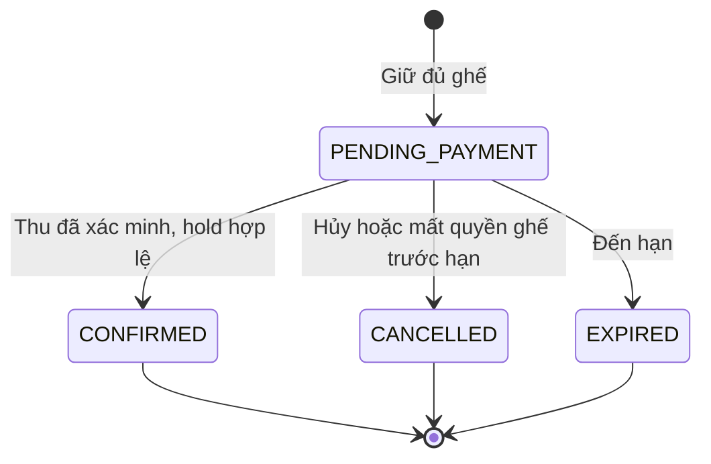

Terminal ở đây là terminal của **đơn**, không kết thúc việc xác minh tiền/refund. Payment thành công lặp cho đúng `confirmed_attempt_id` là no-op. `CANCELLED/EXPIRED` không được chuyển sang CONFIRMED dù ghế hiện lại AVAILABLE.

### 3.3. Seat, ticket và projection

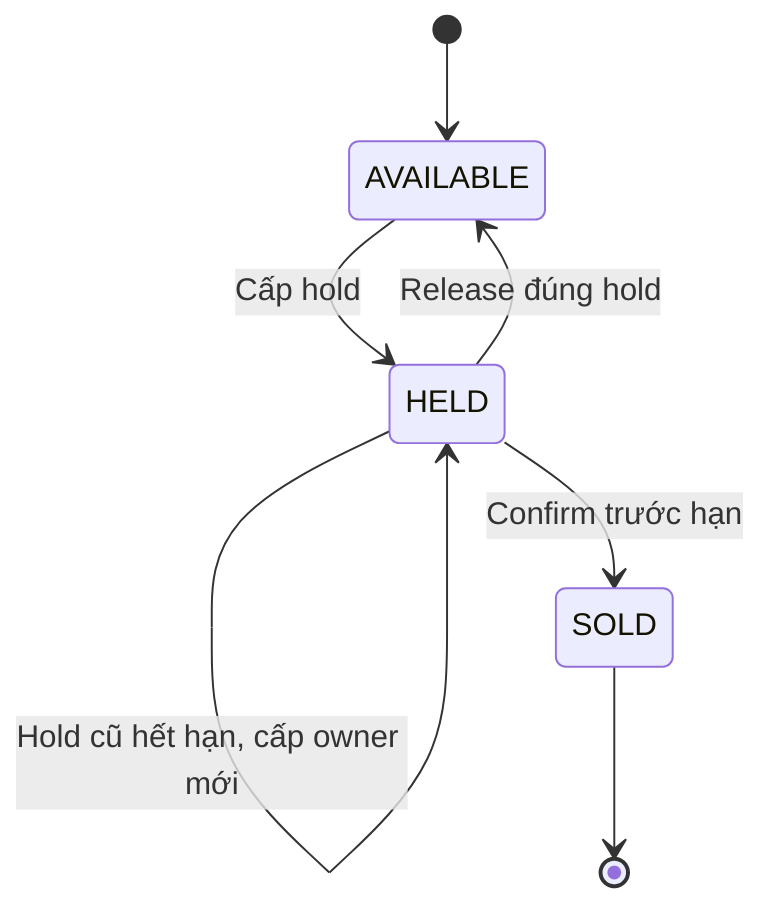

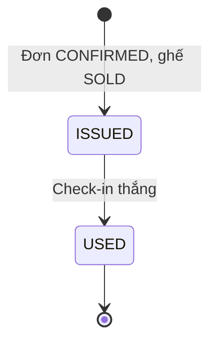

| Trục | Giá trị / xử lý |
|---|---|
| Payment projection | PROCESSING, VERIFYING, SUCCEEDED, FAILED; Payment sở hữu quyết định |
| Refund projection | PENDING, SUCCEEDED, NEEDS_SUPPORT; mỗi refund có version riêng |
| Vé của đơn | `issuedCount / seatCount`; đủ khi `tickets_completed_at != null` |
| Chưa có payment/refund | DTO NOT_STARTED / NOT_APPLICABLE; không tạo row giả |
| Nguồn không đọc được | `available=false`; không diễn giải thành FAILED |
| Cần hỗ trợ | Cờ và lý do, không ép đổi order terminal |

Không có trạng thái PDF hoặc bảng file vé. Email có trạng thái riêng do Notification trả.

## 4. Flow A — Phân công và scope authorization

### 4.1. API, trigger & conditions

Prefix REST ngoài: `/api/v1`. Quản lý role nền tại Keycloak; Booking quản lý scope.

| Method/path | Input | Output |
|---|---|---|
| PUT `/admin/organizers/{id}/members/{subject}` | permission, active, expectedVersion | Membership hiện tại |
| PUT `/admin/performances/{id}/assignments/{subject}` | active, expectedVersion | Assignment hiện tại |
| POST `/internal/v1/authorization/check` | subject, action, organizerId/performanceId | allowed, evaluatedAt |

Admin được phép quản lý phân công; subject phải tồn tại trong Identity. API nội bộ chỉ cho service identity được cấp scope authorization; không mở endpoint để client tự khai subject rồi nhận quyền.

### 4.2. Visual flow

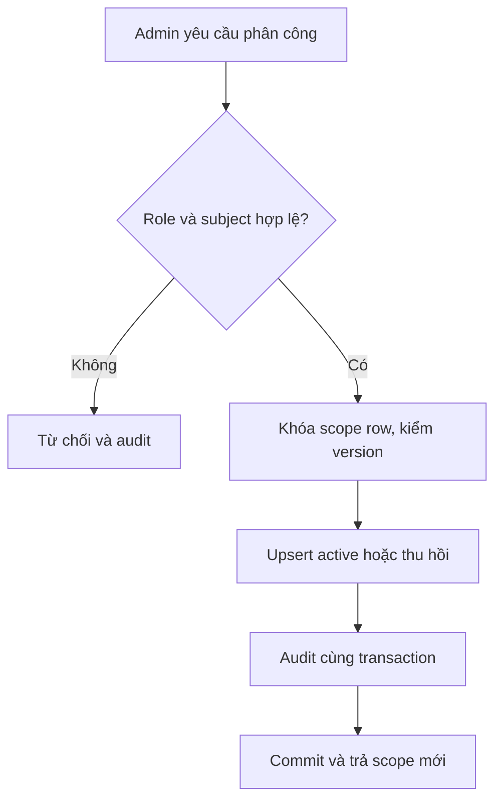

### 4.3. Processing & invariants

Identity lookup diễn ra trước transaction DB. Thay assignment khóa performance rồi assignment; thay membership khóa organizer rồi membership. Mutation đặc quyền đọc membership/assignment trực tiếp và giữ shared lock cần thiết tới commit, để thu hồi quyền và mutation có thứ tự rõ ràng. Request đã giành khóa quyền trước có thể hoàn tất trước khi thu hồi commit. Không dựa token cũ để suy ra scope còn hiệu lực.

Người mua dùng subject từ token; checkout cần `email_verified=true` và `phone_verified=true`. Đăng ký, mật khẩu, OTP, session và SMS adapter thuộc Keycloak, không có password/OTP table trong Booking. Dev identity chỉ dùng profile local theo HLD, không thay nghiệm thu xác thực thật.

### 4.4. Error model

401 token không hợp lệ; 403 thiếu role; 404 subject/resource không tồn tại hoặc ngoài scope; 409 version cũ; 503 Identity/scope chưa xác minh được. Không cho qua khi nguồn quyền lỗi.

## 5. Flow B — Configure & publish concert

### 5.1. API endpoints

| Method/path | Purpose | Response |
|---|---|---|
| POST `/organizer/concerts` | Tạo draft | 201 id, version |
| PUT `/organizer/concerts/{id}` | Sửa nội dung | 200 version mới |
| POST `/organizer/concerts/{id}/performances` | Tạo suất | 201 id |
| PUT `/organizer/performances/{id}/configuration` | Lịch bán/check-in, cổng | 200 version |
| PUT `/organizer/performances/{id}/seat-map` | Cấu hình khu/ghế | 200 số ghế, revision |
| PATCH `/organizer/performances/{id}/seat-prices` | `{changes:[{seatId,priceVnd}],expectedVersions}` | 200 các version mới |
| POST `/organizer/concerts/{id}/publish` | Công bố | 200 PUBLISHED |
| POST `/organizer/concerts/{id}/hide` | Ẩn | 200 HIDDEN |
| POST `/organizer/performances/{id}/close-sales` | Đóng bán sớm | 200 salesEnabled=false |

Scope ORGANIZER + membership MANAGE. Mutation dùng `If-Match`/expectedVersion cho đối tượng cấu hình; không dùng version màn hình thay row lock tại thời điểm ghi.

### 5.2. Design overview & visual flow

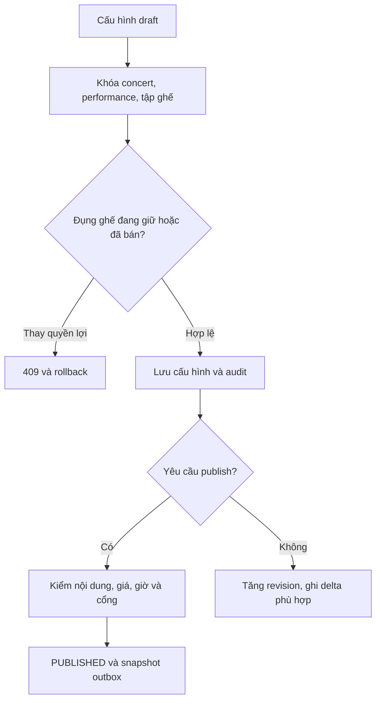

### 5.3. Transaction and invariants

1. Kiểm scope; khóa cấu hình theo mục 13. Khóa từng seat theo UUID tăng dần; lấy DB time sau chờ khóa.
2. Tạo row ghế có AVAILABLE, không owner. Không trùng khu/hàng/số trong suất.
3. Publish kiểm title/artists/terms, ít nhất một suất có ghế enabled giá dương, `open < close <= startsAt`; cửa sổ check-in và cổng đúng venue được cấu hình. Không tự đặt giờ mở cổng.
4. Giá mới được cập nhật mà không sửa order_item, kể cả khi ghế đang giữ giá cũ. Thay nhãn/vị trí, disable hoặc xóa ghế HELD còn hạn/SOLD bị từ chối.
5. Không đổi giờ diễn/venue sau công bố trong MVP. Ẩn/đóng bán chỉ chặn giữ mới, không thu hồi hold cũ.
6. Cùng transaction ghi audit + `CatalogSnapshotChanged` nếu public content thay đổi; thay cấu hình ghế phát `SeatStateChanged` chứa trạng thái/cấu hình sau ghi. Version tăng tại nguồn.

Snapshot catalog lấy dữ liệu dưới khóa concert, gồm tất cả suất cần Search. `catalog_revision` tăng cả khi sửa suất. Không dùng một revision của concert để version từng ghế.

### 5.4. Error model / retry

422 `INVALID_SALES_WINDOW`, `INVALID_PRICE`, `INVALID_GATE`, `INCOMPLETE_CATALOG`; 409 `SEAT_CONFIGURATION_LOCKED`, `VERSION_CONFLICT`, `RESCHEDULE_NOT_SUPPORTED`; 404 ngoài scope. Publish/hide lặp trên trạng thái đích là no-op; không tăng version/phát thêm event khi không đổi dữ liệu.

## 6. Flow C — Read catalog & seat map

### 6.1. Runtime contract

| Endpoint | Result |
|---|---|
| GET `/concerts?cursor=&limit=` | Duyệt cơ bản concert public khi Search lỗi |
| GET `/concerts/{id}` | Nội dung public từ nguồn |
| GET `/performances/{id}/seats` | Ghế, giá hiện tại, trạng thái khả dụng, readAt/serverTime |
| POST `/internal/v1/catalog/resolve-public` | Batch IDs → public DTO được xác minh |
| GET `/internal/v1/catalog/snapshots?cursor=` | Snapshot kèm catalogRevision, gồm tombstone cho reindex worker |

Tìm theo tên/nghệ sĩ/địa điểm/ngày thuộc Search. Booking không triển khai lại Elasticsearch hoặc thêm lọc giá.

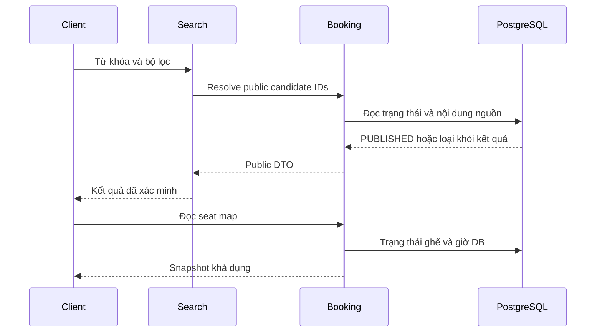

### 6.2. Read consistency and error model

Seat HELD có `hold_expires_at <= readAt` hiển thị AVAILABLE; không sửa row trong API đọc. Không trả buyer, current_order_id, hold_id. Chọn ghế trên UI không có quyền giữ.

Read catalog/seat map dùng statement snapshot hoặc transaction read ngắn nhất quán; xác minh PUBLISHED trong cùng phạm vi đọc trước khi trả. Nếu dùng cache thì vẫn kiểm public ở nguồn. Booking không khả dụng: Search không được trả bản sao chưa xác minh. Đơn/vé của owner vẫn đọc được khi concert HIDDEN.

404 nội dung không public/không tồn tại; 422 cursor/filter sai; 503 nguồn không đọc được. Phân trang cursor ổn định theo `(startsAt,id)` hoặc `(createdAt,id)` tùy endpoint, giới hạn cấu hình; không trả danh sách vô hạn.

## 7. Flow D — Hold seats & create order

### 7.1. Trigger & conditions

`POST /api/v1/orders`, header `Idempotency-Key` bắt buộc.

```json
{
  "performanceId": "<uuid>",
  "seatIds": ["<uuid>", "<uuid>"]
}
```

Input 1–4 ID không trùng, cùng suất; buyer đã xác minh email/phone; còn lịch bán và rate limit. Không nhận buyerId hoặc tổng tiền client làm dữ liệu chuẩn.

### 7.2. Visual flow

```mermaid
sequenceDiagram
    participant U as Buyer
    participant A as CreateOrder
    participant D as Booking DB
    participant W as Dispatcher
    participant T as Temporal
    U->>A: performanceId, seatIds, idempotency key
    A->>A: Auth, canonical hash, rate limit
    A->>D: Begin; key lock; đọc lại kết quả cũ
    A->>D: Khóa cấu hình và ghế theo thứ tự
    A->>D: Lấy DB time; kiểm toàn bộ tập ghế
    alt Có ghế không hợp lệ
        A->>D: Rollback
        A-->>U: 409 hoặc 422
    else Giữ đủ
        A->>D: Order, lines, hold, idempotency, dispatch, outbox
        A->>D: Commit
        A-->>U: 201 orderId, expiresAt, serverTime
        W->>D: Claim START đã commit
        W->>T: Start workflow theo orderId
    end
```

### 7.3. Transaction algorithm

1. Chuẩn hóa seatIds theo thứ tự để hash cùng tập ghế giống nhau. Key scope = subject + CREATE_ORDER + Idempotency-Key. Nếu đã có kết quả cùng hash, trả resource cũ; hash khác trả 409.
2. Với thao tác mới, rate-limit Redis theo subject/IP. Mất rate limit tin cậy thì từ chối giữ mới; không ngăn đọc đơn cũ.
3. Mở transaction; advisory transaction lock theo hash64 của key; đọc lại idempotency đầy đủ. Lấy shared lock concert/performance; khóa ghế tăng dần (mục 13).
4. Sau khi lấy đủ khóa, `decisionTime=clock_timestamp()`. Kiểm PUBLISHED, sales_enabled và `salesOpen <= decisionTime < salesClose`; tất cả ghế enabled/cùng suất và AVAILABLE hoặc HELD đã quá hạn.
5. Sinh orderId/holdId; `heldAt=decisionTime`, `expiresAt=decisionTime+5 phút`. Tạo order và đủ lines snapshot; tổng do server cộng, phí 0.
6. Ghi toàn bộ ghế HELD, current_order_id/hold_id/expiry mới; kiểm số row bằng seat_count. Không khóa/sửa đơn cũ khi tái cấp ghế hết hạn.
7. Ghi idempotency kết quả + START workflow_dispatch + OrderCreated + SeatStateChanged trong transaction đó. Commit rồi trả.

Đơn mới được INSERT trước khi FK ghế trỏ đến nó. Không gọi Kafka/Temporal/Payment trong transaction. Lỗi tại bất kỳ bước nào rollback cả đơn, lines, ghế và idempotency.

### 7.4. Response and errors

201 gồm `orderId, orderCode, status, items[{seatId,section,row,number,priceVnd}], subtotalVnd, feeVnd, totalVnd, currency, heldAt, expiresAt, serverTime`. Retry cùng key trả cùng order/hạn/giá; serverTime có thể tính lại cho countdown, không sửa expiry.

| Code | HTTP | Meaning |
|---|---|---|
| INVALID_SEAT_SET | 422 | Không đủ điều kiện số lượng/trùng/khác suất |
| SALES_CLOSED | 409 | Không public/không trong khoảng bán tại điểm ghi |
| SEAT_UNAVAILABLE | 409 | Có ghế đang giữ hợp lệ hoặc SOLD; rollback cả tập |
| IDEMPOTENCY_CONFLICT | 409 | Key cũ với payload khác |
| RATE_LIMITED | 429 | Có Retry-After; không tạo hold mới |
| BUSY / RATE_LIMIT_UNAVAILABLE | 503 | Chưa thể cấp giữ an toàn |

Timeout không chứng minh chưa commit. Client retry đúng key hoặc mở đơn hiện có; không tự tạo key mới vì response bị mất. Không áp đặt tổng vé/tài khoản/suất ngoài 4 ghế/đơn và rate limit.

## 8. Flow E — Payment initiation & order confirmation

### 8.1. Initiate payment

`POST /api/v1/orders/{id}/payment-attempts`, body rỗng, Idempotency-Key bắt buộc. Booking kiểm owner, pending, còn hạn và quyền hold, đọc giá snapshot. Gọi Payment ngoài transaction khóa ghế bằng key ổn định `(subject,orderId,requestKey)`.

Hợp đồng yêu cầu tới Payment: `orderId, amountVnd, currency, holdExpiresAt, organizerId, performanceId, buyerSubject, operationKey`. Payment phải tạo/lấy attempt, chặn lần mới khi có khoản chưa rõ hoặc thành công, cho lần mới sau FAILED rõ và hold còn hạn. Đây là điều kiện hợp đồng, không thiết kế schema nội bộ Payment.

Response gồm attemptId, status, paymentUrl khi có, provider expiry nếu có. Timeout gọi Payment: trả trạng thái chưa rõ và chỉ dẫn đọc lại; retry cùng operationKey. Booking không sinh vnp_TxnRef, ký URL, nhận IPN hay query VNPAY trực tiếp. Return URL chỉ hướng UI đọc đơn.

### 8.2. Payment event and visual flow

```mermaid
sequenceDiagram
    participant P as Payment
    participant C as Booking Consumer
    participant D as Booking DB
    participant T as Temporal
    participant A as ConfirmOrder
    P-->>C: PaymentStateChanged
    C->>D: Inbox + projection + workflow_dispatch
    C->>D: Commit trước Kafka offset
    C-->>T: Dispatcher signal bền vững
    T->>A: Xử lý kết quả đã xác minh
    A->>D: Khóa order và ghế; lấy DB time
    alt Đã confirmed cùng attempt
        A-->>T: No-op
    else Pending, còn hạn, đủ hold và tiền khớp
        A->>D: CONFIRMED + SOLD + outbox
        A-->>T: Tiếp tục phát hành vé
    else Hủy, hết hạn hoặc mất quyền ghế
        A->>D: Giữ hoặc ghi terminal và compensation intent
        A-->>T: Yêu cầu refund toàn bộ
    end
```

### 8.3. Consume transaction

Kiểm schema, producer identity/ACL và eventId. Trong một transaction: insert inbox, áp dụng projection khi sourceVersion mới hơn, ghi workflow_dispatch theo eventId. Chỉ commit offset sau commit DB. ID lặp cùng payload là no-op; ID lặp khác payload hoặc dữ liệu sai được quarantine và cảnh báo.

Nếu order chưa tồn tại hoặc refund parent chưa có, lưu inbox PENDING để retry/đối chiếu; không bỏ sự kiện. Projection version của payment/refund độc lập. Event cũ không làm lùi trạng thái. Kết quả mâu thuẫn với terminal nguồn cần đọc Payment và lưu audit, không tự ghi đè SUCCEEDED thành FAILED.

### 8.4. Confirm transaction

1. Khóa cấu hình bằng shared lock, order FOR UPDATE, tập ghế theo thứ tự. Không yêu cầu concert vẫn PUBLISHED hoặc sales vẫn mở: hold cũ vẫn có hiệu lực theo HLD.
2. Đọc payment evidence đã commit từ nguồn Payment, đúng order/amount/currency và SUCCEEDED. Lấy giờ DB **sau khóa**.
3. CONFIRMED cùng attempt → no-op, không refund. CONFIRMED khác attempt → giữ đơn, đánh cần đối chiếu; không tự refund khoản đã dùng để chốt. Nếu Payment xác minh thu thừa, bù trừ khoản thừa theo hợp đồng riêng có audit.
4. PENDING và `now < expiresAt`, mọi ghế HELD đúng order+hold và cùng hạn → update tất cả SOLD; order CONFIRMED, confirmed_attempt_id, confirmed_at. Ghi OrderConfirmed và các SeatStateChanged; commit một lần.
5. Đã tới hạn → EXPIRED. Mất một phần hold trước hạn → CANCELLED/INVENTORY_INCONSISTENCY, needs_attention; release phần còn đúng owner. Ghi quyết định bù trừ bền vững qua workflow_dispatch, không xác nhận một phần.
6. CANCELLED/EXPIRED có tiền thành công → giữ nguyên terminal, chuyển Flow G.

### 8.5. Errors / invariants

Sai amount/currency/order: không xác nhận, giữ evidence để đối chiếu; không giả định đã thu đúng để cấp vé. Activity retry đọc trạng thái DB; crash sau commit trước response không tạo xác nhận/vé lần hai. Payment failure không tự hủy hold hoặc gia hạn. DB time, không provider timestamp hoặc giờ trình duyệt, quyết định còn hạn.

## 9. Flow F — Cancel & expire hold

### 9.1. Trigger

- Buyer: POST `/api/v1/orders/{id}/cancel`, Idempotency-Key.
- Hệ thống: Temporal timer theo expiresAt gốc; expiry reconciliation dự phòng.

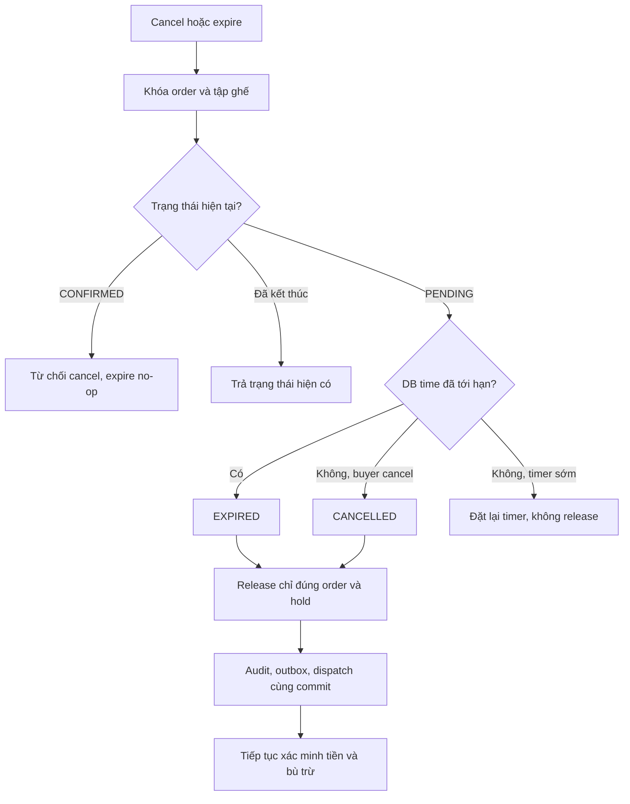

### 9.2. Transaction and retry

Lấy lock cùng chuẩn với confirm; pending tới hạn ưu tiên EXPIRED, trước hạn buyer cancel thành CANCELLED. Chỉ update ghế `status=HELD AND current_order_id=:orderId AND hold_id=:holdId`. Ghế đã cấp người mới hoặc SOLD không được release.

Đơn terminal trả kết quả cũ; CONFIRMED trả 409 ORDER_ALREADY_CONFIRMED cho cancel. Khóa row order khiến cancel và confirm có một nhánh thắng. Timer chậm không gia hạn vì confirm/hold mới luôn kiểm expiry tại DB.

Reconciliation lấy danh sách ID pending quá hạn theo index, rồi gọi ExpireOrder transaction chuẩn cho từng ID, không giữ khóa chọn batch rồi gọi HTTP. Nhiều worker có thể đọc cùng ID, transition idempotent bảo vệ. Tiền VERIFYING tiếp tục được Payment xử lý sau order terminal; không chờ Payment để release ghế.

## 10. Flow G — Compensation & Temporal lifecycle

### 10.1. Workflow contract

| Item | Design |
|---|---|
| Workflow ID | `order:{orderId}`; execution retry không đổi business order |
| Task queue | `booking-order` — tên đề xuất LLD |
| Input | orderId; activity đọc expiresAt/trạng thái DB làm nguồn |
| Signals | paymentChanged(eventId,attemptId,version), refundChanged(eventId,refundId,version), orderClosed, supportRequested |
| Activities | LoadOrderState, ConfirmOrder, ExpireOrder, RequestRefund, IssueTickets, MarkAttention |
| Timer | Theo expiry đã lưu; reload/restart/continue-as-new không cộng thêm 5 phút |

Workflow code không trực tiếp truy cập DB/HTTP, không dùng wall clock/random ngoài cơ chế workflow. Activities thực thi use case idempotent.

### 10.2. Visual flow

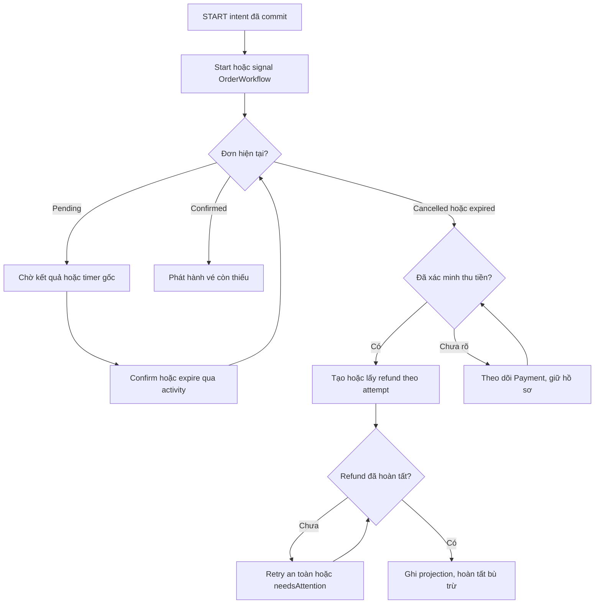

### 10.3. Refund contract and recovery

Booking gửi `attemptId, orderId, reason, operationKey=compensation:{attemptId}` tới Payment. Amount lấy từ khoản thu đã xác minh, hoàn toàn bộ; Payment là nơi cưỡng chế một nghĩa vụ/attempt. Response tiếp nhận không phải SUCCEEDED. Booking không tự đánh hoàn thành và không gửi request provider.

`workflow_dispatch` lưu START/signal/compensation trigger trong cùng transaction ra quyết định. Dispatcher claim với lease/token, commit claim rồi gọi Temporal; chỉ mark DELIVERED khi nhận ack. Nếu signal đến trước start, start-or-signal workflow theo ID xác định. Crash sau signal trước mark có thể lặp; activity kiểm DB.

Không đóng workflow chỉ vì timer hold kết thúc trong khi tiền chưa rõ. Khi execution đã đóng mà có event rất muộn, dispatcher vẫn giữ intent và dùng recovery execution với workflow ID business cũ theo reuse policy cấu hình; activity đọc DB hiện tại, không khôi phục hold. Continue-as-new khi history dài giữ orderId/expiry và reference cần thiết. Không phụ thuộc tập eventId tăng vô hạn trong memory: inbox và idempotent transition là lớp bảo vệ bền vững.

Nếu Payment hoặc Temporal không truy cập được, giữ pending work/needs_attention và thời điểm retry. Payment chịu query provider; Booking chỉ đọc trạng thái nội bộ/nhận sự kiện, không tạo vòng polling VNPAY thứ hai. Cấu hình retry/backoff/lease phải hữu hạn và quan sát được; chưa có ngưỡng SLA được chốt trong nguồn.

## 11. Flow H — Ticket issuance, owner access & email handoff

### 11.1. Trigger & conditions

Order CONFIRMED kích hoạt IssueTickets activity. Mỗi line phải có ghế SOLD thuộc order. Đọc metadata: GET `/api/v1/me/orders`, `/me/orders/{id}`, `/me/tickets/{id}`. Đọc QR: GET `/api/v1/me/tickets/{id}/qr`, trả PNG với `Cache-Control: no-store`.

### 11.2. Visual flow

```mermaid
sequenceDiagram
    participant W as OrderWorkflow
    participant T as Ticketing
    participant D as Booking DB
    participant N as Notification
    W->>T: IssueTickets(orderId)
    T->>D: Khóa order; xác minh CONFIRMED và SOLD
    loop Từng line chưa có vé
        T->>D: Tạo ticket, digest và token mã hóa
    end
    T->>D: Đủ vé: completion marker, grant, outbox
    T->>D: Commit
    D-->>N: Relay TicketSetIssued qua Kafka
    N->>T: Fetch content bằng grant và service identity
    T->>D: Kiểm grant, owner, recipient, đủ vé
    T-->>N: Nội dung email và QR cũ
```

Mũi tên DB → Notification biểu diễn relay outbox, không phải DB tự publish Kafka.

### 11.3. Issuance algorithm

- Khóa order để serialize các lần phát hành, đọc lines và ghế SOLD bất biến. Không gọi lại Inventory mutation hoặc giữ khóa seat từ ticketing theo thứ tự ngược.
- Với tối đa 4 vé/đơn, baseline tạo toàn bộ vé còn thiếu trong một transaction ngắn. Nếu dữ liệu đã có một phần do thao tác/recovery trước đó, lấy lại vé cũ và chỉ tạo thiếu.
- UK(order_item_id), UK(seat_id), UK(qr_digest) bảo vệ trùng. Token sinh một lần bằng nguồn random an toàn; mã hóa AEAD với nonce/keyId; digest phục vụ tra check-in. Retry không tạo token mới cho ticket cũ.
- Khi số vé bằng seat_count, set `tickets_completed_at` nếu chưa có, tạo grant `TICKET_SET:{orderId}`, ghi TicketSetIssued cùng transaction. Mỗi ticket mới có TicketIssued fact cho Report. Nếu marker đã có thì no-op.
- Khi lỗi phát hành, đơn vẫn CONFIRMED và ghế SOLD; retry/needs_attention. Không refund vì lỗi QR/email.

### 11.4. Owner access and email grant

Owner endpoint kiểm token subject bằng booking_order.buyer_subject, kể cả biết ticket UUID. Không đưa QR vào URL query, log, audit, event hoặc support DTO. Không public bucket, không persist ảnh/PDF vé. Mất khóa giải mã làm tạm không dựng được QR, không phát token khác để che lỗi; key rotation re-encrypt token cũ.

API nội bộ `GET /internal/v1/ticket-email-grants/{grantId}/content` chỉ cho Notification service có scope riêng. Booking xác minh grant active, order confirmed/đủ vé, owner và recipient khớp snapshot, rồi trả recipient cùng nội dung QR. Grant ID không thay service authentication. Retry nhiều lần được phép để xử lý email lỗi. Không có endpoint nội bộ lấy QR theo orderId tùy ý mà bỏ qua grant.

Admin yêu cầu resend tạo operation + grant/business key mới, dùng cùng QR và email verified của đơn. Lịch sử gửi chỉ lấy metadata từ Notification, không email HTML/PNG. Người mua có vai trò admin vẫn chỉ dùng buyer endpoint cho vé của chính mình; quyền admin không cấp quyền QR của người khác.

### 11.5. Error model

404 không có vé hoặc không phải owner; 409 TICKETS_NOT_READY; 403 service không được đọc grant; 503 QR_UNAVAILABLE khi crypto/render dependency lỗi. Email timeout được Notification xử lý, không chuyển order/ticket sang thất bại.

## 12. Flow I — Check-in & support

### 12.1. Check-in runtime contract

`POST /api/v1/check-ins`:

```json
{
  "performanceId": "<uuid>",
  "gateId": "<uuid>",
  "qrToken": "<opaque-token>"
}
```

Token trong request body được redact. Cần CHECKIN_STAFF + assignment active, gate enabled của suất, `checkinOpen <= dbTime < checkinClose`.

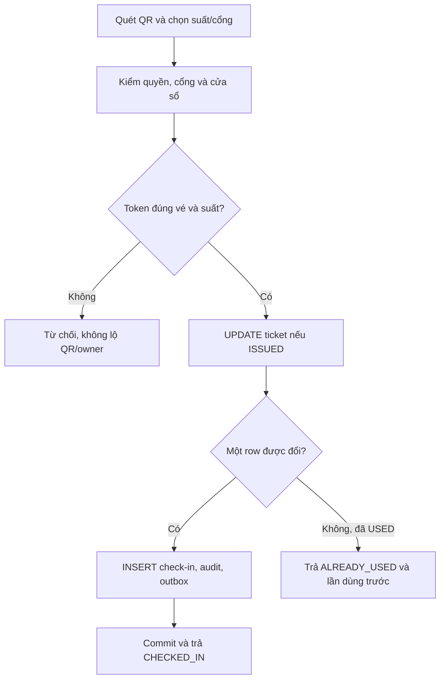

### 12.2. Transaction / race behavior

1. Parse/limit token, digest để lookup ticket; chưa trả metadata trước kiểm scope.
2. Transaction giữ shared lock performance, assignment và gate theo thứ tự ở mục 13; xác minh active/enabled, lấy giờ DB.
3. Khóa ticket rồi kiểm lại cửa sổ theo DB time sau chờ ticket lock; xác nhận performance khớp. Update ISSUED → USED có điều kiện.
4. Nếu thắng, insert ticket_checkin PK(ticket_id), audit và TicketCheckedIn outbox trong cùng transaction. Row check-in không được insert khi update không thắng.
5. Nếu USED, đọc lần check-in trước đã commit; trả ALREADY_USED. Không reset vé, không insert lần vào mới.

Hai cổng đồng thời chỉ một lần thành công. Sau mất response, quét lại trả thông tin lần dùng cũ. Scan fail do lỗi DB/mạng là UNVERIFIABLE, không phải vé giả.

| Result | HTTP | Data |
|---|---|---|
| CHECKED_IN | 200 | ticketCode, seatLabel, usedAt, gateId |
| ALREADY_USED | 409 | usedAt, previousGateId; không token |
| INVALID_QR / WRONG_PERFORMANCE | 422 | Lý do phù hợp, không owner/QR |
| OUTSIDE_CHECKIN_WINDOW / GATE_DISABLED | 409 | Không ghi dùng |
| FORBIDDEN | 403 | Không được phân công |
| UNVERIFIABLE | 503 | Chưa thể quyết định, không cho qua offline |

### 12.3. Support lookup and actions

| Endpoint | Contract |
|---|---|
| GET `/support/orders` | Một tiêu chí exact: orderCode, ticketCode, paymentRef, refundRef, buyerSubject hoặc buyerEmail; phân trang |
| GET `/support/orders/{id}` | Metadata đơn/tiền/vé/email trong scope; không QR |
| POST `/support/operations` | orderId, action, targetReference, reason; Idempotency-Key |
| GET `/support/operations/{id}` | Trạng thái xử lý và reference nguồn |
| GET `/admin/audits` | entityType/id, actor, from/to, cursor; scope bắt buộc |

Organizer chỉ đọc đơn của mình. Admin action cần scope support; không tự coi ADMIN là quyền toàn bộ organizer. Nếu lookup từ payment/refund reference, Payment resolve order nội bộ rồi Booking kiểm scope trước trả. Buyer email khớp chính xác với snapshot chuẩn hóa, không fuzzy search xuyên organizer.

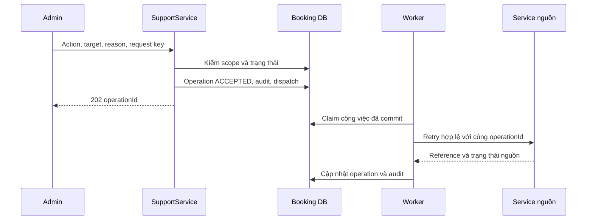

Actions: VERIFY_PAYMENT, RETRY_REFUND, ISSUE_MISSING_TICKETS, RESEND_EMAIL. Worker kiểm lại trạng thái khi thực thi. VERIFY_PAYMENT COMPLETED nghĩa là yêu cầu đối chiếu đã được thực hiện/tiếp nhận có kết quả theo contract; DTO luôn giữ paymentStatus nguồn riêng. Không gọi một refund “đã hoàn” khi mới nhận retry.

Resend email refund sử dụng reference refund SUCCEEDED và recipient nguồn, không cấp grant QR nếu không gửi vé. Email vé dùng ticket_email_grant. 409 ACTION_NOT_ALLOWED cho ép confirm, refund chưa đủ điều kiện, đổi recipient hoặc reset check-in. Audit từ chối được ghi bằng transaction riêng sau rollback.

## 13. Idempotency, concurrency & transactions

### 13.1. Idempotency flow

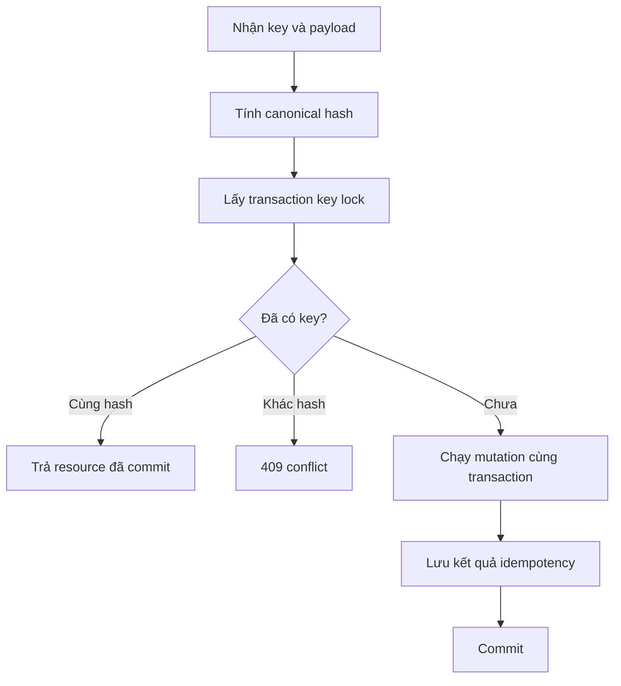

Checkout/cancel/support dùng bảng idempotency_record của Booking. Advisory lock transaction dùng hash64(actor,operation,key); sau khóa vẫn so key đầy đủ và request hash. Unique PK là rào chắn cuối. Không commit IN_PROGRESS row khi chưa tạo kết quả. Lỗi trước commit rollback key; retry dùng lại key cũ. `X-Correlation-Id` chỉ để trace, không thay Idempotency-Key.

HTTP gọi Payment không nằm trong transaction idempotency giữ row lock. Payment operationKey được suy ra ổn định từ order + actor + request key; Payment sở hữu durable result cho operation thu/hoàn. Không lấy cache Redis làm chứng cứ đã/ chưa thu.

### 13.2. Lock order

Isolation baseline: READ COMMITTED. Thao tác luôn đọc lại trạng thái sau khóa; không dùng entity đã đọc ngoài transaction để quyết định ghi.

**Thứ tự chung cho inventory/order:**

1. Advisory idempotency lock nếu có.
2. Scope rows nếu thao tác đặc quyền: organizer rồi membership; không giữ các khóa này khi gọi Identity/HTTP.
3. Concert: FOR SHARE cho hold/confirm/close; FOR UPDATE cho đổi cấu hình/public snapshot.
4. Performance: FOR SHARE cho hold/confirm/close; FOR UPDATE khi sửa lịch/cổng/configuration.
5. Order: FOR UPDATE nếu đơn đã tồn tại; checkout tạo order mới.
6. Các performance_seat: FOR UPDATE theo ID tăng dần.

**Các trường hợp riêng:**

| Operation | Lock / rule |
|---|---|
| Checkout | Shared catalog/performance + row locks tập ghế; các đơn chọn ghế rời nhau có thể chạy đồng thời |
| Change price/map | Exclusive concert/performance rồi cùng seat locks; không chạy HTTP trong khóa |
| Confirm/cancel/expire | Shared catalog/performance → order → seats; không khóa đơn cũ khi tái cấp ghế |
| Issue tickets | Order → insert/find tickets; không quay lại khóa catalog/seats. Chỉ đọc SOLD vì không có sold rollback trong MVP |
| Check-in | Performance SHARE → assignment SHARE → performance_gate SHARE → ticket UPDATE |
| Revoke assignment/gate | Performance UPDATE → assignment/gate UPDATE; không lấy ticket lock |
| Payment consumer | Inbox/own projection; chỉ đọc FK order, không update order hoặc khóa seat. Ghi dispatch để activity thực hiện |

Shared lock concert/performance bảo vệ điều kiện cấu hình nhưng không serialize mọi lượt hold của suất bằng exclusive performance lock. Performance/cấu hình chỉ có một tuyến mutation theo thứ tự trên. Assignment/member dùng active flag, không xóa parent khi đang giữ khóa con.

### 13.3. Time and commit point

`clock_timestamp()` lấy sau đủ row locks. Quyết định confirm cần `decisionTime < expiresAt`; đúng bằng expiry là hết hạn. Không dùng `now()`/transaction start time khi đã chờ khóa. Điểm chốt nghiệp vụ là update có điều kiện trong transaction ngắn rồi commit; không giữ transaction tới khi publish/email hoàn tất.

Ghế HELD quá hạn có thể được hold mới ghi đè; cleanup cũ không được sửa row đó vì điều kiện owner/hold không còn khớp. Một phần quyền hold mất trước hạn dẫn CANCELLED + attention + release phần còn đúng chủ + compensation trigger; không “sửa cho đủ” bằng ghế khác.

### 13.4. Database-enforced invariants

```sql
-- Minh họa ràng buộc; toàn bộ bảng được tạo qua Liquibase.
CREATE UNIQUE INDEX ux_ticket_order_item
    ON booking.ticket(order_item_id);
CREATE UNIQUE INDEX ux_ticket_seat
    ON booking.ticket(seat_id);

-- Check-in transaction đã giữ quyền/cửa sổ hợp lệ.
UPDATE booking.ticket
SET status = 'USED', used_at = :dbTime,
    updated_at = :dbTime, version = version + 1
WHERE id = :ticketId AND status = 'ISSUED'
RETURNING id;
-- Chỉ khi trả một row: INSERT ticket_checkin + audit + outbox.
-- Các ghi này cùng transaction, bất kỳ lỗi nào đều rollback.
```

CHECK/UK bảo vệ cấu trúc và trùng ID; tổng lines/giá, confirmed payment và điều kiện hold liên bảng được kiểm use case dưới khóa. Không tuyên bố SQL CHECK đơn lẻ cưỡng chế được mọi bất biến liên bảng. Application DB role không cho service khác ghi chéo.

Lock timeout, transaction timeout và deadlock retry phải hữu hạn, cấu hình. Khi deadlock/timeout: rollback, retry có giới hạn cùng idempotency key; hết budget trả BUSY. Không tự retry một call provider như thể nó đã rollback cùng DB.

## 14. Auth & security boundaries

| Surface | Policy |
|---|---|
| Public catalog | Chỉ PUBLISHED tại thời điểm kiểm nguồn |
| Buyer writes | Token hợp lệ; owner; email/phone verified cho checkout |
| Organizer writes | ORGANIZER + membership MANAGE; object cùng organizer |
| Check-in | CHECKIN_STAFF + active assignment; gate và window |
| Support | ADMIN + support scope; action whitelist; lý do bắt buộc |
| Owner QR | Owner endpoint riêng; admin role không bypass |
| Internal APIs | Service identity, issuer/audience/expiry, scope theo từng consumer |
| Payment ingress | Kafka ACL/producer trusted; schema và dữ liệu kiểm lại; Booking không public IPN |

Booking không lưu password/OTP, không giữ secret merchant VNPAY. QR key ngoài DB; backup DB cần đi cùng khả năng khôi phục khóa có kiểm soát. Truy cập hạ tầng DB/Mailpit khác quyền admin ứng dụng. Log body endpoint QR/check-in, Authorization header và payload email phải redact.

Thu hồi scope được kiểm trực tiếp ở thao tác đặc quyền. Identity token hợp lệ vẫn phải qua scope/owner kiểm tại Booking. Dev profile không được bật ở demo public/tunnel nghiệp vụ hoàn chỉnh theo HLD.

## 15. API reference & integration contracts

### 15.1. Common REST conventions

- Prefix ngoài `/api/v1`; endpoint nội bộ có `/internal/v1` riêng. `/me` lấy subject từ token.
- Timestamp ISO-8601 UTC; tiền integer VND; UUID chuỗi. Phân trang cursor + limit có giới hạn cấu hình.
- Error: `{code,message,correlationId,retryable,details}`; không stacktrace hoặc dữ liệu trái scope.
- 400 malformed JSON; 401 authentication; 403 role; 404 không tồn tại/ngoài object scope; 409 state/version/idempotency; 422 validation; 429 rate limit; 503 chưa thể xử lý an toàn.
- 202 là accepted async, có operationId; không đồng nghĩa thu/hoàn/phát hành hoàn tất.
- Query nhiều nguồn trả trạng thái từng nguồn với `available`, `lastUpdatedAt`; không gán FAILED khi Payment/Notification tạm unavailable.

### 15.2. Payment port

| Operation | Request | Expected result / idempotency |
|---|---|---|
| CreateOrGetAttempt | orderId, amountVnd, currency, scope, holdExpiresAt, operationKey | attemptId, status, paymentUrl?; cùng key/hash trả attempt cũ |
| GetOrderPayments | orderId | Attempts/refunds và version; không secret/provider raw payload |
| RequestFullRefund | orderId, attemptId, reason, operationKey | refundId, state; duy nhất theo khoản thu |
| VerifyPayment / RetryRefund | reference, supportOperationId, reason | Reference theo dõi; kiểm trạng thái tại Payment |
| ResolveReference | payment/refund reference | orderId để Booking kiểm scope trước trả client |

Timeout hữu hạn, retry chỉ ở thao tác idempotent. Trước call không giữ row lock. Giữa kiểm Booking và call Payment có thể xảy ra cancel/expire; khoản thu tới sau được bù trừ, không giả định có atomic transaction xuyên service.

### 15.3. Notification, Search và Report ports

| Consumer | API/event Booking cung cấp | Limit |
|---|---|---|
| Notification | TicketSetIssued, EmailResendRequested; grant content endpoint | QR chỉ qua service endpoint có binding owner/recipient/purpose |
| Notification | `/internal/v1/orders/{id}/notification-recipient` | Trả email snapshot cho thông báo refund hợp lệ; kiểm notification type và reference bằng Payment khi cần, không cho tùy ý đọc PII |
| Search | CatalogSnapshotChanged; resolve-public; snapshots | Snapshot revision + tombstone; không truy cập DB Booking |
| Report | Order/Ticket/Seat facts; inventory baseline export | Không QR/email; không sửa nguồn |
| Payment/Report/Notification | authorization/check | Fail-closed khi không xác minh scope |
| Support query | Read-only adapter tới Payment/Notification | Chỉ metadata; giới hạn timeout và đánh nguồn unavailable |

API baseline `/internal/v1/performances/{id}/inventory-snapshot` trả tất cả seat state/config/version cùng một snapshot DB tại `asOf`; chia trang phải dùng snapshot/export session cố định, không ghép các lần đọc live thành một snapshot giả. Với baseline local có thể stream một suất trong transaction read-only nhất quán với giới hạn kích thước; nếu vượt giới hạn, thiết kế export session trước khi mở endpoint cho tải lớn.

### 15.4. Event envelope

```json
{
  "eventId": "<uuid>",
  "eventType": "OrderConfirmed",
  "schemaVersion": 1,
  "producer": "booking",
  "aggregateType": "Order",
  "aggregateId": "<orderId>",
  "aggregateVersion": 2,
  "occurredAt": "2026-11-04T03:00:00Z",
  "correlationId": "<uuid>",
  "causationId": "<event-or-request-id>",
  "payload": {}
}
```

Tên topic dưới đây là đề xuất contract của LLD Booking; cần thống nhất khi làm LLD các service consumer.

| Topic / key | Events | Required payload |
|---|---|---|
| `booking.catalog.v1` / concertId | CatalogSnapshotChanged | concertId, organizerId, catalogRevision, isPublic, nội dung và các suất; HIDDEN giữ tombstone/version |
| `booking.seat.v1` / seatId | SeatStateChanged | seatId, performanceId, organizerId, seatVersion, enabled, statusAfter, sectionId, rowLabel, seatNumber, priceVnd, effectiveAt, causeOrderId? |
| `booking.order.v1` / orderId | OrderCreated, OrderConfirmed, OrderClosed | orderId, scope, status, totalVnd, currency, seatCount, expiry, confirmedAttemptId?/reason? |
| `booking.ticket.v1` / orderId | TicketIssued | ticketId, orderId, seatId, scope, issuedAt |
| `booking.ticket.v1` / orderId | TicketSetIssued | orderId, count, grantId, businessKey |
| `booking.ticket.v1` / orderId | TicketCheckedIn | ticketId, orderId, performanceId, organizerId, gateId, usedAt |
| `booking.notification.v1` / orderId | EmailResendRequested | operationId, orderId, notificationType, businessKey, grantId? hoặc refundId |
| `payment.payment.v1` / orderId | PaymentStateChanged — Booking nhận | attemptId, orderId, amountVnd, currency, status, paidAt?, verifiedAt?, sourceVersion |
| `payment.refund.v1` / orderId | RefundStateChanged — Booking nhận | refundId, attemptId, orderId, amountVnd, status, refundedAt?, sourceVersion |

SeatStateChanged phát full after-state từ lúc tạo seat và mọi thay đổi giá/cấu hình/quyền; Report dùng per-seat version, không sum tất cả event như giao dịch mới. Tử/mẫu occupancy được tái dựng cùng effective time và watermark; gap version cần replay/baseline. Không hard-delete ghế làm mất lịch sử mẫu số. Baseline export không thay lịch sử cũ khi cần tái dựng ngày trước đó.

Không phát raw QR, OTP, password, access token. Recipient email lấy qua API được cấp quyền, không cần đặt trong topic dùng chung. Event aggregateVersion phải thuộc đúng aggregate; không so version refund với payment hoặc ticket với order chỉ vì cùng partition key.

### 15.5. Outbox/inbox delivery

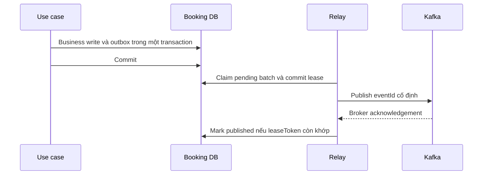

Relay dùng `FOR UPDATE SKIP LOCKED`, lease token để ngăn worker cũ ghi đè claim mới. Publish ngoài transaction. Crash sau ack trước mark gây phát lặp, không mất event. Multi-worker có thể đổi thứ tự; consumer phải xử lý version/idempotency, không dựa hoàn toàn vào partition ordering. Work không giải quyết được chuyển attention/quarantine, vẫn giữ payload/reference và đường replay có audit.

## 16. Observability & failure modes

### 16.1. Mechanism map

| Area | Signals |
|---|---|
| Hold | success/conflict/rate-limit/busy; hold age; DB lock wait/deadlock; oversell invariant |
| Order/payment | pending quá hạn; payment success chưa confirm/refund; needs_attention |
| Temporal | start/signal backlog; oldest workflow_dispatch; activity retry; timer lag |
| Outbox/inbox | oldest pending age; retry; consumer lag; quarantine count |
| Ticketing | confirmed order thiếu vé; QR crypto error; duplicated check-in attempts |
| Security/support | scope rejection; grant access rejected; retry audit |
| Runtime | HTTP latency/5xx, Hikari pool, DB queries, heap/GC, disk |

Structured log tối thiểu: service, operation, correlationId, causationId, orderId/attemptId/ticketId khi phù hợp, outcome, errorCode, duration. Truyền trace rõ qua Kafka/Temporal activity/executor; không chỉ dựa ThreadLocal. ID cụ thể dùng log/traces, không làm Prometheus label có cardinality cao.

### 16.2. Failure behavior

| Failure point | Recovery / expected result |
|---|---|
| DB fail trước commit hold | Rollback; retry cùng key |
| Commit hold rồi crash trước Temporal | START dispatch còn; expiry vẫn là hạn gốc |
| DB commit confirmation rồi activity response mất | Retry thấy CONFIRMED cùng attempt, no-op |
| Signal đã gửi nhưng chưa mark delivered | Gửi lặp được, không tạo tác động lần hai |
| Payment success tới sau cancel/expiry | Giữ terminal, yêu cầu refund toàn bộ |
| Payment chưa rõ | Không confirm/thu lại; tiếp tục đối chiếu nguồn |
| Kafka lỗi | Business commit có outbox; side effect trễ, cần cảnh báo tuổi backlog |
| Temporal lỗi | Hold không gia hạn; expiry reconciliation còn hoạt động |
| Redis lỗi | Hold mới fail-closed nếu không có rate limit tin cậy; đọc đơn/check-in tiếp tục theo DB |
| Issue QR/email lỗi | Giữ CONFIRMED/SOLD, retry vé/email; không refund |
| Check-in commit rồi mất response | Scan sau ALREADY_USED, cùng gate/time cũ |
| Search/Report lỗi | Không chặn checkout; catalog fallback tại Booking |
| Authorization không xác minh được | Từ chối thao tác đặc quyền |

### 16.3. Design verification scenarios

Các tình huống E2E/load/fault từ SRS dùng để kiểm chứng thiết kế, không phải bộ unit test bổ sung:

- Hai buyer tranh cùng ghế; tập 4 có 1 ghế bận phải rollback cả tập.
- Retry checkout cùng key, đổi payload, reload nhiều tab không đổi expiry/giá.
- Chờ row lock qua expiry rồi nhận payment success: không confirm.
- Hold mới chiếm ghế quá hạn rồi timer cũ chạy: không release owner mới.
- Cancel cạnh tranh confirm; kết quả không thể vừa hủy vừa bán.
- Restart tại các khoảng DB → Temporal/Kafka; replay event cũ/đảo thứ tự không lùi trạng thái.
- Đơn đã có một phần vé: issue lại lấy đúng vé cũ, cuối cùng đủ 1 vé/seat.
- Nhiều cổng scan một token: một ticket_checkin; mất response không thêm lượt vào.
- Admin/organizer đoán ticket/grant ID không lấy được QR; resend không đổi recipient.
- Hide concert trong khi Search còn snapshot cũ: resolve-public loại nội dung đã ẩn.

Ghi dataset, phiên bản, môi trường, workload, điểm fault, p50/p95/p99 và đối chiếu ghế/đơn/tiền/vé/check-in. Ngưỡng TPS/latency, retry/rate limit, timeout/lease và retention chưa được nguồn chốt; cấu hình và đo trước khi tuyên bố đạt.

## 17. Migration & requirement traceability

### 17.1. Liquibase order

1. Tạo schema, organizer/membership, venue/gate, concert/performance, gate/assignment.
2. Tạo section và seat nhưng chưa thêm FK seat → order.
3. Tạo order, item, bổ sung composite UK và FK current_order/hold; tạo projection.
4. Tạo ticket/check-in, email grant, support operation.
5. Tạo idempotency, inbox/outbox, workflow dispatch, audit và indexes/checks còn lại.
6. Seed dữ liệu demo riêng profile local; không trộn reset dữ liệu vào migration nghiệp vụ.

Không sửa change set đã chạy; thêm change set mới. DB Keycloak/Temporal do sản phẩm quản lý, không join hoặc migration từ Booking. Ràng buộc FK vòng tạo sau khi đủ bảng. Không có tự động xóa đơn/tiền/audit còn cần đối chiếu.

### 17.2. Traceability

| Source requirements | Booking design |
|---|---|
| FR-01/02, PF-01 | Flow A; Identity claims, membership/assignment, security boundary |
| FR-03/04, PF-02 | Flow B; concert/performance/seat config và audit |
| FR-05/06, PF-03 | Flow C; fallback/public validation, seat map |
| FR-07/08/19, PF-03 | Flow D; atomic hold/order, idempotency, rate limit |
| FR-09, PF-04 | Flow E; Payment port, projection, confirmation transaction |
| FR-10, PF-05 | Flow F; cancel/expire và conditional release |
| FR-11, PF-06 | Flow G; durable compensation, Payment sở hữu refund |
| FR-12/13/15, PF-07 | Flow H; owner QR, issuance, grant và Notification handoff |
| FR-14, PF-08 | Flow I check-in; unique use và scope/cửa sổ |
| FR-16/18, PF-09 | Flow I support; operation, audit, metadata-only lookup |
| FR-17, PF-10 | Mục 15; facts/config history cho Report, không tính báo cáo trong Booking |
| FR-20, PF-11 | Mục 10/13/15/16; retry, durable delivery, fault/recovery |

### 17.3. Review points trước implementation

- Xác nhận tên API/event và payload với LLD Payment/Notification/Search/Report khi các tài liệu đó được thiết kế. Các hợp đồng ở đây là nhu cầu phía Booking.
- Pin phiên bản runtime, adapter/SPI và cấu hình realm; mapping email/phone verified phải kiểm chứng trong tích hợp Identity.
- Chốt giá trị vận hành sau baseline: page limits, rate limit, transaction/lock/HTTP timeout, retry budget, lease, cảnh báo backlog.
- Xác nhận merchant sandbox có query/refund và phương thức QR; Booking giữ thiết kế bù trừ, không giả định Payment đã tích hợp thành công.
- Đồng bộ các AC cũ về PDF/lọc giá/simulator trong SRS theo HLD khi review bộ tài liệu; không đưa các tính năng đã bỏ vào Booking.

Bản LLD này là đầu vào thiết kế/triển khai Booking. Chưa có migration chạy thực tế, API implementation hoặc kết quả load/integration trong lần bàn giao tài liệu.
