# Concert Ticketing — Process Flowchart

**Góc nhìn:** Business Analyst · **Phiên bản:** 1.0 · **Ngày:** 03/11/2026  
**Nguồn:** BRD-Concert-Ticketing.md, phiên bản 1.0 ngày 03/11/2026 trong project sources.

## 1. Phạm vi và cách đọc

Tài liệu mô tả thao tác người dùng, trách nhiệm hệ thống, dữ liệu trao đổi và các nhánh ngoại lệ của toàn bộ MVP. Không bổ sung service hay thay đổi quy tắc BRD. Các tên trạng thái và nhóm dữ liệu dưới đây là tên nghiệp vụ để thiết kế tiếp, chưa phải enum, schema hoặc API contract đã chốt.

Các flowchart Mermaid mô phỏng BPMN: khung là lane trách nhiệm; hình tròn là sự kiện; hình chữ nhật là tác vụ; hình thoi là quyết định XOR; hình trụ là dữ liệu lưu trữ. Mũi tên liền chỉ trình tự hoặc yêu cầu/kết quả liên vai trò có nhãn; nét đứt chỉ dữ liệu/sự kiện bất đồng bộ, không phải bước bắt buộc chờ. Đây không phải mô hình BPMN 2.0 XML; Mermaid không thể hiện đầy đủ semantics pool/message flow/boundary event. Các cuộc đua đồng thời được diễn giải rõ trong phần ghi chú.

| Luồng | Nội dung | Kết quả chính |
|---|---|---|
| PF-01 | Tài khoản và phân quyền | Danh tính và phạm vi truy cập hợp lệ |
| PF-02 | Quản lý concert và mở bán | Concert công bố; suất diễn có ghế, giá, lịch bán |
| PF-03 | Tìm kiếm, chọn và giữ ghế | Đơn chờ thanh toán; giữ 1–4 ghế trong 5 phút |
| PF-04 | Thanh toán và xác nhận | Đơn xác nhận hoặc chuyển xác minh/hoàn tiền |
| PF-05 | Hủy, hết hạn và cạnh tranh | Một kết quả cuối nhất quán; ghế được giải phóng đúng |
| PF-06 | Hoàn tiền bù trừ | Hoàn toàn bộ hoặc tiếp tục theo dõi/cần hỗ trợ |
| PF-07 | Vé, file vé và email | Vé thuộc khách; tác vụ phụ có thể retry |
| PF-08 | Check-in online | Mỗi vé sử dụng thành công một lần |
| PF-09 | Tra cứu và hỗ trợ | Xử lý hợp lệ, có audit và kiểm soát quyền |
| PF-10 | Báo cáo | Chỉ số đúng, có mốc cập nhật dữ liệu |
| PF-11 | Phục hồi khi có lỗi | Giao dịch không bị mất và có thể đối chiếu |

## 2. PF-01 — Tài khoản và phân quyền

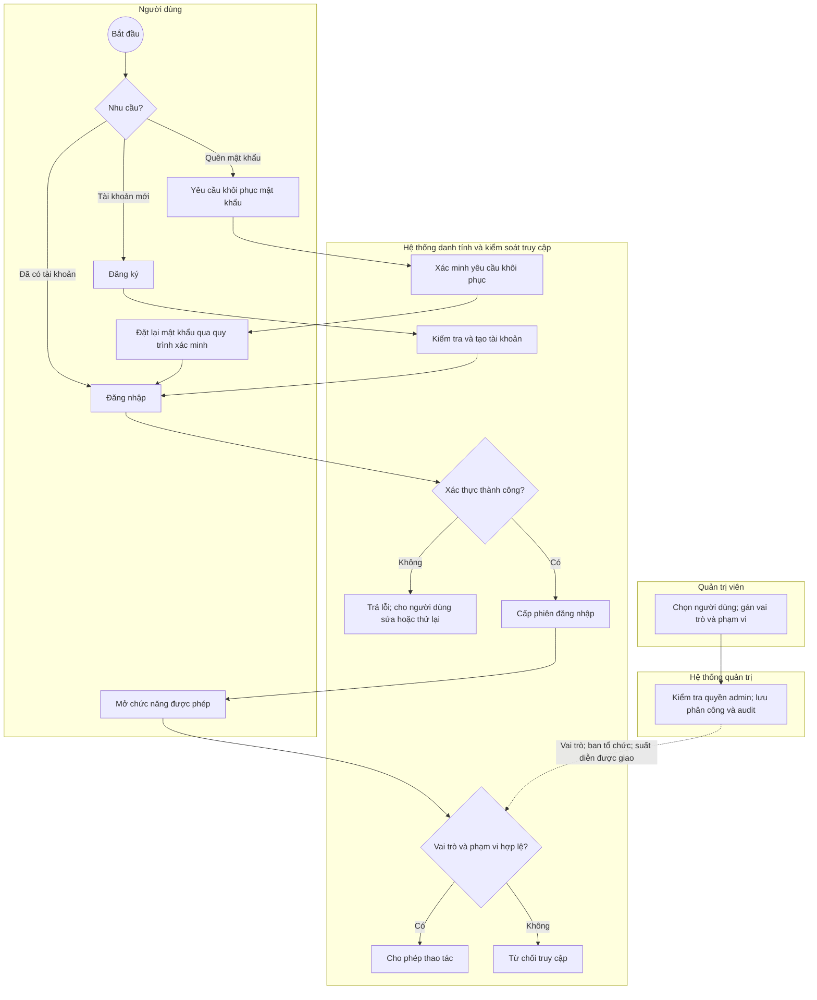

Khách chưa đăng nhập vẫn được xem concert ở PF-03. Kiểm tra quyền phải thực hiện trên từng đối tượng, không chỉ khi mở màn hình: khách chỉ xem đơn/vé của mình; ban tổ chức chỉ xem dữ liệu thuộc mình; nhân viên chỉ check-in suất diễn được giao. Hệ thống danh tính là năng lực hỗ trợ, không phải service nghiệp vụ thứ sáu. Cơ chế xác minh đăng ký/khôi phục cụ thể chưa được BRD quy định.

## 3. PF-02 — Thiết lập concert, công bố và đóng bán

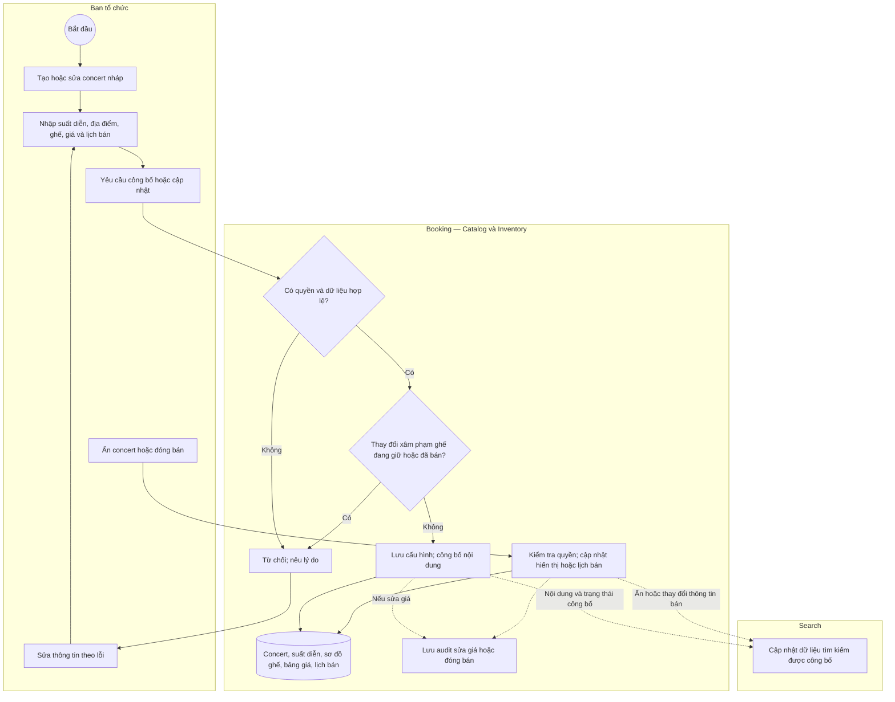

Mỗi suất diễn có **một khoảng mở–đóng bán**. Booking kiểm tra giờ máy chủ khi nhận yêu cầu đặt mới, không chỉ dựa vào nhãn “đang mở bán” trên giao diện. Đổi giá chỉ tác động đơn mới; đơn đang giữ hợp lệ và đơn đã xác nhận giữ nguyên giá chốt. Ẩn/đóng bán không đồng nghĩa hủy concert hoặc tự hủy đơn đã xác nhận. Chính sách tác động của đóng bán sớm lên giữ chỗ đang tồn tại cần làm rõ trước khi bổ sung hành vi ngoài BRD.

## 4. PF-03 — Tìm concert, chọn ghế và tạo đơn

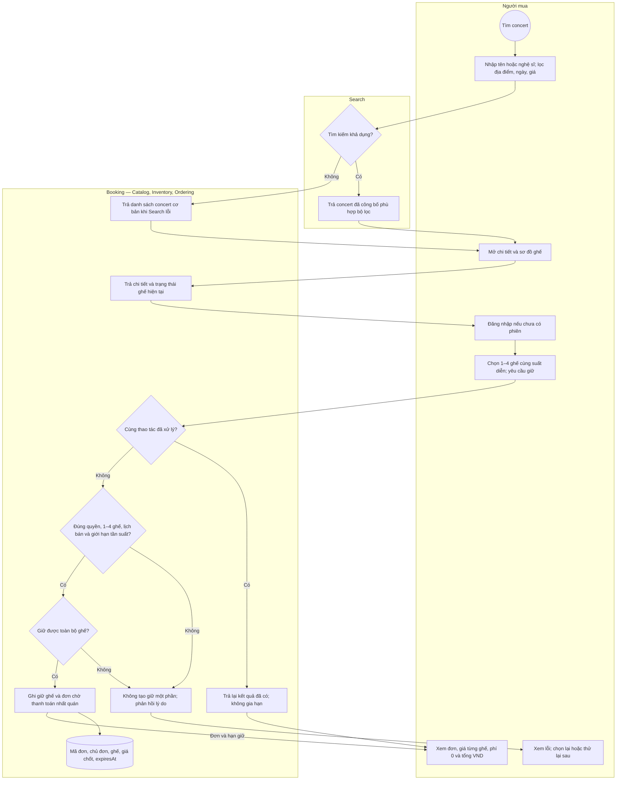

**Dữ liệu vào:** danh tính, suất diễn, danh sách ghế, định danh thao tác để nhận diện gửi lại. **Dữ liệu ra:** mã đơn, ghế, giá chốt, tổng tiền, thời điểm hết hạn. Tên trường cụ thể sẽ xác định trong thiết kế API.

Giữ ghế và tạo đơn là một kết quả nghiệp vụ nhất quán: lỗi giữa quá trình không được để lại giữ chỗ một phần hoặc đơn không có đủ ghế. Thời hạn = thời điểm giữ thành công + 5 phút theo máy chủ. Reload/đổi tab/gửi lại không cộng thêm thời gian. Trạng thái ghế đã xem có thể cũ; bước giữ phải kiểm tra lại. Khi quá tải, trả phản hồi hữu hạn, rõ ràng; các ngưỡng vận hành chưa được chốt.

## 5. PF-04 — Thanh toán, xác minh và xác nhận đơn

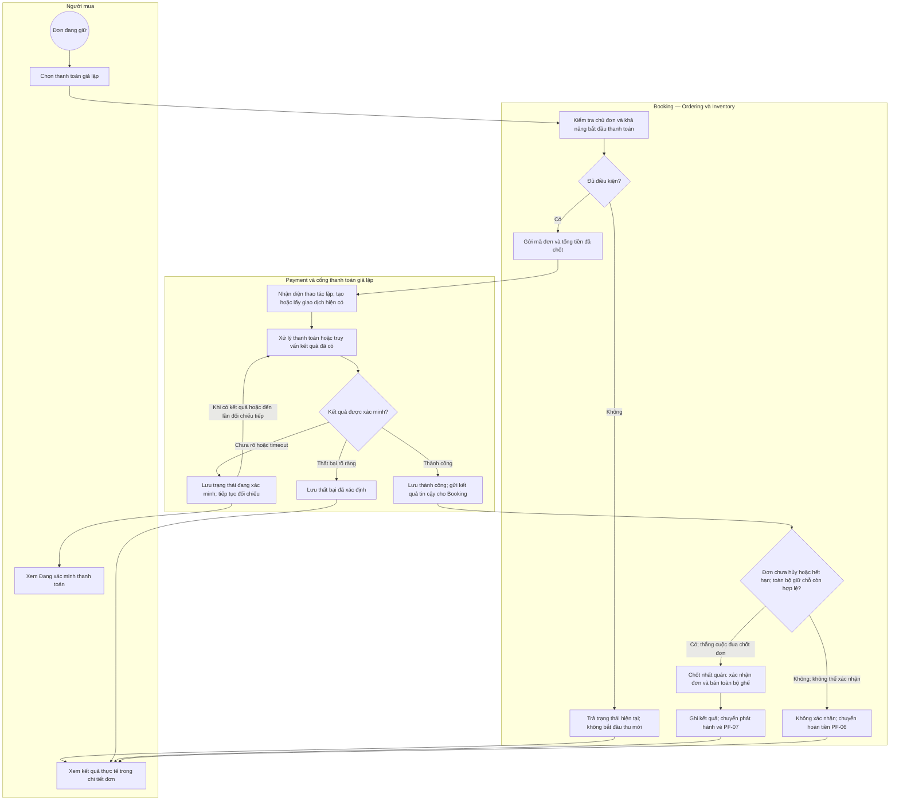

Trong khi xác minh, **PF-05 vẫn chạy theo hạn giữ**, không chờ Payment. Timeout hoặc thông báo trên trình duyệt không đủ để kết luận thất bại/thành công. Payment xác minh kết quả gắn đúng giao dịch, đơn và số tiền; Booking xử lý kết quả lặp theo trạng thái đã có, không phát hành vé hoặc hoàn tiền thêm.

Nếu đơn đã xác nhận, kết quả thành công lặp chỉ trả kết quả cũ, không đi vào nhánh hoàn tiền. Nếu thanh toán thất bại rõ ràng, việc giữ chỗ vẫn chịu hạn 5 phút và thao tác hủy; sơ đồ không tự thêm chính sách gia hạn hoặc giải phóng ngay. Việc cho tạo lần thanh toán mới sau thất bại cần quy định rõ khi thiết kế chi tiết, tuyệt đối không thu mới khi kết quả cũ còn chưa rõ.

## 6. PF-05 — Hủy, hết hạn và cạnh tranh với thanh toán

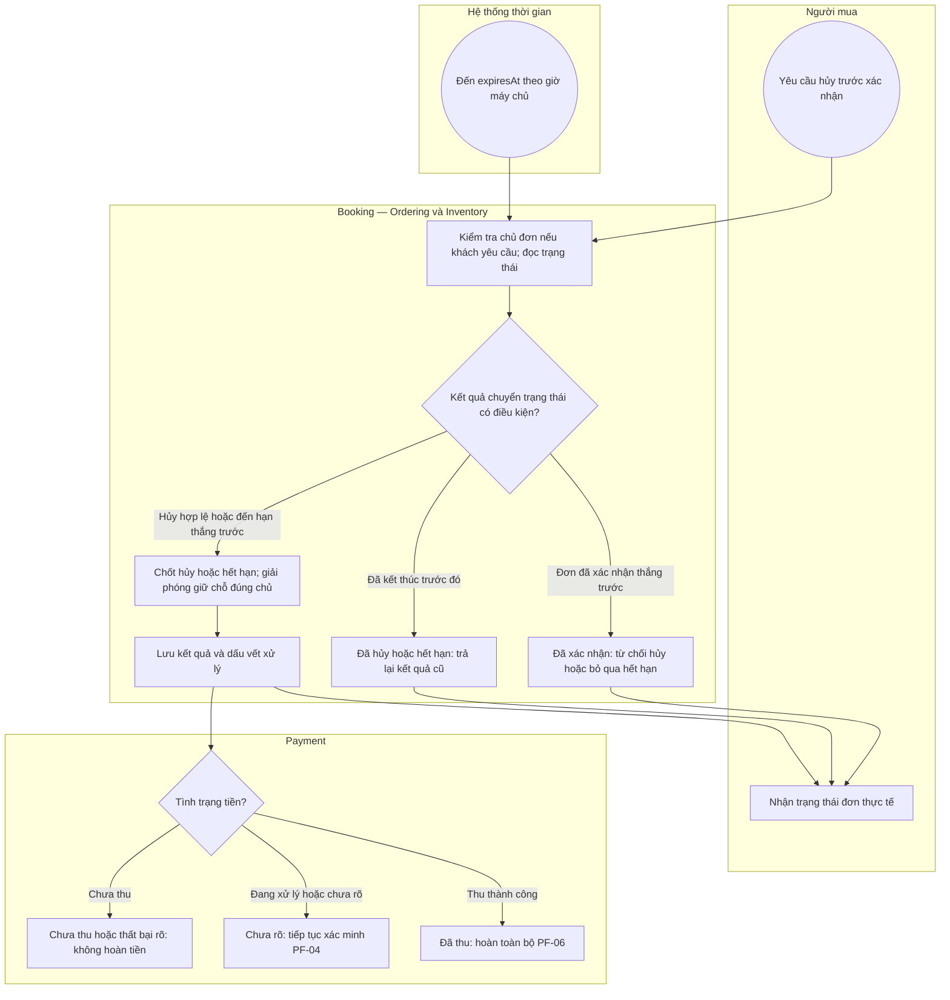

PF-04 và PF-05 cùng tranh quyền chuyển trạng thái của một đơn: chỉ một kết quả chốt được chấp nhận. Xác nhận chỉ hợp lệ nếu tại thời điểm chốt còn quyền giữ toàn bộ ghế và chưa hết hạn. Tác vụ hết hạn chạy chậm không làm kéo dài quyền giữ. Tác vụ cũ không được giải phóng ghế đã chuyển sang người giữ khác. Thanh toán đến muộn không phục hồi đơn đã hết hạn/hủy; tiếp tục xác minh tiền độc lập với trạng thái đơn.

## 7. PF-06 — Hoàn tiền bù trừ

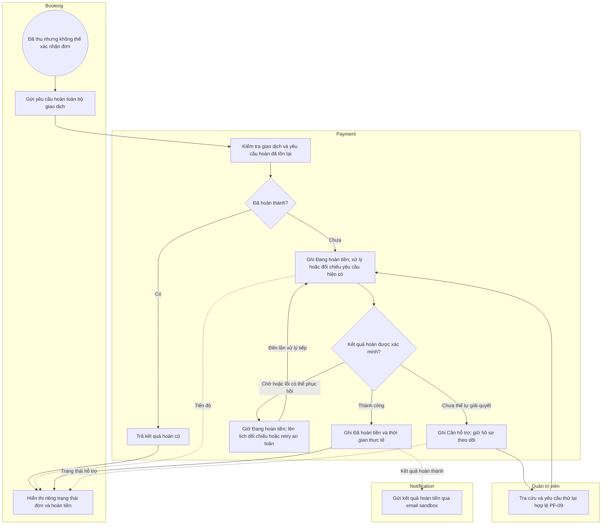

Hoàn **toàn bộ số tiền đã thu**, không hoàn từng vé. Timeout hoàn tiền phải đối chiếu yêu cầu cũ, không tạo giao dịch hoàn mới tùy tiện. Chỉ kết quả đã xác minh thành công mới được tính vào tiền hoàn báo cáo. Ngưỡng retry/chuyển hỗ trợ là tham số vận hành cần thiết kế, chưa có con số trong BRD. Mọi thao tác hoàn tiền quan trọng lưu audit.

## 8. PF-07 — Phát hành vé, chuẩn bị file và email

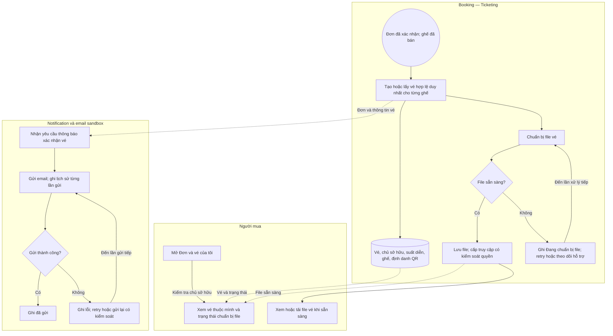

Tạo vé phải phục hồi được và không sinh vé trùng khi xử lý lại. Trạng thái đơn, quyền sở hữu vé, trạng thái file và trạng thái email là các dữ liệu riêng. Lỗi tạo file/email không hủy đơn, không giải phóng ghế và không tự tạo hoàn tiền. QR/file vé không công khai. BRD không bắt buộc email phải đính kèm file; cách gửi liên kết/đính kèm sẽ chốt khi thiết kế thông báo.

## 9. PF-08 — Check-in online

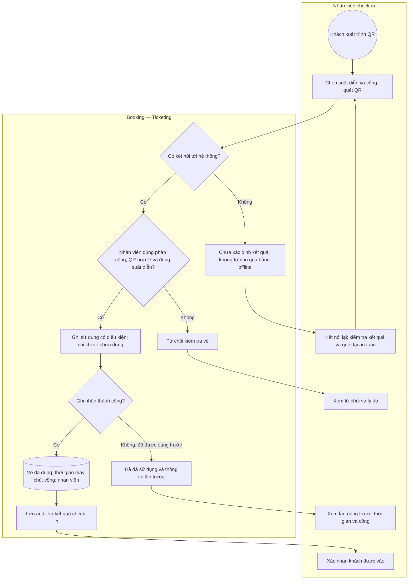

Hai cổng quét đồng thời chỉ một lần ghi sử dụng thành công. Nếu ghi đã thành công nhưng thiết bị mất phản hồi, lần tra/quét sau trả thông tin lần sử dụng trước; không ghi nhận lượt vào thứ hai. Không hỗ trợ vào lại hoặc check-in offline. Lỗi hệ thống không được diễn giải thành vé giả; phản hồi phải phân biệt không hợp lệ, đã dùng và chưa thể xác minh.

## 10. PF-09 — Tra cứu, hỗ trợ và audit

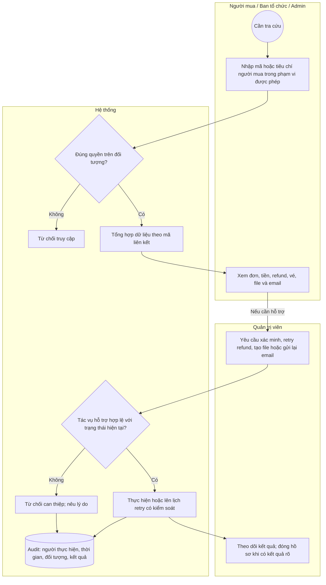

Người mua chỉ tra đơn/vé của chính mình; tìm theo người mua để hỗ trợ dành cho ban tổ chức/admin trong quyền tương ứng. Chỉ admin yêu cầu retry xử lý hỗ trợ theo BRD. Admin không được ép xác nhận khi tiền chưa rõ, bỏ qua quyền ghế hoặc khôi phục đơn hết hạn. Audit bao phủ sửa giá, đóng bán, refund, check-in, đổi quyền và can thiệp đơn; có thể tra theo đối tượng, người và thời gian.

## 11. PF-10 — Báo cáo cơ bản

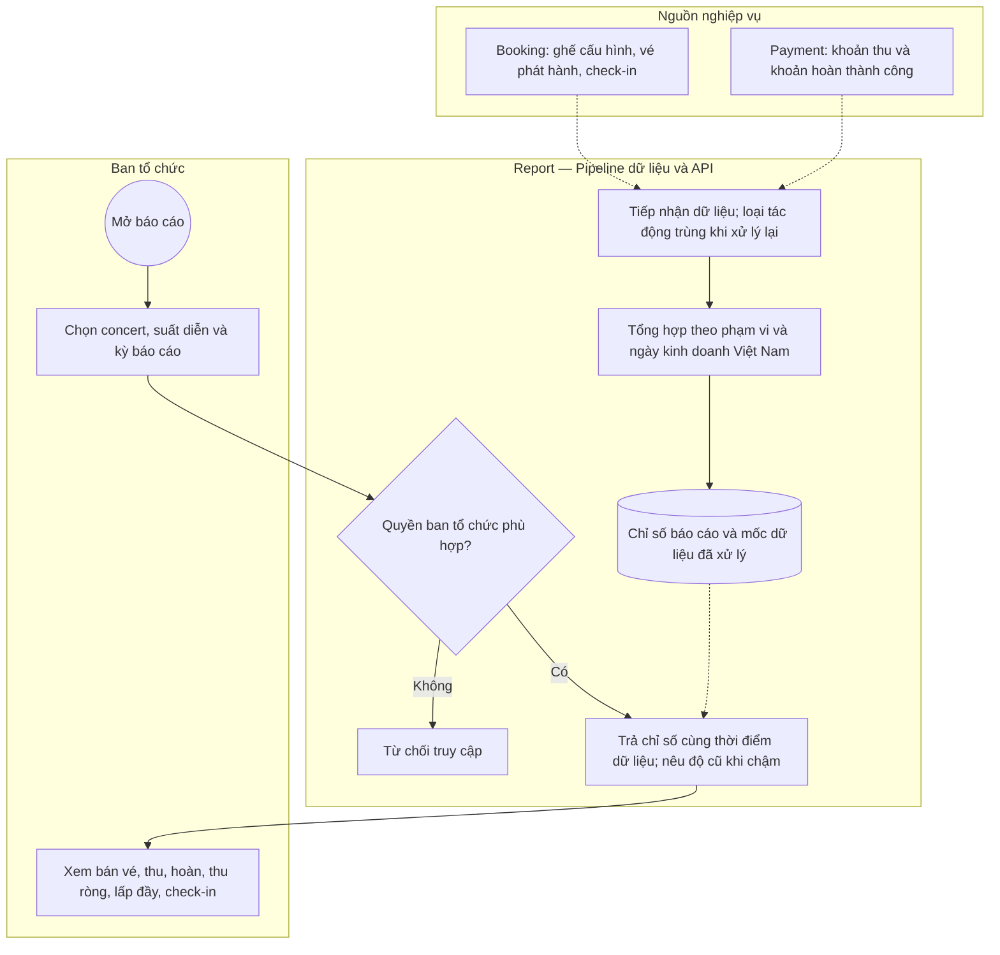

| Chỉ số | Dữ liệu và quy tắc |
|---|---|
| Vé bán | Vé phát hành hợp lệ của đơn đã xác nhận, không thay bằng số payment thành công |
| Tiền thu | Giao dịch thu thành công; mỗi giao dịch tính một lần |
| Tiền hoàn | Giao dịch hoàn thành công; loại yêu cầu đang chờ |
| Thu ròng | Tiền thu trừ tiền hoàn; không phải lợi nhuận |
| Lấp đầy | Ghế đã bán / ghế cấu hình bán × 100%; mẫu số 0: Chưa áp dụng |
| Check-in | Vé ghi sử dụng thành công; quét lặp không tăng đếm |

Thu và hoàn ghi nhận theo ngày giao dịch tương ứng, múi giờ Asia/Ho_Chi_Minh. Báo cáo chấp nhận trễ, phải nêu mốc dữ liệu; khoản đang xác minh/đang hoàn được phân biệt với khoản hoàn tất. Chênh lệch thu và vé bán cần giải thích được bằng giao dịch liên quan. Pipeline có thể chạy bằng Spark riêng theo kiến trúc dự án; MVP không đòi hỏi streaming. Lỗi Report không chặn checkout.

## 12. PF-11 — Phục hồi và mô phỏng lỗi

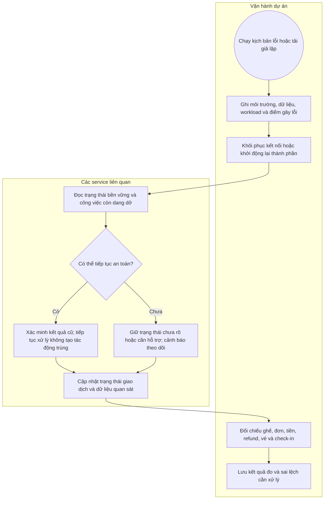

Các trường hợp cần tái lập: mất callback, mất mạng sau thu tiền, khởi động lại giữa giao dịch, hoàn tiền chậm, file/email lỗi, tranh ghế, hai cổng cùng quét và xử lý lại dữ liệu báo cáo. Đây là luồng vận hành chứng minh yêu cầu BL-20, không phải thêm vai trò nghiệp vụ có quyền sửa giao dịch. Đo xem concert, xem ghế, giữ ghế, thanh toán, check-in riêng; tải và SLA định lượng sẽ chốt sau baseline.

## 13. Luồng dữ liệu giữa các service

Hai sơ đồ sau là **data flow**, không phải trình tự BPMN. Mũi tên có nhãn cho biết dữ liệu được trao đổi; không khẳng định endpoint/topic hay cơ chế vận chuyển cụ thể.

### 13.1. Giao dịch mua vé

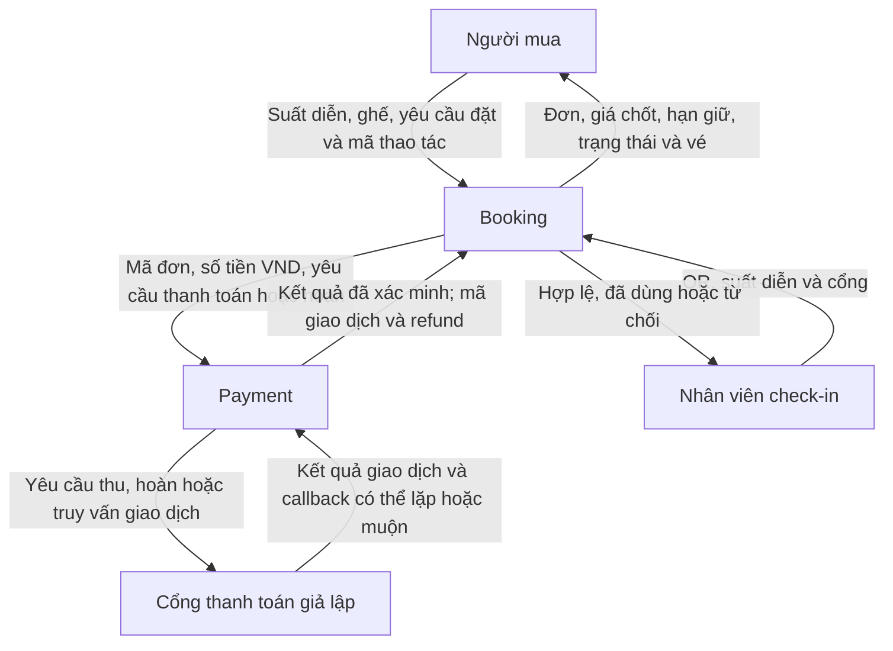

### 13.2. Dữ liệu phục vụ tìm kiếm, thông báo và báo cáo

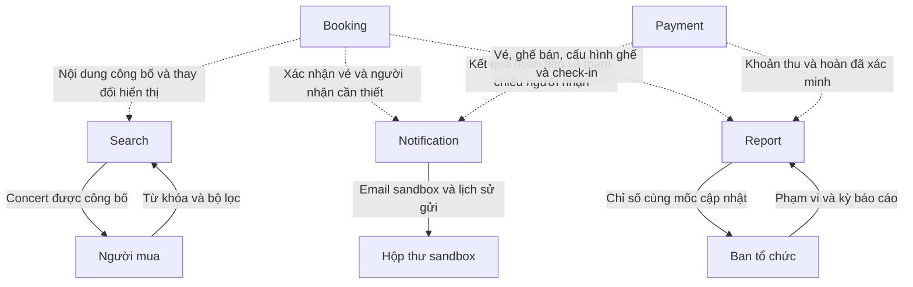

| Nhóm dữ liệu | Nguồn nghiệp vụ | Nơi sử dụng và giới hạn |
|---|---|---|
| Nội dung concert, lịch bán, giá | Booking / Catalog | Giao diện và bản sao Search; Search không quyết định được phép đặt |
| Quyền giữ ghế, hết hạn, ghế bán | Booking / Inventory | Ordering kiểm tra khi đặt và xác nhận; Report nhận dữ liệu tổng hợp |
| Chủ đơn, giá chốt, trạng thái đơn | Booking / Ordering | Khách, Payment, hỗ trợ; người mua không tự quyết tổng tiền |
| Thu tiền, xác minh, refund | Payment | Booking quyết định xử lý đơn; Report tính tiền; Notification báo kết quả |
| Vé, QR và lịch sử check-in | Booking / Ticketing | Khách sở hữu và nhân viên có quyền; QR không đưa vào chỉ mục công khai |
| File vé | Booking / Ticketing quản lý quyền và tham chiếu | Lưu trữ file theo kiến trúc; chỉ cung cấp cho người có quyền |
| Email và lịch sử gửi | Notification | Hỗ trợ gửi lại; không là bằng chứng xác nhận đơn |
| Chỉ mục tìm kiếm | Search | Bản sao để tìm; có thể trễ, có fallback danh sách cơ bản |
| Chỉ số và mốc cập nhật | Report | Bản sao tổng hợp; không là nguồn xác nhận giao dịch |
| Audit | Thành phần xử lý thao tác tương ứng | Admin tra cứu; không thêm service Audit riêng |

Các liên kết dữ liệu cần giữ xuyên suốt: mã concert, suất diễn, ghế, đơn, payment, refund và vé; định danh người thực hiện; định danh thao tác/sự kiện để chống xử lý trùng; thời gian nguồn và thời gian xử lý. Đây là yêu cầu liên kết logic, không phải thiết kế bảng hoặc topic. Chỉ trao đổi thông tin cá nhân cần thiết theo đúng quyền.

## 14. Các trạng thái phải hiển thị độc lập

| Trục | Trạng thái nghiệp vụ minh họa | Tình huống cần thể hiện |
|---|---|---|
| Đơn | Chờ thanh toán / Đã xác nhận / Đã hủy / Hết hạn | Đơn hết hạn không được tự phục hồi |
| Thanh toán | Chưa thanh toán / Đang xử lý / Đang xác minh / Thành công / Thất bại đã xác định | Đơn hết hạn vẫn có thể đang xác minh |
| Hoàn tiền | Không áp dụng / Đang hoàn / Đã hoàn / Cần hỗ trợ | Thu thành công nhưng không xác nhận đơn thì hoàn toàn bộ |
| Vé | Đã phát hành / Đã sử dụng | Vé tồn tại độc lập với file và email |
| File vé | Đang chuẩn bị / Sẵn sàng / Cần xử lý lại | Đơn đã xác nhận vẫn có thể chưa tải được file |
| Email | Chờ gửi / Đã gửi / Lỗi chờ xử lý lại | Email lỗi không làm mất vé |

“Cần hỗ trợ” cũng có thể là cờ theo dõi công việc/giao dịch, không bắt buộc thay trạng thái đơn. Không gom mọi lỗi vào trạng thái “Thất bại”.

## 15. Đối chiếu yêu cầu và các điểm cần thiết kế tiếp

| Luồng | Backlog BRD | Quy tắc trọng tâm |
|---|---|---|
| PF-01 | BL-01, BL-02 | BR-14, BR-16 |
| PF-02 | BL-03, BL-04 | BR-04, BR-05, BR-13, BR-16 |
| PF-03 | BL-05–BL-08, BL-19 | BR-01–BR-06, BR-15 |
| PF-04 | BL-09 | BR-06–BR-09 |
| PF-05 | BL-10 | BR-02, BR-03, BR-08, BR-09 |
| PF-06 | BL-11 | BR-09, BR-10, BR-16 |
| PF-07 | BL-12, BL-13, BL-15 | BR-11, BR-14 |
| PF-08 | BL-14 | BR-12, BR-14, BR-16 |
| PF-09 | BL-16, BL-18 | BR-10, BR-14, BR-16 |
| PF-10 | BL-17 | Định nghĩa báo cáo tại mục 7 BRD |
| PF-11 | BL-20 | Phục hồi, quan sát, hiệu năng tại mục 8 BRD |

Các điểm dưới đây chưa được tự coi là quyết định nghiệp vụ mới: chính sách giữ chỗ khi đóng bán sớm; tạo lần thanh toán mới sau thất bại rõ ràng; mẫu/nội dung email và cách cung cấp file; ngưỡng retry/chuyển hỗ trợ; giá trị rate limit, mức tải, SLA và độ trễ báo cáo. Luồng hiện tại không thêm phòng chờ, nhiều đợt bán, vé đứng, chuyển nhượng, trả vé tự nguyện, hoàn từng vé, hủy/đổi lịch concert hoặc check-in offline.
