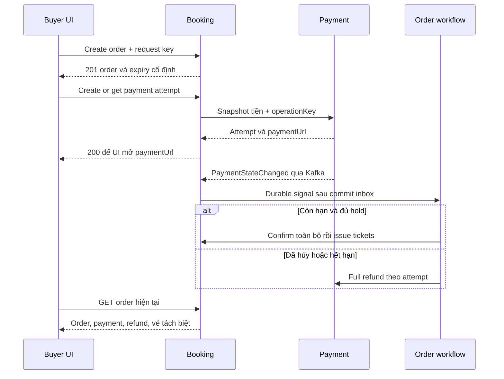

# Booking Service — Technical Design & API Specifications

| Thuộc tính | Giá trị |
|---|---|
| Phiên bản | 1.0 — 04/11/2026 |
| Trạng thái | Đề xuất technical contract để review và triển khai; chưa phải API đang chạy |
| Phạm vi | Catalog, Inventory, Ordering, Ticketing, phân công và hỗ trợ thuộc Booking |
| Người sử dụng | SA, backend/frontend engineer, QA |
| Nguồn chính | LLD-Booking.md v1.0, đặc biệt mục 4–15 |
| Nguồn đối chiếu | HLD-Concert-Ticketing.md v1.0; SRS-Concert-Ticketing.md v1.0; Process-Flows-Concert-Ticketing.md v1.0; BRD-Concert-Ticketing.md v1.0 |

## 1. Mục tiêu, phạm vi và quyết định thiết kế

Tài liệu xác định hợp đồng HTTP của Booking: quyền truy cập, input/output, validation, trạng thái, lỗi, idempotency và xử lý cạnh tranh. Các bảng dữ liệu, khóa và transaction giữ nguyên theo LLD Booking; không thêm microservice hoặc generic abstraction.

Áp dụng thay đổi tại HLD §1.1/18 và LLD: VNPAY sandbox do Payment tích hợp; Keycloak cho mọi vai trò; xác minh email và SMS OTP thật; QR trong tài khoản/email; không PDF; không lọc khoảng giá; local trước. Các yêu cầu cũ trái với các quyết định này không được đưa lại vào API.

Không sử dụng LLD-Concert-Ticketing.pdf chưa review hoặc suy đoán nội dung LLD Payment không nằm trong bộ nguồn hiện tại. API outbound tới Payment/Notification dưới đây là yêu cầu hợp đồng từ Booking, cần đối chiếu với thiết kế service sở hữu.

### 1.1. Phân biệt nguồn và phần cụ thể hóa

| Nhãn | Ý nghĩa |
|---|---|
| LLD | Method/path hoặc capability đã nêu trong LLD Booking |
| Bổ sung | Endpoint đọc cần cho UI nhưng LLD chưa đặt path; không bổ sung nghiệp vụ mới |
| Quyết định API | Wire format, nullable, HTTP code, giới hạn ban đầu do tài liệu này đề xuất |

Tất cả DTO chi tiết là **quyết định API** của bản này, không khẳng định đã được triển khai. Các giới hạn kỹ thuật ban đầu được gom tại §2.6; ngưỡng tải/SLA vẫn cần đo baseline.

### 1.2. Ranh giới trách nhiệm

| Trong Booking | Ngoài Booking |
|---|---|
| Công bố concert, cấu hình suất/ghế/giá | Đăng ký, đăng nhập, OTP, đổi mật khẩu: Keycloak |
| Giữ ghế + tạo đơn, confirm, cancel, expire | Ký URL VNPAY, IPN/Return URL, query/refund: Payment |
| Vé, QR owner, check-in | SMTP và lịch sử gửi: Notification |
| Phân công scope, hỗ trợ hợp lệ, audit Booking | Tìm kiếm nâng cao: Search; dashboard và Spark: Report |

Không có API public để confirm đơn, đánh dấu payment/refund thành công, gia hạn hold, reset check-in, thay chủ vé hoặc lấy QR của người khác. Confirm/expire/issue-ticket là use case nội bộ qua Temporal, không mở REST chỉ để gọi activity.

## 2. Quy ước hợp đồng chung

### 2.1. URL, dữ liệu và header

- Public/user API dùng prefix `/api/v1`; service API dùng `/internal/v1` độc lập, không ghép hai prefix.
- Request/response JSON UTF-8, `camelCase`. DTO tách khỏi JPA entity. Không nhận unknown field trong request: trả `422 UNKNOWN_FIELD`, tránh bỏ qua trường giá/quyền do client tự gửi.
- Path `id` là UUID; `subject` là chuỗi Keycloak 1–128 ký tự, URL-encode một lần, không giả định UUID.
- Timestamp RFC 3339 có offset khi gửi; response UTC hậu tố `Z`. Thời điểm quyết định nghiệp vụ là giờ PostgreSQL sau khi lấy đủ khóa.
- Tiền là JSON integer VND, dương với giá/thu; phí luôn 0. Không float, không nhân hệ số VNPAY trong Booking. API giới hạn tiền trong miền integer an toàn cho JavaScript; giới hạn thực tế còn bị chặn bởi Payment/config.
- Field response liệt kê trong schema luôn có mặt; `?` trong bảng schema nghĩa là **giá trị nullable**, không phải bỏ field. Field request ghi tùy chọn có thể bỏ; không dùng `null` thay một giá trị bắt buộc, trừ expectedVersion của thao tác tạo mới đã nêu rõ.
- Thành công trả DTO trực tiếp, không bọc `data` toàn cục. HTTP 201 có `Location`. HTTP 202 chỉ dùng khi đã có durable operation để theo dõi.

| Header | Quy tắc |
|---|---|
| `Authorization: Bearer …` | Bắt buộc ngoài catalog public; kiểm signature/issuer/audience/expiry và quyền use case |
| `Content-Type: application/json` | Bắt buộc nếu có JSON body |
| `Idempotency-Key` | Bắt buộc với create order, cancel, create/get payment attempt và support operation; 1–128 ký tự ASCII `[A-Za-z0-9._:-]` |
| `X-Correlation-Id` | UUID tùy chọn; thiếu thì server sinh; không hợp lệ trả 422; trả lại trên mọi response, không làm idempotency key |
| `Retry-After` | Số giây với 429 và 503 khi biết thời điểm retry; không hứa kết quả nghiệp vụ sẽ hoàn tất sau khoảng này |
| `Idempotency-Replayed` | `true` khi trả kết quả Booking đã commit cho cùng key; không áp dụng check-in |
| `Cache-Control` | `no-store` cho đơn, vé, QR, support, grant, assignment, audit và seat availability; catalog baseline cũng `no-store` để tránh lộ dữ liệu đã ẩn qua cache |

Version update dùng **body `expectedVersion`**, không dùng đồng thời `If-Match` trong v1. Thiếu version bắt buộc → 422; sai version → 409. Header `If-Match` không được coi là thay thế body. LLD cho phép một trong hai cơ chế; bản này chọn body để thống nhất batch update.

### 2.2. Phân quyền

| Mã | Điều kiện |
|---|---|
| PUBLIC | Không cần login; chỉ PUBLISHED tại snapshot đọc |
| BUYER | Token người dùng hợp lệ; subject lấy từ token; thao tác đơn/vé phải đúng owner |
| VERIFIED_BUYER | BUYER + `email_verified=true`, `phone_verified=true`; email hợp lệ từ Identity, không từ body checkout |
| ORG | Role ORGANIZER + organizer_membership active, permission MANAGE, organizer active |
| ADMIN_ACCESS | ADMIN với quyền quản lý phân công; đây là quyền cấp scope, không tự cấp quyền đọc QR |
| SUPPORT_READ | ORGANIZER + MANAGE hoặc ADMIN + membership active MANAGE/SUPPORT_READ của organizer được yêu cầu |
| SUPPORT_WRITE | ADMIN + membership active MANAGE/SUPPORT_READ của organizer; action whitelist, reason bắt buộc |
| STAFF | CHECKIN_STAFF + assignment active cho suất |
| SERVICE | Client credential/service identity có audience Booking và đúng permission endpoint |

Mapping MANAGE/SUPPORT_READ với ADMIN support ở trên là cách cụ thể hóa hai permission trong schema LLD; không thêm permission DB mới. Role thiếu → 403; object không có/ngoài scope → 404. Riêng check-in thiếu assignment → 403 theo LLD. Không nhận buyerSubject/actor/grantedBy từ body user để cấp quyền. Những trường này do server suy ra.

Read scope phải lọc trong query trước pagination. Mutation đặc quyền đọc quyền từ DB và giữ khóa cần thiết tới commit. Token role cũ không thay thế membership/assignment hiện hành. Role ADMIN/ORGANIZER không bypass owner QR.

### 2.3. Pagination

Các endpoint danh sách dùng `cursor` tùy chọn và `limit` mặc định 20, tối đa 100. `limit` ngoài 1–100, cursor sai/khác query hoặc khác scope → `422 INVALID_PAGINATION`.

```json
{
  "items": [],
  "nextCursor": null,
  "hasMore": false,
  "readAt": "2026-11-04T10:00:00Z"
}
```

Cursor opaque được ký hoặc kiểm toàn vẹn, chứa sort key và hash filter/scope. Không dùng offset; không trả total count bắt buộc. Trừ export đã chỉ rõ, các trang là các snapshot đọc độc lập: cập nhật dữ liệu giữa các trang có thể thay đổi vị trí; không quảng cáo snapshot toàn bộ danh sách. Cursor chỉ dùng để đọc tiếp, không làm authorization.

### 2.4. Error DTO

```json
{
  "code": "SEAT_UNAVAILABLE",
  "message": "Một hoặc nhiều ghế không còn khả dụng.",
  "correlationId": "aaaaaaaa-aaaa-4aaa-8aaa-aaaaaaaaaaaa",
  "retryable": false,
  "details": {
    "fields": [],
    "seatIds": ["44444444-4444-4444-8444-444444444444"]
  }
}
```

`details` luôn là object, có thể `{}`. Lỗi field dùng `fields:[{field,code,message}]`, ví dụ `changes[0].priceVnd`. Chỉ trả seat ID do client đã gửi trong đúng suất được phép thấy; không trả owner/hold người khác. `message` dùng hiển thị, client rẽ nhánh theo `code`. `retryable=true` nghĩa là có thể retry an toàn theo hướng dẫn với cùng key, không đồng nghĩa chưa commit.

| HTTP | Nhóm |
|---|---|
| 400 | MALFORMED_JSON |
| 401 | AUTH_REQUIRED, INVALID_TOKEN; có WWW-Authenticate |
| 403 | FORBIDDEN, ACCOUNT_NOT_VERIFIED |
| 404 | RESOURCE_NOT_FOUND, ORDER_NOT_FOUND, TICKET_NOT_FOUND; cùng thông điệp khi ngoài scope |
| 409 | State/version/idempotency conflict |
| 413 / 415 | PAYLOAD_TOO_LARGE / UNSUPPORTED_MEDIA_TYPE |
| 422 | Validation ngữ nghĩa/field |
| 429 | RATE_LIMITED |
| 500 | INTERNAL_ERROR đã sanitize, không stack trace; trạng thái kết quả có thể chưa rõ |
| 503 | Dependency lỗi, quá tải, kết quả chưa thể xác minh |

### 2.5. Idempotency và optimistic concurrency

| Thao tác | Phạm vi key / hash | Retry |
|---|---|---|
| CreateOrder | subject + CREATE_ORDER + key; hash performanceId + tập seatIds đã sort | Trả 201 và DTO tạo đơn gốc; orderId/giá/expiry giữ nguyên |
| CancelOrder | subject + CANCEL_ORDER + key; hash orderId | Trả 200 kết quả hủy đã commit |
| SupportOperation | subject + SUPPORT_OPERATION + key; hash body chuẩn hóa gồm scope, reason | Trả 202 và operationId gốc; GET để biết tiến độ mới |
| Payment attempt | key suy ra ổn định từ subject + orderId + request key | Payment sở hữu durable result; không giữ khóa DB Booking trong HTTP call |
| Check-in | Unique ticket_checkin(ticket_id), conditional ticket update | Lần quét mới trả 409 ALREADY_USED, không replay 200 |
| Catalog/access update | expectedVersion, unique code/slug và transition idempotent | GET lại khi mất response; không gán idempotency giả cho POST create chưa có key |

Cùng key khác hash → `409 IDEMPOTENCY_CONFLICT`. Replay vẫn kiểm authentication/owner/scope hiện tại trước khi trả DTO. Với checkout replay thành công không chạy lại rate limit/điều kiện bán để tạo hold, không reset expiry. `serverTime` được tính lại; trạng thái trong DTO replay là kết quả gốc, client cần GET order để thấy trạng thái hiện tại. Record Booking không tự xóa trong MVP.

Publish/hide/close-sales: sau kiểm quyền, nếu đã ở trạng thái đích thì trả hiện trạng không tăng version/event; nếu cần transition thì kiểm expectedVersion. Các update còn lại kiểm version trước, không ghi đè cạnh tranh. Đọc version mới trước khi retry update do conflict.

### 2.6. Giới hạn đề xuất ban đầu

| Giá trị | Đề xuất v1 |
|---|---|
| Page limit | 20, tối đa 100 |
| Resolve-public batch | 1–100 concertIds khác nhau |
| Seat-price batch | 1–500 changes khác seatId, atomic toàn batch |
| Full seat-map / inventory export | Tối đa 10.000 ghế/suất; cấu hình ban đầu, không phải cam kết hiệu năng |
| Body thông thường / seat-map | 1 MiB / 5 MiB |
| Artists | 1–50 tên khi publish; mỗi tên 1–200 ký tự; draft cho phép mảng rỗng |
| Description / purchaseTerms | Tối đa 50.000 / 20.000 ký tự; draft có thể rỗng, publish phải đủ |
| Giá và tổng tiền | `1..min(configuredMaxVnd, 9007199254740991)`; tổng phải kiểm overflow và trần Payment |
| QR | Base64url không padding của 32 byte, đúng 43 ký tự; token sai định dạng trả INVALID_QR |
| Polling UI | Khởi đầu 2 giây, backoff tối đa 10 giây khi chờ; dừng khi rời màn hình, không đặt SLA hoàn tất |

Rate limit theo subject/IP, timeout lock/transaction/HTTP, retry budget và cảnh báo phải cấu hình; không tự lấy các con số trên làm ngưỡng production. Full map vượt giới hạn không cắt âm thầm: trả lỗi và thiết kế export/session hoặc map partition trước khi nâng tải.

## 3. Danh mục endpoint

Trong các bảng external dưới đây, path đã bao gồm `/api/v1`.

| ID | Method & path | Quyền | Nguồn |
|---|---|---|---|
| CAT-01 | GET `/api/v1/concerts` | PUBLIC | LLD |
| CAT-02 | GET `/api/v1/concerts/{id}` | PUBLIC | LLD |
| INV-01 | GET `/api/v1/performances/{id}/seats` | PUBLIC | LLD |
| CAT-03 | POST `/api/v1/organizer/concerts` | ORG | LLD |
| CAT-04 | PUT `/api/v1/organizer/concerts/{id}` | ORG | LLD |
| CAT-05 | POST `/api/v1/organizer/concerts/{id}/performances` | ORG | LLD |
| CAT-06 | PUT `/api/v1/organizer/performances/{id}/configuration` | ORG | LLD |
| INV-02 | PUT `/api/v1/organizer/performances/{id}/seat-map` | ORG | LLD |
| INV-03 | PATCH `/api/v1/organizer/performances/{id}/seat-prices` | ORG | LLD |
| CAT-07 | POST `/api/v1/organizer/concerts/{id}/publish` | ORG | LLD |
| CAT-08 | POST `/api/v1/organizer/concerts/{id}/hide` | ORG | LLD |
| CAT-09 | POST `/api/v1/organizer/performances/{id}/close-sales` | ORG | LLD |
| ORD-01 | POST `/api/v1/orders` | VERIFIED_BUYER | LLD |
| ORD-02 | GET `/api/v1/me/orders` | BUYER | Bổ sung |
| ORD-03 | GET `/api/v1/me/orders/{id}` | BUYER | Bổ sung |
| ORD-04 | POST `/api/v1/orders/{id}/payment-attempts` | BUYER | LLD |
| ORD-05 | POST `/api/v1/orders/{id}/cancel` | BUYER | LLD |
| TKT-01 | GET `/api/v1/me/tickets` | BUYER | Bổ sung |
| TKT-02 | GET `/api/v1/me/tickets/{id}` | BUYER | Bổ sung |
| TKT-03 | GET `/api/v1/me/tickets/{id}/qr` | BUYER | Bổ sung cho owner QR capability LLD |
| CHK-01 | POST `/api/v1/check-ins` | STAFF | LLD |
| ACC-01 | PUT `/api/v1/admin/organizers/{id}/members/{subject}` | ADMIN_ACCESS | LLD |
| ACC-02 | PUT `/api/v1/admin/performances/{id}/assignments/{subject}` | ADMIN_ACCESS | LLD |
| SUP-01 | GET `/api/v1/support/orders` | SUPPORT_READ | LLD |
| SUP-02 | GET `/api/v1/support/orders/{id}` | SUPPORT_READ | LLD |
| SUP-03 | POST `/api/v1/support/operations` | SUPPORT_WRITE | LLD |
| SUP-04 | GET `/api/v1/support/operations/{id}` | SUPPORT_WRITE | LLD |
| AUD-01 | GET `/api/v1/admin/audits` | ADMIN + organizer scope | LLD |

Các endpoint đọc phục vụ cấu hình, assignment và danh mục seed được đặc tả chung tại §9. Không thêm CRUD organizer/venue trong bản này: dữ liệu được seed qua Liquibase/local fixture theo LLD.

## 4. DTO dùng chung

Các object được tham chiếu bằng tên dưới đây có shape cố định. `UUID`, `Instant`, `int64`, `boolean`, `string` là kiểu wire; số version không âm và nằm miền integer an toàn ở API.

### 4.1. Catalog DTO

| DTO | Các field |
|---|---|
| VenueSnapshot | `name:string(200), address:string(500), city:string(100), timezone:string(64)` |
| PerformancePublic | `id:UUID, code:string(40), startsAt:Instant, salesOpenAt:Instant, salesCloseAt:Instant, salesEnabled:boolean, saleState:NOT_OPEN/OPEN/CLOSED, venue:VenueSnapshot` |
| ConcertSummary | `id:UUID, slug:string(180), title:string(250), artists:string[], nextStartsAt:Instant?, catalogRevision:int64` |
| ConcertDetail | ConcertSummary + `description:string, purchaseTerms:string, performances:PerformancePublic[], purchasePolicy:{minSeats:1,maxSeats:4,holdSeconds:300,currency:VND,feeVnd:0}, readAt:Instant` |
| ConcertManagement | `id, organizerId, slug, title, artists, description, purchaseTerms, status:DRAFT/PUBLISHED/HIDDEN, firstPublishedAt:Instant?, catalogRevision:int64, version:int64, createdAt, updatedAt` |
| PerformanceManagement | PerformancePublic + `concertId, venueId, checkinOpenAt, checkinCloseAt, gates:[{gateId,enabled}], version, createdAt, updatedAt` |

ID fields là UUID; timestamp createdAt/updatedAt là Instant. `saleState` chỉ suy ra từ flag và khoảng thời gian của suất tại readAt, không bảo đảm còn ghế. `nextStartsAt` là suất gần nhất có startsAt ≥ readAt hoặc null nếu không còn; không dùng nó làm cursor của danh sách fallback.

### 4.2. Order và trạng thái nguồn

| DTO | Các field |
|---|---|
| OrderItem | `seatId:UUID, section:string(120), row:string(20), number:string(20), priceVnd:int64` |
| OrderCreated | `orderId, orderCode:string(40), status, items:OrderItem[], subtotalVnd, feeVnd, totalVnd, currency:VND, heldAt, expiresAt, serverTime` |
| OrderSummary | `orderId, orderCode, performanceId, concertTitle, startsAt, status, seatCount, totalVnd, currency, createdAt, expiresAt, needsAttention:boolean` |
| PaymentAttempt | `attemptId:UUID, status:PROCESSING/VERIFYING/SUCCEEDED/FAILED, amountVnd:int64, currency:VND, paidAt:Instant?, verifiedAt:Instant?, sourceVersion:int64` |
| Refund | `refundId:UUID, attemptId:UUID, status:PENDING/SUCCEEDED/NEEDS_SUPPORT, amountVnd:int64, refundedAt:Instant?, sourceVersion:int64` |
| TicketMetadata | `ticketId, ticketCode:string(40), orderId, performanceId, seatId, seatLabel:string, status:ISSUED/USED, issuedAt, usedAt:Instant?` |

`OrderSummary.status` và `OrderCreated.status` thuộc PENDING_PAYMENT/CONFIRMED/CANCELLED/EXPIRED. OrderCreated mới luôn PENDING_PAYMENT. OrderDetail = OrderCreated với trạng thái hiện tại + các field sau:

| Field | Kiểu / ý nghĩa |
|---|---|
| performanceId, concertId | UUID |
| concert | `{title, artists, venue:VenueSnapshot, startsAt, purchaseTerms}` từ snapshot đơn |
| createdAt, confirmedAt, closedAt | Instant; hai field sau nullable |
| closeReason | USER_CANCELLED / HOLD_EXPIRED / INVENTORY_INCONSISTENCY hoặc null |
| version | int64 version Booking |
| holdValid | boolean; status pending và serverTime < expiresAt, chỉ là chỉ dẫn đọc; mutation kiểm lại toàn bộ quyền ghế |
| needsAttention, attentionReason | boolean, string? |
| payments | SourceState với data `{state:NOT_STARTED/PRESENT, attempts:PaymentAttempt[]}` |
| refunds | SourceState với data `{state:NOT_APPLICABLE/PRESENT, items:Refund[]}` |
| ticketing | `{expectedCount:int, issuedCount:int, completedAt:Instant?, tickets:TicketMetadata[]}` |
| email | SourceState với data `{notifications:EmailMetadata[]}` |
| allowedActions | Array `START_PAYMENT`, `CANCEL`, `VIEW_TICKETS`; chỉ gợi ý, không cấp quyền |

SourceState thống nhất: `{available:boolean, source:string, lastUpdatedAt:Instant?, data:object?, lastKnown:object?}`. `available=true`: data là kết quả đọc hiện tại, lastKnown=null. `available=false`: data=null, lastKnown có thể là projection đã commit, lastUpdatedAt là mốc projection; không giả trạng thái FAILED/NOT_STARTED. lastKnown luôn cùng shape với data. Nguồn Payment/Notification tạm lỗi không làm GET order thất bại nếu Booking còn đọc được; Booking DB lỗi → 503.

Danh sách đơn dùng dữ liệu Booking, không fan-out từng dòng tới service khác. Chi tiết truy vấn có timeout hữu hạn; payments/refunds cùng một call Payment. `lastUpdatedAt` là mốc dữ liệu nguồn cung cấp hoặc mốc nhận projection, không được lấy giờ HTTP hiện tại để giả freshness.

EmailMetadata (wire đề xuất cần Notification thống nhất): `{notificationId:string, type:TICKET_SET/REFUND_SUCCEEDED, status:PENDING/SENDING/SENT/FAILED/NEEDS_SUPPORT, attemptCount:int, lastAttemptAt:Instant?, sentAt:Instant?, errorCode:string?}`. Không HTML, ảnh QR hoặc raw provider payload. Chưa map được trạng thái Notification → nguồn unavailable thay vì tự đoán.

## 5. Public catalog và inventory

### CAT-01 — GET /api/v1/concerts

- Query: `cursor?`, `limit?`; không có keyword/price filter. Duyệt cơ bản khi Search lỗi.
- 200 Page<ConcertSummary>, sort `(createdAt DESC,id DESC)` ổn định theo key; chỉ PUBLISHED và có ít nhất một suất. Có thể còn concert đã diễn; UI xem nextStartsAt, không tự thêm bộ lọc nghiệp vụ ngoài contract.
- Lỗi: 422 INVALID_PAGINATION/UNKNOWN_FIELD; 503 CATALOG_UNAVAILABLE. Không đọc Elasticsearch.

### CAT-02 — GET /api/v1/concerts/{id}

- Không body/query. 200 ConcertDetail. Các suất sort startsAt ASC, id ASC.
- DRAFT/HIDDEN/ID không có đều 404 RESOURCE_NOT_FOUND. Kiểm PUBLISHED và nội dung trong cùng snapshot; không trả cache công khai chưa kiểm nguồn.

### INV-01 — GET /api/v1/performances/{id}/seats

- Query tùy chọn `sectionId:UUID`; không cursor trong baseline map giới hạn 10.000 ghế.
- 200 `{performanceId,sections:[{sectionId,code,name,sortOrder}],seats:[SeatPublic],readAt,serverTime}`.
- SeatPublic = `{seatId,sectionId,row,number,x,y,priceVnd,enabled,status:AVAILABLE/HELD/SOLD,version}`. `x,y` decimal tối đa 2 chữ số thập phân, miền numeric(10,2). Giá hiện tại, không phải giá snapshot đơn.
- HELD hết hạn tại readAt hiển thị AVAILABLE mà không sửa row. Ghế disabled vẫn có vị trí, `enabled=false`; UI không cho chọn bất kể status. Không trả holdId, currentOrderId, owner hoặc hold expiry người khác.
- Suất/concert không public → 404. sectionId sai/khác suất → 422 INVALID_SECTION. Quá giới hạn trả 422 SEAT_MAP_LIMIT_EXCEEDED, không cắt map. Nguồn lỗi → 503 INVENTORY_UNAVAILABLE.
- Ghế hiển thị AVAILABLE không là cam kết giữ. ORD-01 kiểm lại bằng row lock.

## 6. Quản lý catalog và sơ đồ ghế

Tất cả endpoint mục này cần ORG. 404 cho object ngoài organizer scope. Ghi business state, audit và outbox trong cùng transaction theo LLD; không gọi Kafka/HTTP trong transaction. Field code/slug trim, không rỗng. Slug lowercase `[a-z0-9]+(-[a-z0-9]+)*`; code `[A-Za-z0-9_-]+`. Nội dung description/terms là plain text trong v1, encode an toàn khi render; không nhận HTML tùy ý.

### CAT-03 — POST /api/v1/organizer/concerts

Request bắt buộc: `{organizerId:UUID,slug:string(1..180),title:string(1..250),artists:string[],description:string,purchaseTerms:string}`. Các field text dài và artists theo §2.6; cho phép nội dung draft chưa đầy đủ. organizerId phải nằm scope MANAGE, không cho chọn tùy ý.

201 ConcertManagement, status DRAFT, version=0, catalogRevision=0, Location trỏ GET management. Slug trùng → 409 SLUG_CONFLICT. Không nhận status/version/organizer khác qua mutation sau này. Mất response POST: dùng GET danh sách với slug exact để đối chiếu; không tự gửi POST với slug mới.

### CAT-04 — PUT /api/v1/organizer/concerts/{id}

Request: `{slug,title,artists,description,purchaseTerms,expectedVersion:int64}`; full replacement các field nội dung, không phải PATCH. 200 ConcertManagement.

Không nhận organizerId/status. Sau firstPublishedAt, slug bất biến trong v1; đổi slug → 409 IMMUTABLE_FIELD. Sửa title/artists/nội dung không sửa snapshot đơn cũ. Nếu concert đang PUBLISHED phải giữ nội dung hợp lệ như publish. Version sai → 409 VERSION_CONFLICT; slug trùng → 409 SLUG_CONFLICT; text thiếu → 422 INCOMPLETE_CATALOG. Concert HIDDEN từng public không trở thành draft để đổi lịch.

### CAT-05 — POST /api/v1/organizer/concerts/{id}/performances

```json
{
  "code": "SHOW_01",
  "venueId": "22222222-2222-4222-8222-222222222222",
  "startsAt": "2026-12-20T12:00:00Z",
  "salesOpenAt": "2026-11-01T02:00:00Z",
  "salesCloseAt": "2026-12-20T11:00:00Z",
  "salesEnabled": false,
  "checkinOpenAt": "2026-12-20T10:00:00Z",
  "checkinCloseAt": "2026-12-20T13:00:00Z",
  "gates": [{"gateId": "33333333-3333-4333-8333-333333333333", "enabled": true}],
  "expectedVersion": 0
}
```

Tất cả field bắt buộc, expectedVersion của concert cha. code 1–40, unique trong concert; venue active; gates khác nhau, thuộc cùng venue và active. Draft cho phép gates rỗng nhưng publish từ chối. Khoảng bán `open < close <= startsAt`; check-in `open < close`, không tự ràng buộc ± giờ quanh startsAt.

201 `{performance:PerformanceManagement,concertVersion,catalogRevision}`, Location management performance. Tạo snapshot venue phía server. Chỉ thêm suất khi concert chưa từng công bố trong baseline này; thêm sau công bố cần review nghiệp vụ, hiện trả 409 RESCHEDULE_NOT_SUPPORTED. Code trùng → 409 PERFORMANCE_CODE_CONFLICT; lịch sai → 422 INVALID_SALES_WINDOW/INVALID_CHECKIN_WINDOW; venue/cổng sai → 422 INVALID_VENUE/INVALID_GATE.

### CAT-06 — PUT /api/v1/organizer/performances/{id}/configuration

Request full configuration: `{venueId,startsAt,salesOpenAt,salesCloseAt,salesEnabled,checkinOpenAt,checkinCloseAt,gates:[{gateId,enabled}],expectedVersion}`. Code/concertId không đổi. expectedVersion của performance. 200 `{performance:PerformanceManagement,concertVersion,catalogRevision}`.

- Trước firstPublishedAt: được thay venue/startsAt; server xây snapshot venue mới và kiểm mọi cổng.
- Sau firstPublishedAt: venueId/startsAt phải bằng giá trị cũ; sai → 409 RESCHEDULE_NOT_SUPPORTED. Đổi lịch bán/check-in hoặc bật/tắt sales có kiểm window; không tạo nhiều đợt bán.
- `gates` là tập cấu hình mong muốn; cổng bỏ khỏi danh sách bị disable, không xóa row lịch sử. Ít nhất một cổng enabled nếu concert đang public. Cổng đã dùng có thể disable để chặn lượt mới, lịch sử giữ nguyên.
- Đóng/mở hoặc ẩn không đổi expiry của hold cũ. Đổi lịch bán không làm hold cũ mất quyền confirm trước expiry.
- Mỗi thay đổi cấu hình tăng performance.version và concert.catalogRevision; concert.version cũng tăng do aggregate nguồn đổi. Các version mới được trả cho UI.

### INV-02 — PUT /api/v1/organizer/performances/{id}/seat-map

Request là **bản đồ cấu hình đầy đủ**. Khu/ghế hiện có phải được giữ ID; phần tử mới không gửi ID, server sinh. Missing ID không được hiểu là cập nhật theo nhãn.

```json
{
  "expectedVersion": 2,
  "sections": [{"id": null, "code": "VIP", "name": "VIP", "sortOrder": 0}],
  "seats": [{
    "id": null, "sectionCode": "VIP", "row": "A", "number": "01",
    "x": 10.5, "y": 20, "priceVnd": 500000, "enabled": true,
    "expectedVersion": null
  }]
}
```

Section field `id` nullable chỉ khi mới; seat `id,expectedVersion` cùng null chỉ khi mới. Existing seat bắt buộc cả hai. Top-level expectedVersion là performance.version. Section schema `{id:UUID?,code:string(1..40),name:string(1..120),sortOrder:int>=0}`. Seat row/number 1–20, sectionCode phải tồn tại trong request, giá dương, tọa độ theo §5. Không nhận status/currentOrderId/holdId.

- Không có sections/seats → 422 INVALID_SEAT_MAP. ID trùng/khác suất, section code trùng hoặc trùng `(section,row,number)` → 422 INVALID_SEAT_MAP. Giới hạn map theo §2.6.
- Không hard-delete. Phải gửi lại mọi section/seat đã có; bỏ sót → 422 INCOMPLETE_SEAT_MAP. Ngừng bán bằng enabled=false. Đọc management map để lấy toàn bộ ID/version trước khi PUT.
- Không đổi code section hiện có. Đổi tên section làm đổi nhãn ghế: từ chối nếu khu có HELD còn hạn hoặc SOLD. Đổi row/number/x/y/section hoặc disable ghế HELD còn hạn/SOLD → 409 SEAT_CONFIGURATION_LOCKED. Giá được sửa cho đơn mới mà không sửa snapshot cũ.
- Kiểm seat.version từng ghế sau khóa; checkout làm tăng version cũng có thể khiến editor nhận VERSION_CONFLICT. Không ghi đè inventory status theo bản map trên UI.
- Atomic toàn request. Tăng version phần tử thực sự đổi, performance.version, concert.version và catalogRevision. No-op toàn map trả current version, không phát event thừa.

200 `{performanceId,version,concertVersion,catalogRevision,seatCount,sections:[{id,code,name,sortOrder,version}],seats:[{id,version}]}`. Mảng này map ID mới về code khu và thứ tự request ghế; response seats giữ thứ tự request. Lỗi khác: 409 VERSION_CONFLICT, 422 INVALID_PRICE.

### INV-03 — PATCH /api/v1/organizer/performances/{id}/seat-prices

```json
{
  "changes": [{"seatId": "44444444-4444-4444-8444-444444444444", "priceVnd": 600000}],
  "expectedVersions": [{"seatId": "44444444-4444-4444-8444-444444444444", "version": 3}]
}
```

Hai array bắt buộc có cùng tập seatId, không trùng, 1–500 phần tử. Chỉ ghế cùng suất, giá >0, không vượt trần. Khóa seat theo ID tăng dần, kiểm version, update atomic toàn batch. Cho đổi giá hiện tại trên HELD/SOLD nhưng OrderItem không đổi. Không sửa enabled/nhãn qua API này.

200 `{performanceId,changes:[{seatId,priceVnd,version}],performanceVersion,concertVersion,catalogRevision}`. No-op giá không tăng seat.version; version aggregate tăng khi có thay đổi. Lỗi 422 INVALID_PRICE/INVALID_SEAT_SET, 409 VERSION_CONFLICT. Hỗ trợ UI chỉnh giá mà không gửi lại toàn sơ đồ.

### CAT-07 / CAT-08 / CAT-09 — Publish, hide, close-sales

| Endpoint | Body | 200 | Quy tắc / lỗi |
|---|---|---|---|
| POST `/api/v1/organizer/concerts/{id}/publish` | `{expectedVersion}` của concert | `{id,status:PUBLISHED,version,catalogRevision}` | DRAFT/HIDDEN → PUBLISHED; kiểm nội dung, suất, ghế/giá, lịch/cổng; 422 INCOMPLETE_CATALOG |
| POST `/api/v1/organizer/concerts/{id}/hide` | `{expectedVersion}` của concert | `{id,status:HIDDEN,version,catalogRevision}` | PUBLISHED → HIDDEN; HIDDEN no-op; DRAFT → 409 INVALID_CATALOG_STATE |
| POST `/api/v1/organizer/performances/{id}/close-sales` | `{expectedVersion}` của performance | `{id,salesEnabled:false,version,concertVersion,catalogRevision}` | Tắt flag; đã false no-op; không hủy hold cũ |

Publish yêu cầu ít nhất một suất có ghế enabled giá dương; tất cả suất được đưa ra public phải có lịch hợp lệ và ít nhất một cổng enabled. Không tự bật salesEnabled, không tự đổi giờ bán. Ẩn ghi tombstone để Search loại kết quả. Update version và outbox cùng transaction; §2.5 quy định retry trạng thái đích.

## 7. Ordering và Payment initiation

### ORD-01 — POST /api/v1/orders

Header Idempotency-Key bắt buộc. Body chỉ gồm:

```json
{
  "performanceId": "11111111-1111-4111-8111-111111111111",
  "seatIds": ["44444444-4444-4444-8444-444444444444"]
}
```

1–4 seatIds khác nhau, cùng suất. Tạo key mới cho ý định đặt mới; giữ nguyên key khi retry do timeout. Không nhận giá, buyer ID/email hoặc expiry từ client.

201 Location `/api/v1/me/orders/{orderId}`:

```json
{
  "orderId": "55555555-5555-4555-8555-555555555555",
  "orderCode": "ORD-20261104-000001",
  "status": "PENDING_PAYMENT",
  "items": [{"seatId": "44444444-4444-4444-8444-444444444444", "section": "VIP", "row": "A", "number": "01", "priceVnd": 500000}],
  "subtotalVnd": 500000,
  "feeVnd": 0,
  "totalVnd": 500000,
  "currency": "VND",
  "heldAt": "2026-11-04T10:00:00Z",
  "expiresAt": "2026-11-04T10:05:00Z",
  "serverTime": "2026-11-04T10:00:00Z"
}
```

Mã đơn ví dụ chỉ minh họa, không chốt thuật toán sequence. Transaction: khóa key → shared catalog/performance → ghế sort ID → lấy giờ DB → kiểm public/bán/ghế → insert order/items → HELD toàn tập → idempotency/outbox/dispatch → commit. Một ghế không khả dụng làm rollback toàn bộ; không thay ghế hoặc tạo đơn rỗng.

| HTTP/code | Trường hợp | Hành động client |
|---|---|---|
| 403 ACCOUNT_NOT_VERIFIED | Email/phone chưa verified | Hoàn tất xác minh |
| 404 RESOURCE_NOT_FOUND | Performance ID không tồn tại | Dừng, tải lại catalog |
| 422 INVALID_SEAT_SET | Số lượng, trùng, ID ghế không có/khác suất | Sửa tập ghế |
| 409 SALES_CLOSED | Không public/flag tắt/ngoài window | Không tạo key mới để vượt điều kiện bán |
| 409 SEAT_UNAVAILABLE | HELD còn hạn, SOLD hoặc disabled | Reload map, chọn lại; ý định mới dùng key mới |
| 409 IDEMPOTENCY_CONFLICT | Key cũ, payload mới | Khôi phục payload cũ hoặc key cho ý định thực sự mới |
| 429 RATE_LIMITED | Vượt giới hạn tạo hold | Theo Retry-After |
| 503 BUSY / RATE_LIMIT_UNAVAILABLE | Hết lock budget hoặc không có limiter tin cậy | Retry cùng key; không khẳng định chưa tạo đơn khi mất response |

### ORD-02 — GET /api/v1/me/orders

Query `status?` thuộc OrderStatus, `cursor?`, `limit?`. 200 Page<OrderSummary>, sort createdAt DESC/id DESC. Chỉ buyerSubject từ token; không nhận buyerSubject query. Không cần email/phone verified lại để đọc lịch sử. Concert ẩn không làm mất đơn khỏi danh sách.

### ORD-03 — GET /api/v1/me/orders/{id}

200 OrderDetail theo §4.2. 404 ORDER_NOT_FOUND cho ID sai/khác owner. Không QR trong response; link tới ticket metadata/QR endpoint riêng. Khi pending nhưng giờ DB đã tới expiry: giữ status lưu trong DB, `holdValid=false`, không START_PAYMENT/CANCEL trong allowedActions; reconciliation/worker sẽ ghi EXPIRED. GET không sửa DB.

allowedActions: CANCEL khi pending còn hạn; START_PAYMENT chỉ khi pending còn hạn, nguồn Payment đọc được và chưa có thu thành công/attempt chưa rõ; VIEW_TICKETS khi confirmed và đã có vé. Nguồn Payment unavailable thì không gợi ý thanh toán mới. Thông tin này có thể thay đổi trước request tiếp theo.

### ORD-04 — POST /api/v1/orders/{id}/payment-attempts

Idempotency-Key bắt buộc; không body hoặc `{}`. Owner, không nhận provider options, redirect URL, amount/currency từ client. Key stable qua adapter, Payment chịu dedup toàn đơn.

200 `{orderId,attemptId,status,paymentUrl:string?,providerExpiresAt:Instant?,holdExpiresAt:Instant,serverTime:Instant}` khi đã xác định attempt mới/cũ. Luôn 200 cho create-or-get để client không phải suy đoán mới/cũ. paymentUrl chỉ có khi nguồn Payment cho phép tiếp tục attempt, phải là URL provider được adapter tin cậy; không tự dựng ở Booking. Với order terminal/hết hạn, không trả URL để tiếp tục trả tiền.

**Thứ tự xử lý:** kiểm owner; ưu tiên resolve durable result theo operationKey khi retry, kể cả đơn đã hết hạn. Nếu chưa có result, kiểm pending/còn hold trước khi yêu cầu create-or-get. Hợp đồng Payment phải phân biệt lấy attempt cũ với tạo attempt mới và cấm tạo mới sau holdExpiresAt. Không giữ transaction Booking khi gọi HTTP. Cancel/expire cạnh tranh trong khoảng call vẫn có thể xảy ra; tiền muộn được bù trừ.

| HTTP/code | Kết quả |
|---|---|
| 409 HOLD_EXPIRED | Không tạo attempt mới; đọc lại đơn |
| 409 ORDER_NOT_PAYABLE | CANCELLED/EXPIRED/CONFIRMED hoặc hold không còn đủ; không tạo mới |
| 409 PAYMENT_IN_PROGRESS | Key mới khi đã có attempt PROCESSING/VERIFYING; details.attemptId nếu nguồn xác minh được |
| 409 PAYMENT_ALREADY_SUCCEEDED | Không mở khoản thu mới, đọc đơn để theo dõi confirm/refund |
| 409 IDEMPOTENCY_CONFLICT | Payment nhận operationKey cũ với dữ liệu khác |
| 503 PAYMENT_RESULT_UNKNOWN | Call timeout/mất response; details `{orderId,outcome:"UNKNOWN",nextAction:"READ_ORDER_AND_RETRY_SAME_KEY"}`; retryable=true |
| 503 PAYMENT_UNAVAILABLE | Chưa gọi được nguồn; không coi đã thất bại tiền |

Không dùng 202 nếu Booking chưa có durable support operation cho yêu cầu này. Timeout không được tự ghi projection VERIFYING như kết luận của Payment; UI hiển thị chưa xác minh được kết quả. Attempt FAILED rõ cho phép tạo thao tác mới bằng key mới nếu hold còn hạn. Replay key cũ luôn gắn attempt cũ, không tạo lần thu thứ hai.

### ORD-05 — POST /api/v1/orders/{id}/cancel

Idempotency-Key bắt buộc; không body hoặc `{}`. 200 `{orderId,status,closedAt,closeReason,serverTime}`; status CANCELLED hoặc EXPIRED. PENDING trước hạn → CANCELLED/USER_CANCELLED; đã tới hạn → EXPIRED/HOLD_EXPIRED; terminal hủy/hết hạn → hiện trạng. CONFIRMED → 409 ORDER_ALREADY_CONFIRMED.

Khóa order và ghế theo LLD; release chỉ đúng orderId+holdId. Payment đang VERIFYING không chặn release và không bị đổi thành FAILED. Tiền thành công sau cancel được workflow bù trừ. Không trả `refunded=true` khi mới hủy đơn.

### 7.1. Trình tự mua và xử lý bất đồng bộ



UI mở paymentUrl để thanh toán ở provider; đây không phải callback xác nhận đơn. Return URL chỉ đưa UI về GET order. Không REST callback public nào của Booking được phép quyết định đã thu tiền.

## 8. Vé và check-in

### TKT-01 — GET /api/v1/me/tickets

Query `orderId?:UUID`, `performanceId?:UUID`, `status?:ISSUED/USED`, cursor/limit. Các filter AND; nếu orderId chỉ định ngoài owner → 404, không liệt kê vé người khác. 200 Page<TicketMetadata>, sort issuedAt DESC/ticketId DESC. Pending/chưa có vé của chính owner → items rỗng; dùng order.ticketing để biết đang chuẩn bị. Không QR trong list.

### TKT-02 — GET /api/v1/me/tickets/{id}

200 TicketMetadata + `{concert:{title,artists,venue,startsAt,purchaseTerms},seat:{section,row,number},qrAvailable:boolean}`. Dữ liệu concert/seat từ snapshot order/items. qrAvailable=true nghĩa là đủ điều kiện xem QR của vé đã phát hành; không cam kết crypto dependency sẽ hoạt động khi GET QR. Ticket USED vẫn đọc được metadata/QR cũ; không làm vé sử dụng được lần nữa. Khác owner/không có → 404 TICKET_NOT_FOUND.

### TKT-03 — GET /api/v1/me/tickets/{id}/qr

200 `{ticketId,encoding:"BASE64URL",qrToken:string,issuedAt:Instant}`. Chỉ owner; client render QR trực tiếp từ qrToken, không bọc URL hoặc thêm JSON vào nội dung quét. Không tạo file/PDF/bucket object. Header no-store; không ghi request/response body vào log/tracing/cache.

404 nếu ticket không tồn tại/ngoài owner. 409 TICKETS_NOT_READY nếu ticket có nhưng dữ liệu nguồn chưa đủ điều kiện hợp lệ; 503 QR_UNAVAILABLE khi giải mã không được. Không tạo token thay thế khi mất khóa. Tải nhiều lần giữ nguyên token. Token chỉ xuất hiện ở owner QR response, Notification grant content và body check-in, không trong DTO khác.

### CHK-01 — POST /api/v1/check-ins

Body `{performanceId:UUID,gateId:UUID,qrToken:string}` bắt buộc. Không Idempotency-Key; X-Correlation-Id dùng dấu vết request. qrToken đúng format 43 ký tự base64url. Không nhận ticketId thay cho QR. STAFF phải được phân công; cổng thuộc suất và enabled; DB time trong `[checkinOpenAt,checkinCloseAt)`.

200:

```json
{
  "result": "CHECKED_IN",
  "ticketCode": "TKT-000001",
  "seatLabel": "VIP / A / 01",
  "usedAt": "2026-12-20T10:30:00Z",
  "gateId": "33333333-3333-4333-8333-333333333333"
}
```

409 dùng Error DTO, code ALREADY_USED, details `{usedAt,previousGateId}`. Chỉ trả lần sử dụng trước cho staff có scope của suất vé; không buyer email/QR/nhân viên cũ nếu không cần cho nghiệp vụ.

| HTTP/code | Quy tắc |
|---|---|
| 403 FORBIDDEN | Thiếu role/assignment active, không lộ metadata vé |
| 422 INVALID_QR | Token sai định dạng/không match digest |
| 422 WRONG_PERFORMANCE | Token hợp lệ nhưng khác suất đang quét; không trả thông tin suất thật |
| 422 INVALID_GATE | Cổng không thuộc suất hoặc không tồn tại |
| 409 GATE_DISABLED | Cổng đã disable |
| 409 OUTSIDE_CHECKIN_WINDOW | Ngoài cửa sổ |
| 409 ALREADY_USED | Vé đã USED, có lần dùng cũ |
| 503 UNVERIFIABLE | DB/mạng/dependency lỗi; không diễn giải thành vé giả |

Authorization và gate/window được kiểm trước khi trả kết quả token. Khóa ticket, lấy lại giờ DB trước update. ISSUED→USED, insert check-in, audit/outbox cùng transaction. Hai cổng cùng quét chỉ một 200. Mất response rồi quét lại nhận 409; nhân viên xem lần dùng cũ, hệ thống không cho lượt vào thứ hai.

## 9. Access và endpoint đọc bổ sung cho UI

### ACC-01 — PUT /api/v1/admin/organizers/{id}/members/{subject}

Body `{permission:MANAGE/SUPPORT_READ,active:boolean,expectedVersion:int64?}`. Field expectedVersion phải có: null nghĩa là create-if-absent, số nghĩa là update version hiện có. Null khi row đã có hoặc số khi row không có → 409 VERSION_CONFLICT. Identity lookup subject trước transaction; không cấp role Keycloak qua endpoint này.

200 `{organizerId,subject,permission,active,grantedBy,version,updatedAt}` cho cả tạo/cập nhật. grantedBy lấy subject admin. Organizer/subject không có → 404 RESOURCE_NOT_FOUND; Identity không xác minh được → 503 IDENTITY_UNAVAILABLE; thiếu quyền quản lý →403. Khóa organizer→membership, audit cùng commit. Thu hồi bằng active=false, không DELETE.

### ACC-02 — PUT /api/v1/admin/performances/{id}/assignments/{subject}

Body `{active:boolean,expectedVersion:int64?}` cùng quy tắc ACC-01. 200 `{performanceId,subject,active,grantedBy,version,updatedAt}`. Identity phải xác nhận subject có role CHECKIN_STAFF trước cấp active=true; role sai →422 INVALID_ASSIGNEE. Khóa performance→assignment; revoke không xóa lịch sử check-in. Identity lỗi →503, không cho qua.

### 9.1. Read contracts bổ sung

Tất cả endpoint bảng này là **Bổ sung**, để lấy version/ID cho command và chọn dữ liệu trên UI. GET không body; ngoài các query được ghi và cursor/limit của Page, query khác trả 422. Các lỗi chung §2 áp dụng.

| Method/path | Quyền, query | Response 200 / sort |
|---|---|---|
| GET `/api/v1/me/organizer-scopes` | ORG hoặc ADMIN; active=true mặc định | Page<{organizerId,code,name,permission,active,version}>; organizerId ASC, lọc theo subject token |
| GET `/api/v1/organizer/concerts` | ORG; organizerId bắt buộc, status? hoặc slug? exact | Page<ConcertManagement>; createdAt DESC/id DESC |
| GET `/api/v1/organizer/concerts/{id}` | ORG | ConcertManagement + performances:PerformanceManagement[] |
| GET `/api/v1/organizer/performances/{id}` | ORG | PerformanceManagement |
| GET `/api/v1/organizer/performances/{id}/seat-map` | ORG | `{performanceId,version,catalogRevision,sections:[{id,code,name,sortOrder,version}],seats:[{id,sectionCode,row,number,x,y,priceVnd,enabled,status,version}],readAt}`; toàn map giới hạn, không hold/owner |
| GET `/api/v1/organizer/venues` | ORG có ít nhất một scope MANAGE active; active? mặc định true | Page<{id,code,name,address,city,timezone,active,version}>; code ASC/id ASC |
| GET `/api/v1/organizer/venues/{id}/gates` | ORG như trên; active? mặc định true | Page<{id,venueId,code,name,active,version}>; code ASC/id ASC |
| GET `/api/v1/admin/organizers` | ADMIN_ACCESS; active? | Page<{id,code,name,active,version}>; code ASC/id ASC |
| GET `/api/v1/admin/organizers/{id}/members` | ADMIN_ACCESS; subject? exact, active? | Page<Membership response ACC-01>; subject ASC |
| GET `/api/v1/admin/performances` | ADMIN_ACCESS; organizerId bắt buộc | Page<{id,concertId,concertTitle,code,startsAt,venue,version}>; startsAt ASC/id ASC |
| GET `/api/v1/admin/performances/{id}/assignments` | ADMIN_ACCESS; subject? exact, active? | Page<Assignment response ACC-02>; subject ASC |
| GET `/api/v1/check-in/performances` | CHECKIN_STAFF; chỉ assignment active của chính staff | Page<{performanceId,concertTitle,startsAt,checkinOpenAt,checkinCloseAt,gates:[{gateId,name,enabled}]}>; startsAt ASC/performanceId ASC |

Map management trả persisted seat.status; public map trả trạng thái hiệu lực tại readAt. Cả hai không phải quyền ghi: command luôn khóa/kiểm lại. Danh sách admin phân công chỉ trả metadata cấu hình, không quyền dữ liệu buyer. Chọn subject dùng Keycloak admin UI hoặc nhập subject đã biết; không thêm API enumerate toàn bộ tài khoản người mua.

## 10. Support và audit

### SUP-01 — GET /api/v1/support/orders

Query bắt buộc `organizerId:UUID` và **đúng một** tiêu chí exact: `orderCode`, `ticketCode`, `paymentRef`, `refundRef`, `buyerSubject`, `buyerEmail`; kèm cursor/limit. Giới hạn mã đơn/vé 40, subject 128, email 320, payment/refund ref 160 ký tự. Không nhận chuỗi rỗng hoặc fuzzy/wildcard.

200 Page<OrderSummary>, sort createdAt DESC/id DESC. organizerId ngoài scope →404. Tiêu chí sai/sai email →422 INVALID_LOOKUP_CRITERIA. Không match →200 items rỗng. buyerEmail chuẩn hóa theo cùng policy Identity đã dùng lưu order; không tùy tiện lower-case khác quy tắc lúc ghi.

paymentRef/refundRef được Payment resolve → orderId → Booking kiểm organizer/scope trước trả. Payment lỗi →503 REFERENCE_RESOLUTION_UNAVAILABLE, không trả rỗng như thể không có giao dịch. Không fan-out tra mọi organizer.

### SUP-02 — GET /api/v1/support/orders/{id}

200 SupportOrderDetail: phần order và trạng thái nguồn tương tự OrderDetail nhưng **không allowedActions buyer**, không QR. Thêm `{organizerId,buyerSubject,buyerEmailMasked,supportActions:[SupportAction]}`. Mask ví dụ `d***@example.com`, không raw email trong response hỗ trợ. List ticket chỉ TicketMetadata. supportActions chỉ có khi ADMIN đủ scope, còn organizer nhận `[]`.

Nguồn Payment/Notification không đọc được → SourceState.available=false, dữ liệu Booking vẫn 200. Không trả email HTML, screenshot, provider response hoặc secret. 404 nếu không có/ngoài scope.

### SUP-03 — POST /api/v1/support/operations

Idempotency-Key bắt buộc. Request `{orderId:UUID,action:SupportAction,targetReference:string(1..160),reason:string(1..500)}`. Trim reason và cấm rỗng. Không nhận recipient, amount, trạng thái đích hoặc QR. Hash includes reason, targetReference và organizer suy ra từ order.

| Action | targetReference | Điều kiện |
|---|---|---|
| VERIFY_PAYMENT | attemptId | Attempt thuộc order; chỉ gửi xác minh giao dịch cũ |
| RETRY_REFUND | refundId | Refund thuộc khoản thu của order; kiểm trạng thái nguồn, retry nghĩa vụ cũ |
| ISSUE_MISSING_TICKETS | orderId bằng body.orderId | Order CONFIRMED; phát hành phần thiếu hoặc no-op nếu đủ |
| RESEND_EMAIL | orderId cho bộ vé; refundId cho email hoàn tiền | Vé đã đủ/order confirmed hoặc refund SUCCEEDED; recipient snapshot, không thay địa chỉ |

Reference RESEND_EMAIL được phân giải theo orderId exact trước, nếu không thì refundId đã xác minh thuộc order. notificationType do server suy ra, không thêm field không có trong LLD. Nếu dependency cần để xác minh target lỗi, trả 503 SUPPORT_DEPENDENCY_UNAVAILABLE **trước accepted**; không tiếp nhận target không được xác minh.

202 Location `/api/v1/support/operations/{operationId}`:

```json
{
  "operationId": "66666666-6666-4666-8666-666666666666",
  "orderId": "55555555-5555-4555-8555-555555555555",
  "action": "ISSUE_MISSING_TICKETS",
  "status": "ACCEPTED",
  "acceptedAt": "2026-11-04T10:02:00Z"
}
```

Operation, audit, workflow_dispatch commit cùng nhau trước 202. Worker kiểm lại quyền admin/scope và điều kiện nghiệp vụ trước thực thi; quyền đã bị thu hồi → operation REJECTED/FORBIDDEN, không gọi nguồn. Thao tác trạng thái không hợp lệ →409 ACTION_NOT_ALLOWED; target không thuộc đơn →404 RESOURCE_NOT_FOUND; key conflict →409.

### SUP-04 — GET /api/v1/support/operations/{id}

200 `{operationId,orderId,action,targetReference,reason,status,createdAt,updatedAt,resultReference:string?,errorCode:string?}`. status = ACCEPTED/RUNNING/COMPLETED/REJECTED/NEEDS_SUPPORT. Actor đọc cần SUPPORT_WRITE cho organizer của operation; không chỉ kiểm người tạo.

COMPLETED là hoàn tất tác vụ theo action, không thay trạng thái nguồn: verify đã đối chiếu; retry refund đã được nguồn tiếp nhận/đối chiếu; issue đã đủ vé; resend đã tạo/dispatch yêu cầu gửi. Muốn biết đã hoàn tiền/gửi email, đọc SUP-02 và trạng thái nguồn. Không dùng operation COMPLETED như bằng chứng refund SUCCEEDED hoặc email SENT.

### AUD-01 — GET /api/v1/admin/audits

Query bắt buộc `organizerId:UUID,from:Instant,to:Instant`; tùy chọn `entityType`, `entityId:UUID`, `actor:string(128)`, cursor/limit. from < to, khoảng `[from,to)`; v1 tối đa 31 ngày mỗi query (đề xuất bảo vệ truy vấn). entityId chỉ nhận khi có entityType. EntityType whitelist ORGANIZER_MEMBERSHIP/PERFORMANCE_ASSIGNMENT/CONCERT/PERFORMANCE/SEAT/ORDER/TICKET/SUPPORT_OPERATION. Với entity composite, entityId là organizerId/performanceId, subject thể hiện trong metadata audit.

200 Page<{auditId,actor,action,entityType,entityId,occurredAt,result,before:object?,after:object?,correlationId}>; sort occurredAt DESC/auditId DESC. before/after whitelist field nghiệp vụ, không token/email body/password, không trả PII thô. Quyền ADMIN + scope organizer; ngoài scope 404. Query sai →422 INVALID_AUDIT_FILTER. Không join DB khác. V1 là audit nguồn Booking; audit Payment/Notification/Identity cần adapter và schema riêng, không giả dữ liệu đó đã có ở endpoint này.

## 11. API nội bộ Booking cung cấp

Service credentials không được dùng như token người dùng. Quyền bên dưới là tên permission **đề xuất** để cấu hình realm/client scope, không tự cho mọi service đọc tất cả endpoint. Không expose `/internal/v1` qua public route. Lỗi vẫn theo §2, service thiếu permission →403.

### INT-01 — POST /internal/v1/authorization/check

Permission `booking:authorization:check`; client allowlist Payment/Notification/Report. Body `{subject:string(1..128),action,organizerId:UUID?,performanceId:UUID?}`. Gửi ít nhất một scope ID; nếu cả hai phải cùng organizer.

Action whitelist `SUPPORT_READ`, `SUPPORT_WRITE`, `REPORT_READ`, `CHECK_IN`; service caller chỉ được gọi action đã cấp riêng. REPORT_READ dùng ORGANIZER+MANAGE hoặc ADMIN+membership active; CHECK_IN cần STAFF+assignment, performanceId bắt buộc. Không có action đọc QR theo admin.

200 `{allowed:boolean,evaluatedAt:Instant}`; false cho subject thiếu quyền/không có scope, không giải thích existence của đối tượng. Invalid action/ID mismatch →422 INVALID_AUTHORIZATION_REQUEST; Identity/DB không xác minh được →503 AUTHORIZATION_UNAVAILABLE. Caller phải lấy subject từ token đã xác minh của request gốc, không forward body user tùy ý. Lookup role hiện hành qua Identity port; chưa có cache revocation đáng tin cậy thì fail-closed. Result là snapshot lúc kiểm, không capability token hoặc quyền vô thời hạn; mutation tại service đích vẫn áp dụng policy của nó.

### INT-02 — POST /internal/v1/catalog/resolve-public

Permission `booking:catalog:read`, Search. Body `{concertIds:UUID[]}` từ 1–100 không trùng. 200 `{items:ConcertDetail[],readAt:Instant}`; giữ thứ tự tương đối input, bỏ ID không public/không có, không tiết lộ lý do. Snapshot nhất quán khi kiểm công bố và đọc DTO. Batch sai →422 INVALID_ID_SET; source lỗi →503 CATALOG_UNAVAILABLE. Search không được trả candidate cache chưa xác minh khi call lỗi.

### INT-03 — GET /internal/v1/catalog/snapshots

Permission `booking:catalog:reindex`, Search worker. Query cursor/limit. 200 Page<CatalogSnapshot>, sort concertId ASC; quét mọi concert gồm DRAFT/HIDDEN.

CatalogSnapshot = `{concertId,organizerId,catalogRevision:int64,isPublic:boolean,content:ConcertDetail?}`. DRAFT/HIDDEN: isPublic=false, content=null là tombstone. Không hard-delete record/tombstone trong MVP. Mỗi page đọc nhất quán nội bộ, toàn traversal **không** là một snapshot DB duy nhất.

Reindex phải bắt đầu lưu delta Kafka từ watermark trước khi scan, ghi snapshot theo catalogRevision, rồi áp dụng toàn bộ delta đã lưu và tiếp tục consume trước swap index. Row tạo/sửa trong khi scan được delta bao phủ; version cũ không ghi đè version mới. Nếu mất retention/không giữ được delta thì bỏ run và scan lại, không tuyên bố reindex hoàn chỉnh. Offset do consumer quản lý, endpoint không tạo Kafka watermark giả.

### INT-04 — GET /internal/v1/ticket-email-grants/{grantId}/content

Permission `booking:ticket-email:read`, chỉ Notification. Không query/body. Kiểm grant active, binding order/owner/recipient snapshot, order CONFIRMED và đủ vé.

200 `{grantId,orderId,businessKey,purpose:TICKET_SET/TICKET_RESEND,recipientEmail,concert:{title,artists,venue,startsAt,purchaseTerms},tickets:[{ticketId,ticketCode,seatLabel,qrToken}]}`. QR vẫn token cũ, Notification tự render inline email. Không trả crypto key/digest/ciphertext. No-store, redact toàn body và response logs. Endpoint duy nhất cấp bộ QR nội bộ, không có lookup bằng orderId tùy ý.

404 grant không có/không active; 409 TICKETS_NOT_READY khi chưa đủ vé; 409 GRANT_BINDING_INVALID khi dữ liệu không khớp, đánh attention; 503 QR_UNAVAILABLE. Retry cùng grant không sinh vé/token/grant mới. Grant ID không thay bearer authentication.

### INT-05 — GET /internal/v1/orders/{id}/notification-recipient

Permission `booking:notification-recipient:read`, chỉ Notification. Query bắt buộc `notificationType=REFUND_SUCCEEDED`, `referenceId:UUID` là refundId. Không dùng API này để lấy QR hoặc email tùy ý.

Xác minh refund thuộc order và SUCCEEDED bằng projection đáng tin cậy, thiếu evidence thì query Payment ngoài transaction. 200 `{orderId,notificationType,referenceId,recipientEmail,businessKey}`; businessKey gốc `REFUND_SUCCEEDED:{refundId}`. Resend event có businessKey riêng của operation, Notification giữ key resend từ event.

404 order/reference không có hoặc không khớp; 409 NOTIFICATION_NOT_ALLOWED khi refund chưa thành công; 422 INVALID_NOTIFICATION_TYPE; 503 RECIPIENT_UNVERIFIABLE khi chưa thể xác minh. Recipient luôn buyer_email snapshot, không nhận email query.

### INT-06 — GET /internal/v1/performances/{id}/inventory-snapshot

Permission `booking:inventory:export`, chỉ Report worker. Không cursor trong baseline. 200 `{performanceId,organizerId,asOf:Instant,seats:[InventorySeat]}`.

InventorySeat = `{seatId,sectionId,rowLabel,seatNumber,x,y,priceVnd,enabled,status:AVAILABLE/HELD/SOLD,seatVersion:int64,holdExpiresAt:Instant?,soldAt:Instant?}`. Không buyer/QR/email, không currentOrderId. Đây là **persisted status**, khác public availability; Report dùng SOLD/enabled theo LLD, không coi expired HELD là SOLD.

asOf và mọi row lấy từ một snapshot PostgreSQL REPEATABLE READ read-only trong một transaction; trả đủ map trong giới hạn 10.000 ghế. Có thể buffer toàn response trước gửi để không đưa JSON dở khi đọc lỗi. Vượt giới hạn →422 INVENTORY_EXPORT_LIMIT_EXCEEDED; source lỗi →503 INVENTORY_UNAVAILABLE. Không ghép page live thành snapshot giả. Muốn mở rộng phải thiết kế snapshot/export session riêng trước triển khai.

## 12. Hợp đồng outbound và sự kiện

### 12.1. Payment/Notification application ports

Các dòng sau là capability/DTO, **không tự đặt URL HTTP của service khác**. Adapter implement theo API spec service sở hữu sau khi review.

| Port | Request từ Booking | Response tối thiểu / quy tắc |
|---|---|---|
| ResolveAttemptOperation | orderId, buyerSubject, operationKey | Found attempt hoặc not found; không tạo attempt khi chỉ tra cứu retry |
| CreateOrGetAttempt | orderId, amountVnd, currency, holdExpiresAt, organizerId, performanceId, buyerSubject, operationKey | attemptId, status, paymentUrl?, providerExpiresAt?; reject new attempt nếu đang có khoản chưa rõ/thành công; key cũ luôn attempt cũ |
| GetOrderPayments | orderId | PaymentAttempt[], Refund[], observed/source timestamp; không raw provider data |
| RequestFullRefund | orderId, attemptId, reason, operationKey=`compensation:{attemptId}` | refundId, state; một nghĩa vụ toàn bộ khoản thu/attempt; accepted không phải SUCCEEDED |
| VerifyPayment | attemptId, supportOperationId, reason | resultReference, state; đối chiếu khoản cũ |
| RetryRefund | refundId, supportOperationId, reason | resultReference, state; không tạo nghĩa vụ hoàn mới |
| ResolveReference | referenceType PAYMENT/REFUND, reference | orderId; Booking kiểm scope sau resolve |
| GetNotificationMetadata | orderId | EmailMetadata[], source timestamp; không nội dung email/QR |

ResolveAttemptOperation là **bổ sung hợp đồng cần thiết** để retry sau expiry không bị biến thành một yêu cầu thu mới. Nếu Payment dùng CreateOrGetAttempt cho cả hai, phải hỗ trợ lookup-only và semantics tương đương. Key derivation phải tránh collision do nối chuỗi mơ hồ: hash SHA-256 canonical JSON `{subject,orderId,requestKey}` với prefix `booking-payment:`. Không tạo key mới mỗi lần retry.

HTTP call timeout hữu hạn, không có DB row lock còn giữ. Không retry POST không-idempotent. Khi dependency unavailable, trả trạng thái không rõ hoặc giữ durable work; không đổi order terminal. Khoản thu sai amount/currency/order được đối chiếu, không tự confirm hoặc hoàn theo số tiền client khai.

### 12.2. Envelope sự kiện

```json
{
  "eventId": "77777777-7777-4777-8777-777777777777",
  "eventType": "OrderConfirmed",
  "schemaVersion": 1,
  "producer": "booking",
  "aggregateType": "Order",
  "aggregateId": "55555555-5555-4555-8555-555555555555",
  "aggregateVersion": 1,
  "occurredAt": "2026-11-04T10:02:00Z",
  "correlationId": "aaaaaaaa-aaaa-4aaa-8aaa-aaaaaaaaaaaa",
  "causationId": "88888888-8888-4888-8888-888888888888",
  "payload": {}
}
```

eventId UUID cố định qua retry; schemaVersion integer; aggregateVersion thuộc đúng aggregate, không lấy partition key thay aggregate identity. occurredAt là thời gian business commit/update nguồn, không giờ relay gửi lại. payload ví dụ rỗng ở trên chỉ minh họa envelope; payload thực tế phải đủ theo bảng.

| Topic / Kafka key | Event | Payload bắt buộc |
|---|---|---|
| booking.catalog.v1 / concertId | CatalogSnapshotChanged | CatalogSnapshot §11; dùng catalogRevision để áp dụng snapshot |
| booking.seat.v1 / seatId | SeatStateChanged | seatId,performanceId,organizerId,seatVersion,enabled,statusAfter,sectionId,rowLabel,seatNumber,priceVnd,effectiveAt,causeOrderId nullable |
| booking.order.v1 / orderId | OrderCreated, OrderConfirmed, OrderClosed | orderId,organizerId,concertId,performanceId,status,totalVnd,currency,seatCount,expiresAt,confirmedAttemptId nullable,reason nullable |
| booking.ticket.v1 / orderId | TicketIssued | ticketId,orderId,seatId,organizerId,performanceId,issuedAt |
| booking.ticket.v1 / orderId | TicketSetIssued | orderId,count,grantId,businessKey |
| booking.ticket.v1 / orderId | TicketCheckedIn | ticketId,orderId,performanceId,organizerId,gateId,usedAt |
| booking.notification.v1 / orderId | EmailResendRequested | operationId,orderId,notificationType,businessKey,grantId nullable,refundId nullable; đúng một grantId/refundId |
| payment.payment.v1 / orderId | PaymentStateChanged nhận vào | attemptId,orderId,amountVnd,currency,status,paidAt nullable,verifiedAt nullable,sourceVersion |
| payment.refund.v1 / orderId | RefundStateChanged nhận vào | refundId,attemptId,orderId,amountVnd,status,refundedAt nullable,sourceVersion |

TicketIssued/CheckedIn có aggregateType Ticket, aggregateId ticketId; TicketSetIssued dùng Order và version order tại marker đủ vé. Catalog dùng Catalog và catalogRevision; Seat dùng Seat và seatVersion. EmailResendRequested gắn SupportOperation và version operation. Partition theo order của topic ticket không đổi ý nghĩa version từng ticket.

Payment SUCCEEDED bắt buộc paidAt/verifiedAt, Refund SUCCEEDED bắt buộc refundedAt. Projection chỉ tiến theo sourceVersion của chính attempt/refund. Inbox/outbox delivery at-least-once; eventId trùng cùng payload no-op, khác payload quarantine. Refund đến trước payment parent được giữ PENDING và bổ sung snapshot nguồn, không bỏ mất.

Không token QR, email, mật khẩu hoặc raw access token trong event. Consumer cần recipient/QR phải dùng endpoint có service permission. Các tên topic/enum outbound cần thống nhất với consumer trước khóa contract.

## 13. Mapping kỹ thuật, transaction và phục hồi

| API/use case | Application module | DB chính | Điểm commit và công việc tiếp theo |
|---|---|---|---|
| CAT management | Catalog | concert,performance,performance_gate | Cấu hình + audit + snapshot outbox; Search cập nhật async |
| INV map/price | Inventory phối hợp Catalog | seat_section,performance_seat | Atomic batch + source versions + outbox |
| ORD-01 | Ordering/CreateOrder | booking_order,order_item,performance_seat,idempotency_record,workflow_dispatch | Đơn+hold+START intent cùng commit; dispatcher start workflow sau |
| ORD-04 | Ordering/StartPayment | Read order/hold, Payment port | Không transaction xuyên HTTP; Payment dedup/guard khoản thu |
| ORD-05, ExpireOrder | Ordering | order,seats,idempotency/outbox/dispatch | Terminal và release đúng owner; xác minh/refund tiếp tục |
| PaymentStateChanged → ConfirmOrder | Ordering + Inventory | inbox,payment_projection; order,seats | Consumer commit projection+dispatch trước offset; activity confirm+SOLD atomic |
| IssueTickets | Ticketing | ticket,ticket_email_grant,order marker,outbox | Vé thiếu + marker đủ bộ + grant + event; email async |
| CHK-01 | Ticketing | ticket,ticket_checkin,audit,outbox | Một update ISSUED→USED và một check-in |
| ACC | Access | membership/assignment,audit | Quyền và audit atomic; revoke có thứ tự khóa với mutation |
| SUP-03 | Support | support_operation,audit,workflow_dispatch | Accepted durable; worker gọi port/use case sở hữu |

Không thêm table cho request/response ngoài idempotency đã có. Endpoint đọc tổng hợp không query DB service khác. Theo Hexagonal, REST controller validate/map DTO → input port/use case → output port; rule owner/scope/state đặt tại use case, không chỉ annotation/controller.

| Tình huống | Hành vi phải giữ |
|---|---|
| Timeout sau checkout commit | Cùng key trả đơn cũ, cùng expiry |
| Sửa giá đua checkout | Khóa cùng seat; order dùng snapshot nhất quán; update giá không đổi order cũ |
| Confirm đua cancel/expiry | Row lock order, DB time sau khóa, một transition thắng |
| Cleanup cũ chạy sau hold mới | Predicate orderId+holdId ngăn release ghế người mới |
| Kafka/Temporal ngừng | Intent/outbox còn DB; expiry không gia hạn; reconciliation tiếp tục |
| Payment event muộn | Không phục hồi đơn; bù trừ khoản thu xác minh |
| Phát hành/email lỗi | Order CONFIRMED và ghế SOLD giữ nguyên; retry cùng vé/token |
| Check-in mất response | Retry trả ALREADY_USED với lần dùng cũ |
| Nguồn trạng thái tạm lỗi | available=false, không dựng FAILED giả |

Không bổ sung unit test trong tài liệu này. Các điều kiện trên là tiêu chí contract và căn cứ E2E/load/fault scenario của SRS, không phải kết quả kiểm thử đã chạy.

## 14. Truy vết và điểm cần review trước khóa API v1

### 14.1. Truy vết yêu cầu

| Nguồn | API/thiết kế |
|---|---|
| FR-01/02; LLD Flow A | ACC-01/02, read scopes/assignments, INT-01; account API thuộc Keycloak |
| FR-03/04; LLD Flow B | CAT-03–09, INV-02/03, management reads |
| FR-05/06; LLD Flow C | CAT-01/02, INV-01, INT-02/03; advanced search ngoài Booking |
| FR-07/08/19; LLD Flow D | ORD-01/02/03, idempotency, rate limit, expiry và giá server |
| FR-09; LLD Flow E | ORD-04, Payment port/event, ConfirmOrder nội bộ |
| FR-10/11; LLD Flow F/G | ORD-05, Temporal expiry/full refund, projection độc lập |
| FR-12/13/15; LLD Flow H | TKT-01–03, INT-04/05, Notification metadata/grant |
| FR-14; LLD Flow I | CHK-01, STAFF assignment/gate/window |
| FR-16/18; LLD Flow I | SUP-01–04, AUD-01 |
| FR-17; LLD §15 | INT-06, source events; Report không ghi Booking |
| FR-20; LLD §13/16 | Durable intent/outbox/inbox, recovery và §13 tài liệu này |

### 14.2. Những quyết định được cụ thể hóa trong bản API

1. Body expectedVersion thay If-Match; create-if-absent của membership/assignment dùng null; update dùng version đã đọc.
2. DTO không bọc data toàn cục, errors chung và Page dùng cursor. Owner QR tách endpoint riêng; metadata không mang QR.
3. Endpoint `/me`, management read, danh mục seed và assignment read được thêm để các màn hình có dữ liệu/ID/version cần thiết, không thêm nghiệp vụ mới.
4. Full seat-map giữ mọi ID đã có, disable thay xóa; atomic batch và seat-level expectedVersions. Giá có thể sửa cho đơn mới dù seat HELD/SOLD.
5. Payment create-or-get trả 200; timeout trả 503 PAYMENT_RESULT_UNKNOWN; bắt buộc lookup retry cũ kể cả sau expiry. Cần review capability lookup-only với Payment.
6. SourceState phân biệt dữ liệu đang đọc được và lastKnown. Payment/Notification enum/mapping phải chốt với service nguồn, không diễn giải lỗi nguồn thành thất bại nghiệp vụ.
7. Support exact lookup yêu cầu organizerId; audit v1 chỉ nguồn Booking. Tổng hợp audit nhiều service theo HLD cần contract riêng trước bổ sung, không giả rằng endpoint hiện tại đã đáp ứng toàn bộ audit hệ thống.
8. Quy tắc thêm suất chỉ trước công bố, slug bất biến sau công bố, bounds batch/map/body và page limit là quyết định API đề xuất. Review trước triển khai; không diễn giải chúng thành yêu cầu BRD đã chốt.

### 14.3. Phụ thuộc triển khai

- Xác nhận mapping claim email_verified/phone_verified và role/service permission trong Keycloak. Không nhận claim do client tự khai.
- Chốt Payment/Notification ports, enum metadata, semantics retry/query-only, response source timestamps và event schemas với API specs service tương ứng.
- Pin timeout, retry budget, rate limit và giới hạn map/body theo cấu hình local thực tế. Không có cam kết TPS/p95 hoặc SLA mới trong tài liệu này.
- Nếu cần inventory export lớn hơn baseline, thiết kế snapshot/export session trước mở phân trang; catalog reindex phải bảo đảm giữ được delta.
- Đồng bộ các AC SRS cũ về PDF/lọc giá/simulator theo HLD; không dùng AC cũ để yêu cầu Booking triển khai các tính năng đã bỏ.

Bản này là đầu vào để tạo OpenAPI và triển khai adapter REST. Chưa có code, migration hoặc bằng chứng tích hợp thực tế; không sửa các tài liệu nguồn đã upload.
